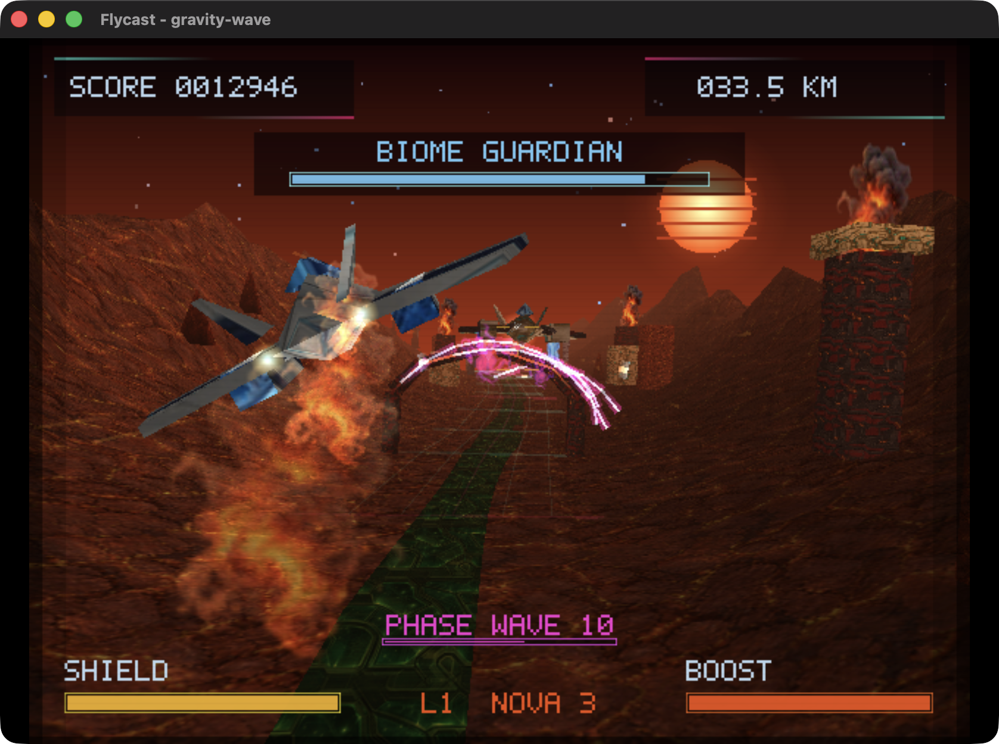
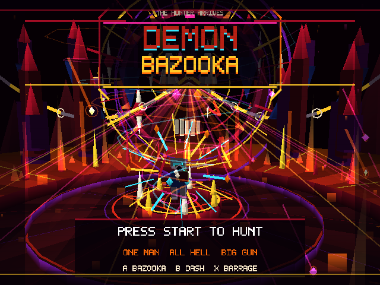
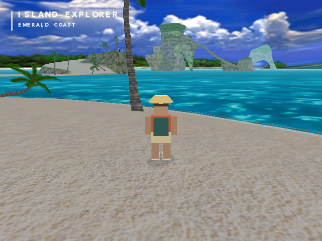
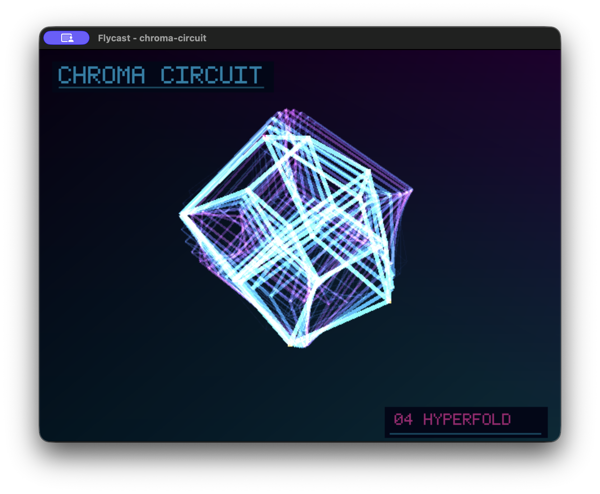
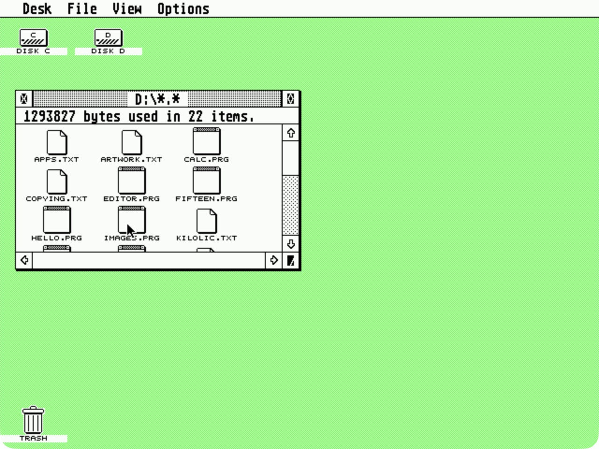
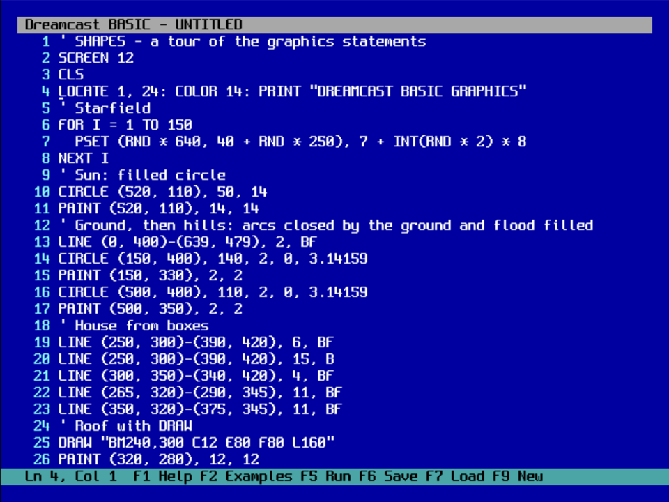
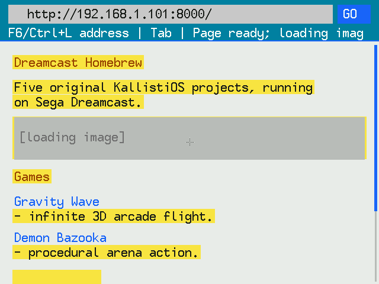
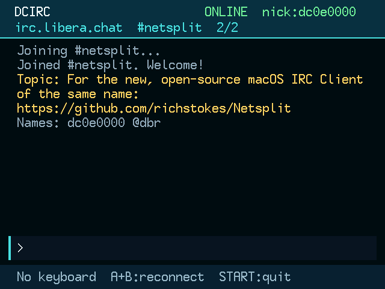
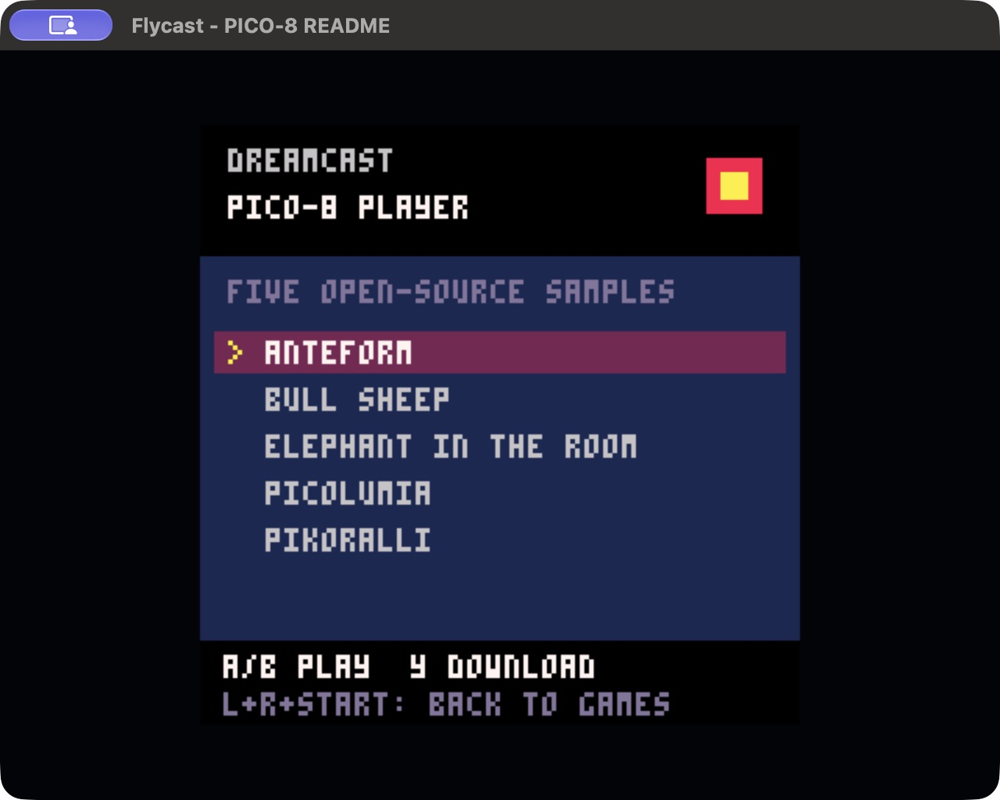
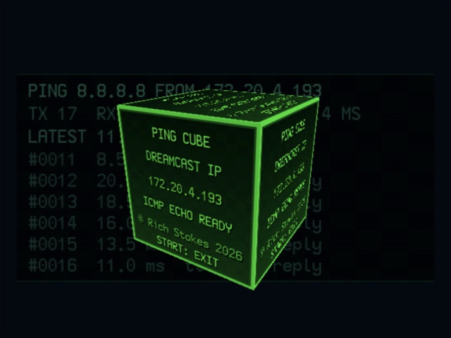

# Dreamcast Homebrew

My original Sega Dreamcast games, network apps and technical demos.

**[Download the latest builds](https://github.com/richstokes/dreamcast-homebrew/releases/latest).**
Every project ships as a self-booting CDI and a plain ELF. The CDI is the
easiest way to play: open it in an emulator, or load it on a real console with
GDEMU or similar. If you are burning a physical CD-R, you may want to try the
**CD-R** download instead: the same disc padded out to a full CD, zipped (unzip
before burning). Each project directory has its own README.

## Games

| Preview | Project | Latest download | Try in browser |
| --- | --- | --- | --- |
|  | **[DreamKarts](projects/games/dreamkarts/)**<br>A Mario Kart-style kart racer with hop-into-drift handling and mini-turbos, six courses, CPU rivals, two-player split screen and online races. | **[CDI](https://github.com/richstokes/dreamcast-homebrew/releases/latest/download/dreamkarts.cdi)**<br>[ELF](https://github.com/richstokes/dreamcast-homebrew/releases/latest/download/dreamkarts.elf)<br>[CD-R](https://github.com/richstokes/dreamcast-homebrew/releases/latest/download/dreamkarts-cdr.zip) | [Play](https://appsbyrich.com/dreamcast?rom=continuous%2Fdreamkarts.elf&name=DreamKarts) |
|  | **[Drift Los Angeles](projects/games/drift-los-angeles/)**<br>An open-city arcade street-drifting game with a C7-inspired coupe, four Los Angeles-style districts, traffic, drift chains, dense tire smoke, and recorded V8 audio. | **[CDI](https://github.com/richstokes/dreamcast-homebrew/releases/latest/download/drift-los-angeles.cdi)**<br>[ELF](https://github.com/richstokes/dreamcast-homebrew/releases/latest/download/drift-los-angeles.elf)<br>[CD-R](https://github.com/richstokes/dreamcast-homebrew/releases/latest/download/drift-los-angeles-cdr.zip) | [Play](https://appsbyrich.com/dreamcast?rom=continuous%2Fdrift-los-angeles.elf&name=Drift%20Los%20Angeles) |
|  | **[Gravity Wave](projects/games/gravity-wave/)**<br>An infinite 3D arcade flight game featuring four biomes, procedural terrain, enemy formations, guardians, upgrades, and a synthesized soundtrack. | **[CDI](https://github.com/richstokes/dreamcast-homebrew/releases/latest/download/gravity-wave.cdi)**<br>[ELF](https://github.com/richstokes/dreamcast-homebrew/releases/latest/download/gravity-wave.elf)<br>[CD-R](https://github.com/richstokes/dreamcast-homebrew/releases/latest/download/gravity-wave-cdr.zip) | [Play](https://appsbyrich.com/dreamcast?rom=continuous%2Fgravity-wave.elf&name=Gravity%20Wave) |
|  | **[Demon Bazooka](projects/games/demon-bazooka/)**<br>A compact 3D arena shooter with rockets, dashes, screen-clearing barrages, escalating demon waves, and runtime-generated visuals and audio. | **[CDI](https://github.com/richstokes/dreamcast-homebrew/releases/latest/download/demon-bazooka.cdi)**<br>[ELF](https://github.com/richstokes/dreamcast-homebrew/releases/latest/download/demon-bazooka.elf)<br>[CD-R](https://github.com/richstokes/dreamcast-homebrew/releases/latest/download/demon-bazooka-cdr.zip) | [Play](https://appsbyrich.com/dreamcast?rom=continuous%2Fdemon-bazooka.elf&name=Demon%20Bazooka) |
|  | **[Totally Bazaar](projects/games/totally-bazaar/)**<br>A traditional market trading card game for 2-4 players: hot-seat play with hidden hands, CPU merchants, 3D-rendered goods, animated cards and tokens, and a synthesized bazaar soundtrack. | **[CDI](https://github.com/richstokes/dreamcast-homebrew/releases/latest/download/totally-bazaar.cdi)**<br>[ELF](https://github.com/richstokes/dreamcast-homebrew/releases/latest/download/totally-bazaar.elf)<br>[CD-R](https://github.com/richstokes/dreamcast-homebrew/releases/latest/download/totally-bazaar-cdr.zip) | [Play](https://appsbyrich.com/dreamcast?rom=continuous%2Ftotally-bazaar.elf&name=Totally%20Bazaar) |
|  | **[Island Explorer](projects/games/island-explorer/)** (experimental)<br>A coastal exploration prototype with walking, swimming and dolphins, built on locally extracted Sonic Adventure assets. | Source only | - |

## dcvmu.com

Cloud saves for the Dreamcast. The console client backs up VMU saves to
[dcvmu.com](https://dcvmu.com) and restores them, from the Dreamcast itself.

| Preview | Project | Latest download | Guide |
| --- | --- | --- | --- |
|  | **[DCVMU](projects/dcvmu.com/client/)**<br>Browse, upload and download VMU saves on the console. The [web service](projects/dcvmu.com/service/) lives here too. | **[CDI](https://github.com/richstokes/dreamcast-homebrew/releases/latest/download/dcvmu-client.cdi)**<br>[ELF](https://github.com/richstokes/dreamcast-homebrew/releases/latest/download/dcvmu-client.elf)<br>[CD-R](https://github.com/richstokes/dreamcast-homebrew/releases/latest/download/dcvmu-client-cdr.zip) | [Getting started](https://dcvmu.com/getting-started) |

## Apps and demos

| Preview | Project | Latest download | Try in browser |
| --- | --- | --- | --- |
|  | **[Chroma Circuit](projects/apps/chroma-circuit/)**<br>A nine-act, 60 Hz Dreamcast demo built entirely in SH-4 assembly, with raw PowerVR2 graphics and AICA music. | **[CDI](https://github.com/richstokes/dreamcast-homebrew/releases/latest/download/chroma-circuit.cdi)**<br>[ELF](https://github.com/richstokes/dreamcast-homebrew/releases/latest/download/chroma-circuit.elf)<br>[CD-R](https://github.com/richstokes/dreamcast-homebrew/releases/latest/download/chroma-circuit-cdr.zip) | [Play](https://appsbyrich.com/dreamcast?rom=continuous%2Fchroma-circuit.elf&name=Chroma%20Circuit) |
|  | **[Dream TOS](https://github.com/richstokes/Dream-TOS)** (separate repo)<br>A native port of EmuTOS, the open-source Atari TOS desktop, with bundled apps, games and utilities. | **[CDI](https://github.com/richstokes/Dream-TOS/releases/latest/download/DreamTOS.cdi)**<br>[ELF](https://github.com/richstokes/Dream-TOS/releases/latest/download/dream-tos.elf) | - |
|  | **[Dreamcast BASIC](projects/apps/dreamcast-basic/)**<br>A BASIC interpreter and full-screen editor for the Dreamcast keyboard, with QBasic-style graphics, `PLAY` music, one VMU save per program, and classic games such as Super Star Trek bundled as examples. | **[CDI](https://github.com/richstokes/dreamcast-homebrew/releases/latest/download/dreamcast-basic.cdi)**<br>[ELF](https://github.com/richstokes/dreamcast-homebrew/releases/latest/download/dreamcast-basic.elf)<br>[CD-R](https://github.com/richstokes/dreamcast-homebrew/releases/latest/download/dreamcast-basic-cdr.zip) | [Play](https://appsbyrich.com/dreamcast?rom=continuous%2Fdreamcast-basic.elf&name=Dreamcast%20BASIC) |
|  | **[Dreamcast Browser](projects/apps/dreamcast-browser/)**<br>A deliberately limited HTTPS browser supporting basic text, links, raster images, and Dreamcast keyboard, mouse, and controller input. JavaScript is not executed. | **[CDI](https://github.com/richstokes/dreamcast-homebrew/releases/latest/download/dreamcast-browser.cdi)**<br>[ELF](https://github.com/richstokes/dreamcast-homebrew/releases/latest/download/dreamcast-browser.elf)<br>[CD-R](https://github.com/richstokes/dreamcast-homebrew/releases/latest/download/dreamcast-browser-cdr.zip) | [Play](https://appsbyrich.com/dreamcast?rom=continuous%2Fdreamcast-browser.elf&name=Dreamcast%20Browser) |
|  | **[Dreamcast IRC](projects/apps/dreamcast-irc/)**<br>An IRC client for Broadband Adapter or modem/DreamPi, with server and channel pages, fixed-size scrollback, keyboard input, and controller navigation. | **[CDI](https://github.com/richstokes/dreamcast-homebrew/releases/latest/download/dreamcast-irc.cdi)**<br>[ELF](https://github.com/richstokes/dreamcast-homebrew/releases/latest/download/dreamcast-irc.elf)<br>[CD-R](https://github.com/richstokes/dreamcast-homebrew/releases/latest/download/dreamcast-irc-cdr.zip) | [Play](https://appsbyrich.com/dreamcast?rom=continuous%2Fdreamcast-irc.elf&name=Dreamcast%20IRC) |
|  | **[PICO-8 Player](projects/apps/pico8-dreamcast/)**<br>A native FAKE-08 port with a cartridge picker, sound, controller support, HTTPS downloads over BBA or modem, and five MIT/GPL-licensed sample games. | **[CDI](https://github.com/richstokes/dreamcast-homebrew/releases/latest/download/pico8-dreamcast.cdi)**<br>[ELF](https://github.com/richstokes/dreamcast-homebrew/releases/latest/download/pico8-dreamcast.elf)<br>[CD-R](https://github.com/richstokes/dreamcast-homebrew/releases/latest/download/pico8-dreamcast-cdr.zip) | [Play](https://appsbyrich.com/dreamcast?rom=continuous%2Fpico8-dreamcast.elf&name=PICO-8%20Player) |
|  | **[Ping Cube](projects/apps/ping-cube/)**<br>A networking and PowerVR demo that continuously pings `8.8.8.8`, visualizes latency through the cube's color, and displays live replies, loss, and timing statistics. | **[CDI](https://github.com/richstokes/dreamcast-homebrew/releases/latest/download/ping-cube.cdi)**<br>[ELF](https://github.com/richstokes/dreamcast-homebrew/releases/latest/download/ping-cube.elf)<br>[CD-R](https://github.com/richstokes/dreamcast-homebrew/releases/latest/download/ping-cube-cdr.zip) | [Play](https://appsbyrich.com/dreamcast?rom=continuous%2Fping-cube.elf&name=Ping%20Cube) |

## Building and running

Known-working baseline: KallistiOS 2.3.0, GCC 15.2.0 SH-4 toolchain, Flycast 2.7.
For a native macOS Flycast with the fixes these projects rely on, see
[tools/flycast](tools/flycast/README.md).

```sh
git clone https://github.com/richstokes/dreamcast-homebrew.git
cd dreamcast-homebrew
source "$HOME/.local/share/dreamcast/kos/environ.sh"
make -C projects/games/drift-los-angeles
./projects/games/drift-los-angeles/run-flycast.sh --skip-build
```

Each project's `run-flycast.sh` builds by default, then opens the ELF in
Flycast. `KOS_ENV` and `FLYCAST_BIN` override the installed dependencies.

- Drift Los Angeles, DreamKarts, Island Explorer, PICO-8 Player and Totally
  Bazaar depend on [SH4ZAM](https://sh4zam.com/), which is neither vendored nor
  pinned, to ensure we always get the latest gainz (granted - at the potential
  cost of instability). Each build fast-forwards an ignored `third_party/sh4zam`
  checkout to upstream `master`; `tools/update-sh4zam.sh` refreshes them by hand
- Chroma Circuit is pure assembly and needs no KOS:
  `make -C projects/apps/chroma-circuit verify`
- DCVMU and Dreamcast Browser need the kos-ports curl, mbedTLS, zlib and
  stb_image. The [Dreamcast Browser README](projects/apps/dreamcast-browser/README.md)
  has the install commands and the compatibility patch

## Layout and releases

- `projects/games/`: games
- `projects/apps/`: apps and demos
- `projects/dcvmu.com/`: DCVMU client and web service
- `tools/`: Flycast build, real-hardware runner, SH4ZAM updater

Every push to `main` runs the tests, builds each project in
[the release manifest](.github/console-projects.txt) against pinned SDK
commits, and republishes
[the rolling release](https://github.com/richstokes/dreamcast-homebrew/releases/latest)
with CDI and ELF files.

## License and attribution

The original project code in this repository is available under the
[MIT License](LICENSE).

These projects are powered by
[KallistiOS](https://kos-docs.dreamcast.wiki/), the independent Dreamcast SDK.
KallistiOS is distributed separately under its BSD-like KOS license and
requires attribution.

Drift Los Angeles, DreamKarts, Island Explorer, PICO-8 Player and Totally
Bazaar use [SH4ZAM](https://sh4zam.com/), the SH-4 math library by Falco
Girgis and contributors, available under the
[MIT License](https://github.com/gyrovorbis/sh4zam/blob/master/LICENSE).
It is fetched at build time and not included in this repository.

## Support

If you enjoy these projects and want to support my work, you can buy me a coffee. Totally optional, but much appreciated!

<a href="https://buymeacoffee.com/richstokes"></a>
