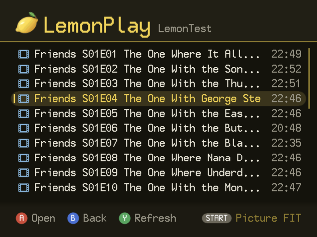

# Dreamcast Homebrew

My original Sega Dreamcast games, network apps and technical demos.

**[Download the latest builds](https://github.com/richstokes/dreamcast-homebrew/releases/latest).**
Every project ships as a self-booting CDI and a plain ELF. The CDI is the
easiest way to play: open it in an emulator, or load it on a real console with
GDEMU or similar. If you are burning a physical CD-R, you may want to try the
**CD-R** download instead. Each project directory has its own README.

## Games

| Preview | Project | Latest download | Try in browser |
| --- | --- | --- | --- |
|  | **[DreamKarts](projects/games/dreamkarts/)**<br>A Mario Kart-style kart racer with hop-into-drift handling and mini-turbos, eight courses, CPU rivals, two-player split screen and online races. | **[CDI](https://github.com/richstokes/dreamcast-homebrew/releases/latest/download/dreamkarts.cdi)**<br>[CD-R](https://github.com/richstokes/dreamcast-homebrew/releases/latest/download/dreamkarts-cdr.zip) | [Play](https://appsbyrich.com/dreamcast?rom=continuous%2Fdreamkarts.cdi&name=DreamKarts) |
|  | **[Drift Los Angeles](projects/games/drift-los-angeles/)**<br>An open-city arcade street-drifting game with a C7-inspired coupe, four Los Angeles-style districts, traffic, drift chains, dense tire smoke, and recorded V8 audio. | **[CDI](https://github.com/richstokes/dreamcast-homebrew/releases/latest/download/drift-los-angeles.cdi)**<br>[ELF](https://github.com/richstokes/dreamcast-homebrew/releases/latest/download/drift-los-angeles.elf)<br>[CD-R](https://github.com/richstokes/dreamcast-homebrew/releases/latest/download/drift-los-angeles-cdr.zip) | [Play](https://appsbyrich.com/dreamcast?rom=continuous%2Fdrift-los-angeles.elf&name=Drift%20Los%20Angeles) |
|  | **[Gravity Wave](projects/games/gravity-wave/)**<br>An infinite 3D arcade flight game featuring four biomes, procedural terrain, enemy formations, guardians, upgrades, and a synthesized soundtrack. | **[CDI](https://github.com/richstokes/dreamcast-homebrew/releases/latest/download/gravity-wave.cdi)**<br>[ELF](https://github.com/richstokes/dreamcast-homebrew/releases/latest/download/gravity-wave.elf)<br>[CD-R](https://github.com/richstokes/dreamcast-homebrew/releases/latest/download/gravity-wave-cdr.zip) | [Play](https://appsbyrich.com/dreamcast?rom=continuous%2Fgravity-wave.elf&name=Gravity%20Wave) |
|  | **[Demon Bazooka](projects/games/demon-bazooka/)**<br>A compact 3D arena shooter with rockets, dashes, screen-clearing barrages, escalating demon waves, and runtime-generated visuals and audio. | **[CDI](https://github.com/richstokes/dreamcast-homebrew/releases/latest/download/demon-bazooka.cdi)**<br>[ELF](https://github.com/richstokes/dreamcast-homebrew/releases/latest/download/demon-bazooka.elf)<br>[CD-R](https://github.com/richstokes/dreamcast-homebrew/releases/latest/download/demon-bazooka-cdr.zip) | [Play](https://appsbyrich.com/dreamcast?rom=continuous%2Fdemon-bazooka.elf&name=Demon%20Bazooka) |
|  | **[Totally Bazaar](projects/games/totally-bazaar/)**<br>A traditional market trading card game for 2-4 players: hot-seat play with hidden hands, CPU merchants, 3D-rendered goods, animated cards and tokens, and a synthesized bazaar soundtrack. | **[CDI](https://github.com/richstokes/dreamcast-homebrew/releases/latest/download/totally-bazaar.cdi)**<br>[ELF](https://github.com/richstokes/dreamcast-homebrew/releases/latest/download/totally-bazaar.elf)<br>[CD-R](https://github.com/richstokes/dreamcast-homebrew/releases/latest/download/totally-bazaar-cdr.zip) | [Play](https://appsbyrich.com/dreamcast?rom=continuous%2Ftotally-bazaar.elf&name=Totally%20Bazaar) |
|  | **[Island Explorer](projects/games/island-explorer/)** (experimental)<br>A coastal exploration prototype with walking, swimming and dolphins, built on locally extracted Sonic Adventure assets. | Source only | - |

## dcvmu.com

Cloud saves for the Dreamcast. The console client backs up VMU saves to
[dcvmu.com](https://dcvmu.com) and restores them, from the Dreamcast itself.

| Preview | Project | Latest download | Guide |
| --- | --- | --- | --- |
|  | **[DCVMU](projects/dcvmu.com/client/)**<br>Browse, upload and download VMU saves on the console. The [web service](projects/dcvmu.com/service/) lives here too. | **[CDI](https://github.com/richstokes/dreamcast-homebrew/releases/latest/download/dcvmu-client.cdi)**<br>[ELF](https://github.com/richstokes/dreamcast-homebrew/releases/latest/download/dcvmu-client.elf)<br>[CD-R](https://github.com/richstokes/dreamcast-homebrew/releases/latest/download/dcvmu-client-cdr.zip) | [Getting started](https://dcvmu.com/getting-started) |

## Apps and demos

| Preview | Project | Latest download | Try in browser |
| --- | --- | --- | --- |
|  | **[Chroma Circuit](projects/apps/chroma-circuit/)**<br>A nine-act, 60 Hz Dreamcast demo built entirely in SH-4 assembly, with raw PowerVR2 graphics and AICA music. | **[CDI](https://github.com/richstokes/dreamcast-homebrew/releases/latest/download/chroma-circuit.cdi)**<br>[ELF](https://github.com/richstokes/dreamcast-homebrew/releases/latest/download/chroma-circuit.elf)<br>[CD-R](https://github.com/richstokes/dreamcast-homebrew/releases/latest/download/chroma-circuit-cdr.zip) | [Play](https://appsbyrich.com/dreamcast?rom=continuous%2Fchroma-circuit.elf&name=Chroma%20Circuit) |
|  | **[Dream TOS](https://github.com/richstokes/Dream-TOS)** (separate repo)<br>A native port of EmuTOS, the open-source Atari TOS desktop, with bundled apps, games and utilities. | **[CDI](https://github.com/richstokes/Dream-TOS/releases/latest/download/DreamTOS.cdi)**<br>[ELF](https://github.com/richstokes/Dream-TOS/releases/latest/download/dream-tos.elf) | - |
|  | **[Dreamcast BASIC](projects/apps/dreamcast-basic/)**<br>A BASIC interpreter and full-screen editor for the Dreamcast keyboard, with QBasic-style graphics, `PLAY` music, one VMU save per program, and classic games such as Super Star Trek bundled as examples. | **[CDI](https://github.com/richstokes/dreamcast-homebrew/releases/latest/download/dreamcast-basic.cdi)**<br>[ELF](https://github.com/richstokes/dreamcast-homebrew/releases/latest/download/dreamcast-basic.elf)<br>[CD-R](https://github.com/richstokes/dreamcast-homebrew/releases/latest/download/dreamcast-basic-cdr.zip) | [Play](https://appsbyrich.com/dreamcast?rom=continuous%2Fdreamcast-basic.elf&name=Dreamcast%20BASIC) |
|  | **[Dreamcast Browser](projects/apps/dreamcast-browser/)**<br>A deliberately limited HTTPS browser supporting basic text, links, raster images, and Dreamcast keyboard, mouse, and controller input. JavaScript is not executed. | **[CDI](https://github.com/richstokes/dreamcast-homebrew/releases/latest/download/dreamcast-browser.cdi)**<br>[ELF](https://github.com/richstokes/dreamcast-homebrew/releases/latest/download/dreamcast-browser.elf)<br>[CD-R](https://github.com/richstokes/dreamcast-homebrew/releases/latest/download/dreamcast-browser-cdr.zip) | [Play](https://appsbyrich.com/dreamcast?rom=continuous%2Fdreamcast-browser.elf&name=Dreamcast%20Browser) |
|  | **[Dreamcast IRC](projects/apps/dreamcast-irc/)**<br>An IRC client for Broadband Adapter or modem/DreamPi, with server and channel pages, fixed-size scrollback, keyboard input, and controller navigation. | **[CDI](https://github.com/richstokes/dreamcast-homebrew/releases/latest/download/dreamcast-irc.cdi)**<br>[ELF](https://github.com/richstokes/dreamcast-homebrew/releases/latest/download/dreamcast-irc.elf)<br>[CD-R](https://github.com/richstokes/dreamcast-homebrew/releases/latest/download/dreamcast-irc-cdr.zip) | [Play](https://appsbyrich.com/dreamcast?rom=continuous%2Fdreamcast-irc.elf&name=Dreamcast%20IRC) |
|  | **[KOS_Test](projects/apps/kos-test/)**<br>A service-menu style test and benchmark suite that checks KallistiOS and the hardware and records CPU, memory and GPU numbers for each KOS build. | **[CDI](https://github.com/richstokes/dreamcast-homebrew/releases/latest/download/kos-test.cdi)**<br>[ELF](https://github.com/richstokes/dreamcast-homebrew/releases/latest/download/kos-test.elf)<br>[CD-R](https://github.com/richstokes/dreamcast-homebrew/releases/latest/download/kos-test-cdr.zip) | - |
|  | **[LemonPlay](projects/apps/lemonplay/)**<br>A DLNA media player that streams video and music from a PC running ZeroConfigDLNA in Dreamcast mode over the Broadband Adapter. | **[CDI](https://github.com/richstokes/dreamcast-homebrew/releases/latest/download/lemonplay.cdi)**<br>[ELF](https://github.com/richstokes/dreamcast-homebrew/releases/latest/download/lemonplay.elf)<br>[CD-R](https://github.com/richstokes/dreamcast-homebrew/releases/latest/download/lemonplay-cdr.zip) | - |
|  | **[PICO-8 Player](projects/apps/pico8-dreamcast/)**<br>A native FAKE-08 port with a cartridge picker, sound, controller support, HTTPS downloads over BBA or modem, and five MIT/GPL-licensed sample games. | **[CDI](https://github.com/richstokes/dreamcast-homebrew/releases/latest/download/pico8-dreamcast.cdi)**<br>[ELF](https://github.com/richstokes/dreamcast-homebrew/releases/latest/download/pico8-dreamcast.elf)<br>[CD-R](https://github.com/richstokes/dreamcast-homebrew/releases/latest/download/pico8-dreamcast-cdr.zip) | [Play](https://appsbyrich.com/dreamcast?rom=continuous%2Fpico8-dreamcast.elf&name=PICO-8%20Player) |
|  | **[Ping Cube](projects/apps/ping-cube/)**<br>A networking and PowerVR demo that continuously pings `8.8.8.8`, visualizes latency through the cube's color, and displays live replies, loss, and timing statistics. | **[CDI](https://github.com/richstokes/dreamcast-homebrew/releases/latest/download/ping-cube.cdi)**<br>[ELF](https://github.com/richstokes/dreamcast-homebrew/releases/latest/download/ping-cube.elf)<br>[CD-R](https://github.com/richstokes/dreamcast-homebrew/releases/latest/download/ping-cube-cdr.zip) | [Play](https://appsbyrich.com/dreamcast?rom=continuous%2Fping-cube.elf&name=Ping%20Cube) |

## Building and running

Every project builds with [KallistiOS](https://kos-docs.dreamcast.wiki/)
(KOS), the open-source Dreamcast SDK, and runs in the
[Flycast](https://github.com/flyinghead/flycast) emulator. I build on macOS;
CI builds the same projects on Linux. Known-working baseline: KOS 2.3.0 master
`e7ab1a2`, kos-ports `f4faacc`, GCC 15.2.0, and Flycast master `628bd3d` with
[these patches](tools/flycast/README.md).

### One-time setup

The launchers look for everything under `~/.local/share/dreamcast`, so
installing there needs no extra config. If you already have KOS somewhere
else (its own default is `/opt/toolchains/dc`), export
`KOS_ENV=/path/to/kos/environ.sh` and the launchers use that instead.

1. Clone this repo, then KOS and kos-ports side by side at the tested
   commits:

   ```sh
   git clone https://github.com/richstokes/dreamcast-homebrew.git
   DC="$HOME/.local/share/dreamcast"
   git clone https://github.com/KallistiOS/KallistiOS.git "$DC/kos"
   git -C "$DC/kos" checkout e7ab1a2
   git clone https://github.com/KallistiOS/kos-ports.git "$DC/kos-ports"
   git -C "$DC/kos-ports" checkout f4faacc
   ```

2. Build the SH-4 cross compiler with kos-chain, KOS's toolchain builder.
   Install the host packages from its
   [platform notes](https://github.com/KallistiOS/KallistiOS/tree/master/utils/kos-chain#getting-started)
   first (on macOS that's the Xcode command-line tools and one `brew
   install`). This is the slow step:

   ```sh
   cd "$DC/kos/utils/kos-chain"
   cp Makefile.dreamcast.cfg Makefile.cfg
   sed -i.bak "s|/opt/toolchains/dc|$DC|" Makefile.cfg
   make
   ```

3. Create `environ.sh`. This is KOS's environment script: it sets `KOS_BASE`,
   the compiler paths and flags, and puts `kos-cc` on your `PATH`. Every build
   starts by sourcing it. KOS ships a sample to copy:

   ```sh
   cd "$DC/kos"
   cp doc/environ.sh.sample environ.sh
   sed -i.bak "s|/opt/toolchains/dc|$DC|" environ.sh
   source environ.sh
   ```

4. Back in your clone of this repo, apply its
   [KOS patches](tools/kos/README.md) and build KOS. Every project expects
   them (network, dial-up, VMU and controller fixes):

   ```sh
   tools/kos/apply-patches.sh
   make -C "$KOS_BASE"
   ```

5. Dreamcast Browser, DCVMU and PICO-8 Player also link some kos-ports
   libraries, which need `cmake` to build:

   ```sh
   for port in zlib mbedtls curl stb_image; do make -C "$KOS_PORTS/$port" install; done
   ```

6. Flycast. On macOS, `tools/flycast/build-macos.sh` builds the patched
   Flycast the launchers try first. Stock Flycast 2.7 in `/Applications` runs
   most projects, but networking and keyboard input need the patches
   ([details](tools/flycast/README.md)). Anywhere else, export
   `FLYCAST_BIN=/path/to/flycast`. DreamKarts also needs mkdcdisc
   (`tools/mkdcdisc/build-macos.sh`, or one on your `PATH`).

CI runs steps 1 and 3-5 from [.github/scripts](.github/scripts/), with the
compiler from the `pcercuei/dreamcast-toolchain` Docker image in place of
step 2.

### Build and run a project

Source the environment in each new shell (or add the line to your shell
profile), then build and launch from the repo root:

```sh
source "$HOME/.local/share/dreamcast/kos/environ.sh"
make -C projects/games/drift-los-angeles
projects/games/drift-los-angeles/run-flycast.sh   # builds first; --skip-build reuses the ELF
```

Each project README has its own make targets and launcher options.

- Drift Los Angeles, DreamKarts, Island Explorer, PICO-8 Player and Totally
  Bazaar depend on [SH4ZAM](https://sh4zam.com/), pinned to a tested commit
  (v0.10.0) in `tools/update-sh4zam.sh`. Each build checks out an ignored
  `third_party/sh4zam` clone at the pin; a weekly canary flags new upstream
  gainz so they get benchmarked on the console before we bump
- Chroma Circuit is pure assembly: it needs the step 2 compiler but not KOS
  (`make -C projects/apps/chroma-circuit verify`)
- Asset generators and QA scripts run through [uv](https://docs.astral.sh/uv/).
  Generated assets are checked in, so a plain build doesn't need it

### Real hardware

The `make hw`, `hwbench`, `hwsoak` and `auto` targets are wired to my own
console setup, so they probably won't work as-is for you.
[`tools/dc-hw.sh`](tools/dc-hw.sh) expects:

- A Broadband Adapter, with the console booting into
  [dcload-ip](https://github.com/sizious/dcload-ip) (mine goes GDEMU,
  openMenu, dcload-ip)
- `dc-tool-ip` on the host (`DC_TOOL=/path/to/dc-tool-ip`)
- The console plugged into a Shelly smart plug on the LAN (`DC_PLUG_IP`), so
  the script can power-cycle a hung console and switch it off after a test

**If your setup differs, build with `make` and load the ELF however you
normally do.** For example `dc-tool-ip -t <console-ip> -x game.elf` with
dcload-ip, dcload-serial with a coder's cable, or a CDI on GDEMU or a CD-R
(`tools/flycast/elf-to-cdi.sh game.elf game.cdi`, or grab one from the
releases). The Makefiles call the script through `DC_HW`, so `make hw
DC_HW=/path/to/your-script` swaps in your own; it gets `run`, dc-hw.sh's
options and the ELF.

## Layout and releases

- `projects/games/`: games
- `projects/apps/`: apps and demos
- `projects/dcvmu.com/`: DCVMU client and web service
- `projects/common/`: code shared between projects
- `tools/`: Flycast build, KOS patches, real-hardware runner, SH4ZAM pin

Every push to `main` runs the tests, builds each project in
[the release manifest](.github/console-projects.txt) against pinned SDK
commits, and republishes
[the rolling release](https://github.com/richstokes/dreamcast-homebrew/releases/latest)
with CDI and ELF files.

## License and attribution

The original project code in this repository is available under the
[MIT License](LICENSE).

These projects are powered by
[KallistiOS](https://kos-docs.dreamcast.wiki/), the independent Dreamcast SDK.
KallistiOS is distributed separately under its BSD-like KOS license and
requires attribution.

Drift Los Angeles, DreamKarts, Island Explorer, PICO-8 Player and Totally
Bazaar use [SH4ZAM](https://sh4zam.com/), the SH-4 math library by Falco
Girgis and contributors, available under the
[MIT License](https://github.com/gyrovorbis/sh4zam/blob/master/LICENSE).
It is fetched at build time and not included in this repository.

## Support

If you enjoy these projects and want to support my work, you can buy me a coffee. Totally optional, but much appreciated!

<a href="https://buymeacoffee.com/richstokes"></a>
