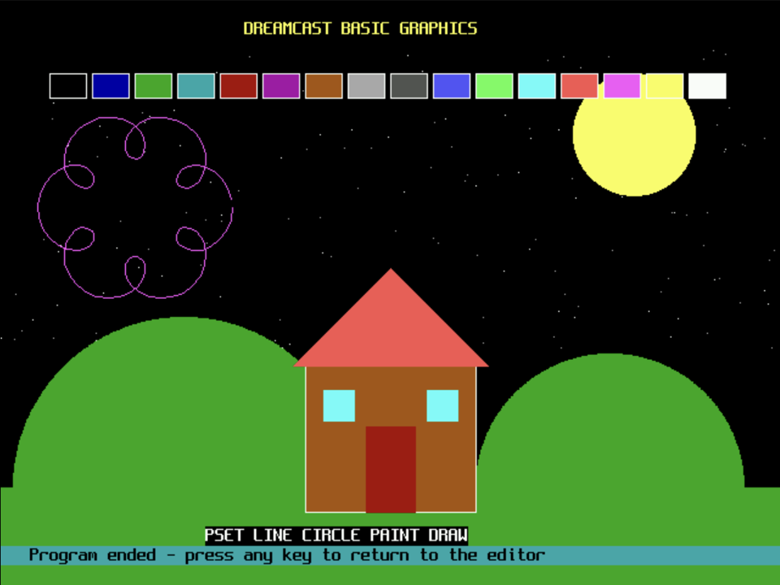

# Dreamcast BASIC

<p align="center">
  
</p>

A BASIC programming environment for the Dreamcast keyboard: a full-screen
editor, a Microsoft-style interpreter with graphics and sound, and one VMU save
per program. It runs the 1970s *BASIC Computer Games* listings unmodified and
adds the QBasic conveniences (optional line numbers, labels, block `IF`,
`DO`/`LOOP`, `SCREEN 12`/`13` graphics and `PLAY` music). Built with
[KallistiOS](https://kos-docs.dreamcast.wiki/).

| | |
| --- | --- |
|  | The bundled `SHAPES` example: `PSET`, `LINE`, `CIRCLE`, `PAINT` and `DRAW` in `SCREEN 12`, ending with a `PLAY` arpeggio. |

## Download

Download the latest **[self-booting CDI](https://github.com/richstokes/dreamcast-homebrew/releases/latest/download/dreamcast-basic.cdi)**
for Flycast or GDEMU. A direct-load [ELF](https://github.com/richstokes/dreamcast-homebrew/releases/latest/download/dreamcast-basic.elf) is also available.
If you are burning a physical CD-R, you may want to try the padded
[CD-R image](https://github.com/richstokes/dreamcast-homebrew/releases/latest/download/dreamcast-basic-cdr.zip) instead (unzip before burning).

## Using it

Plug a Dreamcast keyboard into any port. Type a program and press **F5**.

| Key | Action |
| --- | --- |
| **F5** | Run the program |
| **F6** | Save to the VMU (asks for a name) |
| **F7** | Load from the VMU (pick from a list, or type a name) |
| F1 | Help |
| F2 | Load one of the bundled examples |
| F3 | Toggle automatic line numbering (on by default) |
| F4 | Renumber the program |
| F9 | New program |
| Esc or Ctrl+C | Stop a running program |
| Ctrl+Y | Delete the current line |
| Arrows, Home, End, PgUp, PgDn, Ctrl+Home/End | Move around |

The status bar shows the cursor position and, while a program runs, the line
being executed. After an error the cursor lands on the offending line. `KEY OFF`
hides the bar for full-screen graphics. Without a keyboard, **Y** on a
controller opens the examples, the D-pad and **A** pick one, **Start** runs it
and **B** stops it.

Line numbers are optional, and lines run in editor order, not sorted by number.

- Auto numbering (F3): Enter on a numbered line suggests the next number (ten
  more, or halfway to the following line). Type your own to replace it; Enter
  on a bare suggestion removes it
- Renumber (F4): 10, 20, 30... in editor order, rewriting targets after `GOTO`,
  `GOSUB`, `THEN`, `ELSE`, `RESTORE` and in `ON ... GOTO` lists. Targets that
  match no line keep their number and are counted in the status bar
- With no line numbers at all, `GOTO 3` means editor line 3 (the left margin);
  F4 converts such a program to a numbered one. Labels (`Top:` ... `GOTO Top`)
  avoid numbers altogether

Programs are saved one per VMU file as `NAME.BAS` (names up to eight
characters), overwriting where the program already lives, otherwise on the
first VMU. The text is stored as-is: a typical listing takes a few blocks,
Super Star Trek about 42.

## The language

Numbers are double precision and print the Microsoft way (`.5`, seven
significant digits). Strings hold up to 32,767 characters. Arrays have up to
eight dimensions and get ten elements per dimension when used without `DIM`.

| Area | Supported |
| --- | --- |
| Flow | `GOTO`, `GOSUB`/`RETURN`, `ON x GOTO/GOSUB`, `FOR`/`NEXT` (including `NEXT J, I`), `WHILE`/`WEND`, `DO`/`LOOP` with `WHILE`/`UNTIL`, `EXIT FOR`/`EXIT DO`, single-line and block `IF`/`ELSEIF`/`ELSE`/`END IF`, `END`, `STOP`, `RUN`. Targets are line numbers or `Label:` names |
| Data | `LET`, `DIM`, `ERASE`, `CLEAR`, `SWAP`, `DATA`/`READ`/`RESTORE`, `DEF FN`, `CONST`, `DEFINT`/`DEFSNG`/`DEFDBL`/`DEFSTR`, `RANDOMIZE` |
| Text | `PRINT` with zones, `TAB`, `SPC` and `USING`; `INPUT`, `LINE INPUT`, `CLS`, `LOCATE`, `COLOR`, `POS`, `CSRLIN`. The text screen is 76x27, inset so TV overscan cannot clip it |
| Graphics | `SCREEN` 0, 1, 2, 7, 8, 9, 12 (640x480, 16 colours) and 13 (320x200, 256 colours, pixel-doubled); `PSET`, `PRESET`, `LINE` with `B`/`BF`, `CIRCLE` with arcs and aspect, `PAINT`, `DRAW`, `PALETTE`, `WINDOW`, `POINT()`, `STEP` relative coordinates |
| Sound | `PLAY` with the full music macro language (octaves, lengths, dotted notes, tempo, `N`, rests, `MN`/`ML`/`MS`, foreground/background), `SOUND`, `BEEP` |
| Input | `INKEY$` (arrow and function keys arrive as the PC's two-byte codes), `INPUT$`, `SLEEP`, `TIMER`; `STICK(0..3)` reads controller A's stick and D-pad as 0-255, `STRIG(0..7)` its A, X, B and Y buttons |
| Functions | `ABS ATN COS EXP FIX INT LOG RND SGN SIN SQR TAN CINT CLNG`, `LEN ASC VAL INSTR CHR$ STR$ LEFT$ RIGHT$ MID$` (also a statement), `STRING$ SPACE$ UCASE$ LCASE$ LTRIM$ RTRIM$ HEX$ OCT$ DATE$ TIME$` |
| Other dialects | Keywords packed against operands (`FORX=1TO9`, `IFA$="Y"THENPRINT"OK"`), `RND()` with no argument, HP BASIC's `#` for not-equal and `GOTO X OF 100,200` |
| Not supported | `SUB`/`FUNCTION`, `SELECT CASE`, user types, file I/O, `GET`/`PUT` sprites, `ON ERROR`. `POKE`, `OUT`, `WAIT`, `WIDTH` and `VIEW` are accepted and ignored so old listings keep running |

## Bundled examples

Press F2.

| Program | Source |
| --- | --- |
| `STARTREK`, `LUNAR`, `HAMURABI`, `ACEYDUCY`, `BAGELS`, `WORD`, `MUGWUMP`, `AMAZING`, `LIFE`, `TICTAC`, `BOMBS`, `HILO`, `LOVE`, `SINEWAVE` | Unmodified listings from David Ahl's *BASIC Computer Games*, which he released into the public domain, as transcribed by [basic-computer-games](https://github.com/coding-horror/basic-computer-games) |
| `WUMPUS` | Gregory Yob's 1973 *Hunt the Wumpus* in its original HP BASIC, from [original-hunt-the-wumpus](https://github.com/RayKV423/original-hunt-the-wumpus). The only edit is `RND(0)` to `RND(1)` |
| `ELIZA` | Jeff Shrager's BASIC version of Weizenbaum's ELIZA as printed in *Creative Computing*, July-August 1977, from [this transcription](https://gist.github.com/dmberry/3f84d0f81ddb5dc8f054), unmodified. Type in capitals; `SHUT UP` ends the session |
| `OREGON` | The 1978 *Oregon Trail* by Rawitsch, Heinemann and Dillenberger as published in *Creative Computing*, via the lightly adapted [oregon-trail-1978-basic](https://github.com/LiquidFox1776/oregon-trail-1978-basic) transcription (MIT), unmodified. Its timed shooting uses `CLK(0)`, the clock in seconds. Answer in lower case |
| `SNAKE`, `BREAKOUT`, `CONWAY` | Written for this project: `SCREEN 13` games for keyboard or controller (`CONWAY` is Life with a random soup or a Gosper glider gun) |
| `SHAPES`, `MANDEL`, `PLASMA`, `BOUNCE`, `MUSIC`, `MAZE` | Written for this project: graphics, palette animation, sound and `INKEY$` demos |

## Build and run

Needs the toolchain from the [root README setup](../../../README.md#one-time-setup).

```sh
source "$HOME/.local/share/dreamcast/kos/environ.sh"
make -C projects/apps/dreamcast-basic
./projects/apps/dreamcast-basic/run-flycast.sh   # --skip-build; KOS_ENV and FLYCAST_BIN override paths
```

The launcher puts a keyboard on port B (fed by the host keyboard) and leaves
the controller and its VMU on port A.

## Tests

Everything except `dreamcast-basic.c` is portable C, so the interpreter, screen
and editor also build on the host (`tests/host.c`) with scripted keys, virtual
time and a directory standing in for the VMU.

| Command | Checks |
| --- | --- |
| `make -C projects/apps/dreamcast-basic/tests check` | Runs every `tests/cases/*.keys` script and diffs the transcript against its `.expected`: language, graphics (via `POINT()`), sound (queued tones), errors, scripted sessions of the bundled games, and the editor through type/save/new/load/run, auto numbering and renumbering. CI runs this on every push |
| `UPDATE=1 tests/run-tests.sh` | Regenerates the expectations |
| `tests/ppm2png.py` | Converts the harness's `{SNAP}` screen dumps |
| `make -C projects/apps/dreamcast-basic clean && make -C projects/apps/dreamcast-basic AUTORUN=STARTREK AUTOKEYS=SRS_LRS_` | Emulator build that loads an example at boot, types keys and mirrors program output to the serial console. `_` is Enter, `@5` is F5, `@S` a space (see `plat_key`). Run `make clean` afterwards or the hooks stay in the next build |

## Gotchas

- The interpreter was written from scratch. Portable interpreters such as
  MY-BASIC deliberately reject the line-numbered, packed-keyword Microsoft
  dialect the old listings use, so porting one is a dead end
- Lines run in the order they appear in the editor, never sorted by number
- An `AUTORUN`/`AUTOKEYS` build leaves test hooks in the objects; `make clean`
  before the next normal build

## Credits

The 8x16 screen font is [Spleen](https://github.com/fcambus/spleen) by Frederic
Cambus, under the BSD 2-Clause license in [LICENSE.spleen](LICENSE.spleen).
Example program sources and licenses are listed under Bundled examples.
