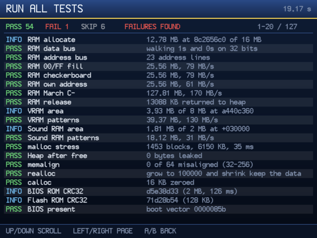

# KOS_Test

<p align="center">
  
</p>

A service-menu style test and benchmark suite for KallistiOS on the Dreamcast.
It checks that KOS and the hardware behave (RAM, CPU, FPU, caches, DMA,
threads, libc, VMU, network) and puts numbers on CPU, memory and GPU speed so
one KOS build can be compared with another.

## What's in it

| Menu item | What it does |
| --- | --- |
| VMU test (asked at boot) | Pick a VMU; writes a 2-block `KOSTEST` save (reused on later runs), reads it back and checks it, plus root block, directory, free blocks, raw block reads, clock and LCD, and whether `vmufs_write` pads short files with zeros ([KallistiOS#1574](https://github.com/KallistiOS/KallistiOS/pull/1574), via a temporary file it deletes) |
| System information | KOS, GCC and newlib versions, CPU clock, FPSCR, RAM, heap, VRAM, PowerVR ID, cable, video mode, region and BIOS settings |
| Input test | Every maple port live: controller buttons, triggers and sticks, keyboard keys, modifiers and typed text, mouse buttons and movement, sub-units |
| Memory & hardware self-test | Main RAM (data bus, address bus, patterns, March C-), VRAM, sound RAM, heap stress, BIOS and flash CRCs, RTC and timers, GD-ROM, maple bus, and a RAM burn-in loop |
| CPU test suite | SH-4 integer ops, shifts, MAC, DIV1, register file and banks, FPU and FSRRA/FSCA/FIPR/FTRV, TRAPA and exceptions, cache coherency, self-modifying code, store queues and texture loads past 1 MiB ([KallistiOS#1529](https://github.com/KallistiOS/KallistiOS/pull/1529)), PVR and G2 DMA, stereo sample split channel order ([KallistiOS#1557](https://github.com/KallistiOS/KallistiOS/pull/1557)), maple DMA against stale cache lines ([KallistiOS#1576](https://github.com/KallistiOS/KallistiOS/pull/1576), console only), threads and their FPU modes ([KallistiOS#1519](https://github.com/KallistiOS/KallistiOS/pull/1519)), libc, libm |
| Benchmarks | 52 results: CPU, memory and kernel (25), I/O (18: small memcpy/memset/strlen, romdisk and ramdisk, GD-ROM reads, VMU round trips, sound stream CPU) and GPU (9); compared with a baseline saved on the VMU |
| GPU feature test | 13 pages: colours, every texture format (incl. VQ, palettes, YUV, stride), filtering and mipmaps, all 64 blend modes, texture environments and UV modes, shading, fog, depth and punch-through, modifier volumes, a 3D scene, palette animation, sprites, render to texture |
| Monitor test | Colour bars, crosshatch, dots, purity fields, grey scale, ramps, safe areas, sharpness, geometry |
| Sound test | Left/right/both tones, pan, pitch and volume sweeps, a scale, sine/square/saw/noise |
| Network test | Finds the BBA, LAN Adapter, W5500 or modem, then DHCP or dial-up, pings, DNS, NTP over UDP and HTTP over TCP |
| Run all tests | Self-tests, CPU suite and benchmarks in one go |

## Download

Download the latest **[self-booting CDI](https://github.com/richstokes/dreamcast-homebrew/releases/latest/download/kos-test.cdi)**
for Flycast or GDEMU. A direct-load [ELF](https://github.com/richstokes/dreamcast-homebrew/releases/latest/download/kos-test.elf) is also available.
If you are burning a physical CD-R, you may want to try the padded
[CD-R image](https://github.com/richstokes/dreamcast-homebrew/releases/latest/download/kos-test-cdr.zip) instead (unzip before burning).
These are the interactive build; auto mode is built and sent with `make auto`.

## Auto mode

`make auto` sends an auto-mode build to the console over dcload-ip. On launch
it runs the self-tests and CPU suite, then every benchmark three times
(keeping the median and the spread between passes), sends the results back
over the dcload connection as one `KT RESULTS` block, and returns to dcload.
It takes about 90 s. The results are then recorded in
[benchmark_results](benchmark_results/) against the KOS commit the ELF was
built with, compared with the last console run, and the console is switched
off. It skips the VMU test (no writes to your cards) and the network test,
which would take the Broadband Adapter away from dcload-ip mid-run.

The block goes out as a single write: under dcload-ip each `printf` is a
round trip with interrupts off, and a lost packet freezes the console.

`AUTO_VMU=1` adds the VMU test on the first card found (it writes the
`KOSTEST` save and the temporary padding file).

## Other KOS versions

`KOS=<ref>` builds and runs any target against KallistiOS at that commit,
branch, tag or `pr/<number>` instead of the installed SDK. The first use
fetches and builds it with [`tools/kos/kos-at.sh`](../../../tools/kos/README.md)
(about 10 s once the history is cloned) and later runs reuse it. It's
unpatched unless `KOS_PATCHED=1` adds this repo's KOS patches. Each SDK gets
its own objects and ELFs (`kos-test-auto-kos-368a2eb.elf`), and its runs
record that commit, so running two back to back compares them.

```sh
make auto KOS=master AUTO_VMU=1             # unpatched upstream master on the console
make auto KOS=master KOS_PATCHED=1          # master with this repo's patches
make auto-flycast KOS=pr/1576               # a KallistiOS pull request, in Flycast
make run KOS=b470ef09                       # any commit, interactively in Flycast
```

`make auto-stock` is short for `make auto KOS=master`. KOS_Test builds against
KOS as far back as `b470ef09` (2026-09-12); older trees may lack APIs it uses.

## Controls

| Input | Action |
| --- | --- |
| D-pad / stick | Move; LEFT/RIGHT change page on the GPU and monitor tests and page through reports |
| A / Start | Select, run; toggles the page's mode on GPU, monitor and sound pages |
| B | Back |
| X | Second option on GPU pages; re-run the network tests |
| Start + B | Leave the input test (Esc on a keyboard) |
| Start + X / Start + Y | Rumble the jump pack / beep the VMU on that port (input test) |
| A+B+X+Y+Start | Back to the menu; on the menu, out to the BIOS |

A keyboard works in the menus too: arrows, Enter, Esc.

## Benchmark baseline

Run the benchmarks, then pick **Save results as VMU baseline** (it needs the
VMU picked at boot; it holds the first 48 benchmarks). Later runs show each
result against the baseline, with `SLOWER`/`FASTER` past 5%. **To compare KOS versions over time, use
`make auto` and benchmark_results; the VMU baseline is for quick checks on
the console itself.** Any benchmark or run-all also ends with the same
`KT RESULTS` block on the serial console, so `tools/record_results.py` can
read a Flycast or `make hw` log too.

## Console performance

The first recorded console run, 2026-10-26 (VGA, dcload-ip, KOS 2.3.0
`e7ab1a2` with this repo's patches, GCC 15.2.0, GDEMU); every run is in
[benchmark_results](benchmark_results/).

| Benchmark | Console |
| --- | --- |
| memcpy / memset / read RAM (1 MB) | 63 / 118 / 187 MB/s |
| memcpy 16 / 64 / 256 B | 3.92 / 2.02 / 0.68 M calls/s |
| sq_cpy RAM / uncached write | 181 / 76 MB/s |
| Texture load SQ / DMA | 215 / 552 MB/s |
| Sound RAM write / DMA | 5.5 / 5.5 MB/s |
| Float / double multiply-add | 110 / 44 MFLOPS |
| mat_transform (FTRV) / FIPR | 5.2 / 13.3 M/s |
| Romdisk / ramdisk read | 64 / 64 MB/s |
| GD-ROM read (GDEMU) / random sector | 1.5 MB/s / 6.2 ms |
| VMU block read / directory read | 27 / 349 ms |
| Sound stream (44.1 kHz stereo) | 0.8% CPU |
| GPU blended / textured fill | 87 / 87 Mpix/s |
| GPU flat / textured triangles | 1.77 / 1.54 M/s |
| TA submit pvr_prim / direct | 3.8 / 7.4 M verts/s |
| 3D scene (2304 lit textured tris) | GPU 4.1 ms, ~240 fps |

**Inside a run most results repeat to within 0.1%, but rebuilding on the
same KOS moved some a lot:** mutex 42%, sq_cpy 20%, thread switch 12%,
libm sinf 10%, romdisk readdir 12-30%. That's code and data layout against
the direct-mapped caches, so a KOS change in those areas needs several runs
to call. Romdisk readdir was 12% slower on stock master than with the
patches, with identical filesystem code: in the stock link `romdisk_readdir`
and newlib's `strncpy` landed on the same two lines of the 8 KB instruction
cache, so both reload on every directory entry.
`record_results.py` learns each benchmark's noise from runs on the same KOS
build. The bulk memory buffers now sit at a fixed cache offset, which moved
memcpy from 67-73 MB/s (wherever the heap put them) to a steady 63.

## Build and run

Needs the toolchain from the [root README setup](../../../README.md#one-time-setup).

```sh
source "$HOME/.local/share/dreamcast/kos/environ.sh"
make
./run-flycast.sh              # BBA on Flycast's local proxy; builds first
./run-flycast.sh --dcnet      # BBA over the DCNet VPN
./run-flycast.sh --modem      # modem instead of the BBA
KT_KEYBOARD=1 ./run-flycast.sh    # Mac keyboard as a Dreamcast keyboard on port B
```

On a real console, with my [hardware setup](../../../README.md#real-hardware):

```sh
make hw        # upload and leave it running
make auto      # auto mode: all suites and benchmarks, recorded in benchmark_results, then power off
```

## Checks

| Command | Checks |
| --- | --- |
| `make autotest` | Every screen with no input on blank scratch VMUs: VMU test, all suites and benchmarks, every GPU and monitor page with its modes, every sound test, the network test. Ends on `KT AUTOTEST DONE`; a panic fails it |
| `make VARIANT=tour` then `KT_ELF=kos-test-tour.elf KT_EXIT_ON_LOG='KT AUTOTEST DONE' ./run-flycast.sh --skip-build` | The visual pages only (GPU, monitor, sound, network) |
| `make VARIANT=nettest` (same run line) | The network test alone |
| `make auto-flycast` | Auto mode in Flycast, recorded under `build/auto/results` |
| `make auto-flycast KOS=<ref>` | The same against KallistiOS at another commit (`KOS_PATCHED=1` adds this repo's patches) |

`KT_BLANK_VMUS=1` runs Flycast on a temporary set of blank cards, so scripted
runs never touch your real VMUs.

## Gotchas

- Flycast has no SH-4 performance counters, cache model or address errors: the CPU clock, operand cache and address error checks skip there. On the console they run
- Flycast reports a constant ~7.5 ms PVR render time and finishes DMA instantly, so GPU and DMA benchmark numbers only mean something on the console
- Flycast missed a fog table written before the fog page's first frame; the page writes it again a frame later
- Over DCNet something answers NTP with an empty packet; the test flags it rather than showing a bogus time. The local proxy works
- The Dreamcast RTC holds local time, so the NTP line shows its offset from UTC (your time zone)
- Under dcload-ip every `printf` is slow and risky, so console runs log only failures, report summaries and the `KT BENCH` table
- The network stack only starts when the network test is opened; boots never wait on an adapter
- The filesystem benchmarks read a 512 KB romdisk that `tools/make_romdisk.py` makes at build time
- The GD-ROM benchmarks measure the drive or GDEMU, whichever is fitted, and skip with no disc; on GDEMU with openMenu the data track is only 41 sectors
- VMU timings follow the 60 Hz maple poll, so each one is the median of single operations
- The `vmufs_write` padding check fails on KOS 2.3 until #1574 is merged: the repo works around it in `vmusave.h` rather than patching KOS
- The `pcm16 split` check fails on KOS 2.3 until #1557 is merged: `snd_pcm16_split()` swaps left and right, so 16-bit stereo streams from 32-byte aligned buffers play swapped. The sound RAM split is fine
- On the console a VMU drops off the bus for ~80-90 ms after a burst of flash writes (both SDKs), then re-attaches; the VMU test waits for it and says how long it was gone
- The maple DMA check skips in Flycast, which has no cache to leave stale lines; on the console it runs 60 block reads with the operand cache flushed at six points during each reply's DMA

## Known limitations

- The network test hasn't been run on the console yet (auto mode leaves it out)
- Dial-up has only been tried against Flycast's emulated modem, not a DreamPi

## Credits

Built on [KallistiOS](https://kos-docs.dreamcast.wiki/). Text uses the
Dreamcast BIOS font.
