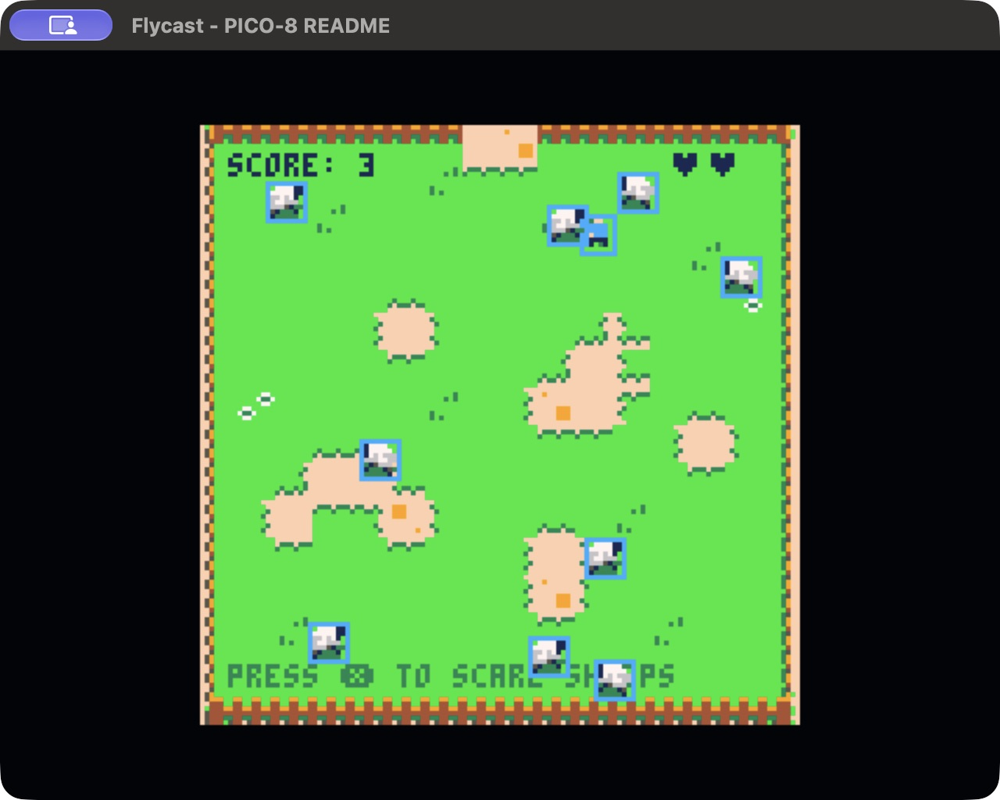
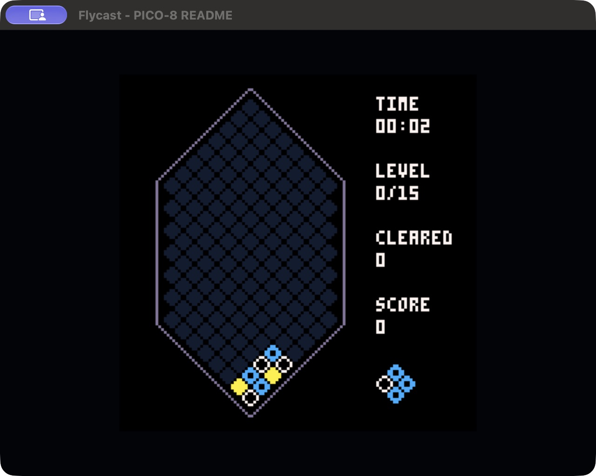
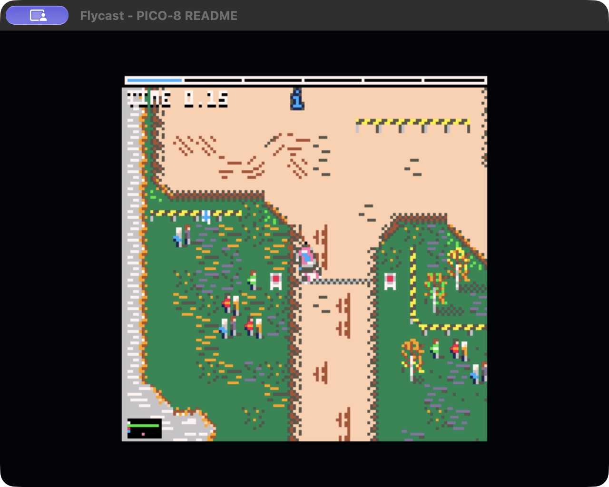

# PICO-8 player for Dreamcast

A KallistiOS port of [FAKE-08](https://github.com/jtothebell/fake-08) with a
controller-driven cartridge picker, seven freely licensed games built into the
ELF, and Download & Play for fetching `.p8` / `.p8.png` carts over HTTPS. It
runs real PICO-8 cartridge code (Z8lua, 16.16 fixed point). It is not the
proprietary PICO-8 editor and is not affiliated with Lexaloffle.

## Screenshots

Captured from the Dreamcast build running in Flycast.

| Cartridge picker | Bull Sheep |
| --- | --- |
|  |  |
| **Picolumia** | **Pikoralli** |
|  |  |

## Download

Download the latest **[self-booting CDI](https://github.com/richstokes/dreamcast-homebrew/releases/latest/download/pico8-dreamcast.cdi)**
for Flycast or GDEMU. A direct-load [ELF](https://github.com/richstokes/dreamcast-homebrew/releases/latest/download/pico8-dreamcast.elf) is also available.
If you are burning a physical CD-R, you may want to try the padded
[CD-R image](https://github.com/richstokes/dreamcast-homebrew/releases/latest/download/pico8-dreamcast-cdr.zip) instead (unzip before burning).

## Playing

| Dreamcast control | Action |
| --- | --- |
| D-pad or analog stick | Move the selection / PICO-8 directions |
| Left/right in the picker | Show the selected game's credits |
| A or X | PICO-8 O button / launch the selected game |
| B or Y | PICO-8 X button / launch the selected game |
| Y in the picker | Open Download & Play |
| Start | Pause/resume (games may add their own pause-menu items) |
| Both triggers + Start | Return to the picker |
| A+B+X+Y+Start | Return to the picker; in the picker, exit to the Dreamcast BIOS menu |

Picolumia starts with A+B together. Pikoralli steers with left/right, up/down
accelerates/reverses and A is the handbrake. WIZRND: up jumps, down while
standing raises a shield, A fires lightning, B a magic missile. The other
games show their controls in-game.

Bundled games (chosen for verifiable licenses, not popularity; sources, pinned
revisions and hashes in [samples/README.md](samples/README.md)):

| Game | Author | License |
| --- | --- | --- |
| [Anteform](https://github.com/Feneric/Anteform) | Eric W. Brown / Feneric | GPL-3.0 |
| [Bull Sheep](https://github.com/derpycoder/bull-sheep) | Abhijit Kar | MIT |
| [Elephant in the Room](https://github.com/ekaktusz/elephant) | Csaba Ekart and contributors | MIT |
| [NanoMan](https://github.com/FunFetched/NanoMan) | Fun Fetched (music by Gruber) | GPL-3.0 |
| [Picolumia](https://github.com/andrewedstrom/picolumia) | Andrew Edstrom | MIT |
| [Pikoralli](https://github.com/nothke/pikoralli) | Ivan Notaros | MIT |
| [WIZRND](https://github.com/mattleblanc/WIZRND) | mattleblanc | Apache-2.0 |

To add your own, copy `.p8` or `.p8.png` files (PICO-8 cart PNGs, not plain
images) into `romdisk/carts/` with any `#include` files beside them and run
`make`. A disc build also scans `/carts/` at the CD root; that path is
untested on hardware.

### Download & Play

Press Y in the picker, enter a direct `https://` link to a `.p8` or `.p8.png`
(a GitHub Raw link, not the game's page) and press Start. On the keyboard the
D-pad moves, A types, X toggles case, Y deletes, L/R move the cursor and B goes
back or cancels; a Dreamcast keyboard also works. Downloads live in `/ram` and
stay in the picker until the player quits. Nothing is written to a VMU.

- Broadband Adapter or WIZnet W5500 (serial port): DHCP; the download waits for an address
- Modem: dials the saved PlanetWeb/DreamPassport ISP profile, or the DreamPi
  defaults (`555`, `dream` / `cast`). Tone dialing only, no prefixes
- Flycast: `EmulateBBA=yes,DCNet=no` by default (outbound proxy, not LAN
  bridging); `./run-flycast.sh --modem` uses its modem PPP peer

HTTPS only, TLS 1.2 with the bundled Mozilla roots and no way to skip
verification (set the console clock). Limits: 1 MiB carts, 1,024-character
ASCII URLs, five redirects, no HTTP downgrade, single-file text carts. No
logins, cookies, proxies or IPv6.

## Build and run

```sh
source "$HOME/.local/share/dreamcast/kos/environ.sh"
make -C projects/apps/pico8-dreamcast -j8
./projects/apps/pico8-dreamcast/run-flycast.sh --skip-build
```

`run-flycast.sh` builds unless `--skip-build` is given and honors `KOS_ENV`
and `FLYCAST_BIN`. Baseline: KOS 2.3.0, SH-4 GCC 15.2.0, Flycast 2.7. Beyond
stock KOS it needs:

- kos-ports `mbedtls` (tested 3.6.6) and `curl` (tested 8.18.0, Mbed TLS backend):
  `make -C "$KOS_PORTS/mbedtls" install`, then `make -C "$KOS_PORTS/curl" install`
- The repository's [KOS patches](../../../tools/kos/README.md), which CI also
  applies: `tools/kos/apply-patches.sh`, then `make -C "$KOS_BASE"`. This
  project needs the maple receive-buffer, PPP lifecycle, BBA receive, TCP
  window, TCP poll-lock and keyboard attach fixes
- [SH4ZAM](third_party/SH4ZAM.md), header-only and never pinned: every build
  fast-forwards the ignored `third_party/sh4zam` checkout to upstream `master`

On a real Dreamcast ([`tools/dc-hw.sh`](../../../tools/dc-hw.sh): dcload-ip
over the network, Shelly plug power), from this directory:

```sh
make hw        # play: builds pico8-hw.elf and keeps dc-tool-ip attached
make hwbench   # smoke suite and per-cart timings, then powers the console off
```

Both log to `build/hw-console.log` (`HW_LOG=` overrides). After `make hw`,
run `../../../tools/dc-hw.sh power off`. `pico8-hw.elf` has no Download &
Play; see gotchas.

## Updating FAKE-08

FAKE-08, Z8lua and LodePNG are vendored at pinned revisions with local
changes, both listed in [third_party/README.md](third_party/README.md). No
script: copy the new upstream files over, re-apply the local changes, and run
the smoke and kernel tests (the PCM hashes must still match).

## Tests

Run from this directory with KOS sourced. The Flycast runners need a desktop
session and stop only the Flycast they start.

| Command | Verifies |
| --- | --- |
| `uv run tests/check_samples.py` | Bundled cart hashes, manifest, readable sources and license notices (CI runs this) |
| `uv run tests/run_smoke.py` | 360 scripted VM ticks per game, framebuffer changes, audio counts and timings, fixed-point/graphics/memory/cartdata API checks, picker and pause path |
| `uv run tests/run_smoke.py --kernels` | Rendering kernels and exact PCM hashes only |
| `uv run tests/run_smoke.py --profile --log build/profile.log`, then `uv run tests/analyze_profile.py build/profile.log` | Scheduler PC-sampling profile per symbol; keep the matching `pico8-profile.elf` with each log |
| `uv run tests/run_network.py [--modem] [--host <Mac IPv4>] [--no-public]` | Real HTTPS transfers against local TLS fixtures: both cart formats, redirects, chunked encoding, certificate failures, malformed/oversized/truncated data, cancellation, the URL screen, and a pinned GitHub cart |
| `./run-flycast.sh --smoke-test` | The smoke ELF, left visible for inspection |

CI builds and validates the ELF and packages the CDI through
[.github/console-projects.txt](../../../.github/console-projects.txt).

## Performance

Seconds for the smoke test's 360 VM ticks on a retail Dreamcast (6.0 is full
speed, including each game's startup): the September 2026 build, then the two
2026-10-16 passes (audio/allocator, then the Lua interpreter).

| Cartridge | Sept 2026 | Oct 16 pass 1 | Oct 16 pass 2 |
| --- | ---: | ---: | ---: |
| Anteform | 7.0 | 6.8 | 6.7 |
| Bull Sheep | 13.7 | 7.8 | 6.8 |
| Elephant in the Room | 16.4 | 10.6 | 8.3 |
| NanoMan | | 6.7 | 6.5 |
| Picolumia | 12.5 | 8.4 | 7.7 |
| Pikoralli | 15.1 | 7.6 | 6.7 |
| WIZRND | | 6.4 | 6.4 |

Anteform, NanoMan and WIZRND run at full speed. The rest spend most of their
time in Z8lua dispatch and string-keyed table lookups; Elephant also spends
about 30% drawing. Flycast is faster than the console for the same build.
Details: [hardware pass 1](VALIDATION.md#real-hardware-2026-10-16),
[pass 2](VALIDATION.md#lua-interpreter-on-hardware-2026-10-16-second-pass)
and the [earlier emulator numbers](VALIDATION.md#sh4-optimization-results).

## Gotchas

Each is also commented where it lives in the code.

- Under dcload-ip, `INIT_NET` can hang at boot and every `printf` blocks with
  interrupts off until dc-tool-ip reads it, so hardware builds skip networking
  and `make hw` keeps dc-tool-ip attached (`main.cpp`, `Makefile`)
- A stale cache line evicted over a DMA-filled maple receive buffer broke boot
  (`cont_cond_t` assertion) on some link layouts; CI applies
  [kos-maple-rx-cache.patch](../../../tools/kos/patches/kos/kos-maple-rx-cache.patch)
- Data placement moves audio mixer speed by up to 60%; the ROM disk is padded
  to 16 KiB multiples (the operand cache size) so cart changes do not shift
  everything linked after it (`Makefile`)
- `-O2` beats `-O3` for the VM and rasterizers on the 8 KiB instruction cache;
  the audio files stay at `-O3` because their PCM hashes depend on code
  generation. No `-ffast-math`: fixed-point results must stay exact (`Makefile`)
- Z8lua is compiled as C++, so without `LUA_USE_LONGJMP` every coroutine
  yield (one per frame) was a C++ throw costing milliseconds (`Makefile`)
- newlib's malloc takes a KOS mutex whose unlock scans the wait queues (about
  7% of a busy cart); Lua uses a lock-free small-block allocator (`lua_alloc.cpp`)
- kos-ports builds Mbed TLS without certificate date checks;
  `projects/common/https.c` checks them, hence the console clock
- FAKE-08's `assert()` only prints and calls `stop()`, which the main loop
  clears; the test carts override it to fail the run (`romdisk/tests/api.p8`)
- The release ELF is stripped (debug info in `build/*.elf.debug`) to stay
  under Flycast's 16 MiB ELF limit (`Makefile`)

## Known limitations

- One controller. No mouse, in-game keyboard text, screenshots, file writes
  or save states
- `cartdata` persists for the session only (32 keys); quitting loses saves
- Demanding carts run below 60 ticks/s on the 200 MHz SH-4, and heavy scenes
  can miss audio deadlines
- Compatibility is FAKE-08's. A passing smoke test does not certify a whole
  game; runtime errors drop back to the picker and are logged on serial
- Untested on hardware: `/cd/carts` from a disc and Download & Play

## Licenses

The Dreamcast host and launcher use the repository's MIT license. Runtime
provenance, local changes and third-party notices (FAKE-08, Z8lua, LodePNG,
SH4ZAM, curl, Mbed TLS, libppp, Mozilla roots): [third_party/README.md](third_party/README.md).
Game licenses: [samples/README.md](samples/README.md) and [licenses/](licenses/).
Full notices are embedded in the ELF at `/rd/NOTICE.txt`, with HTTPS dependency
notices under `/rd/certs/`.
