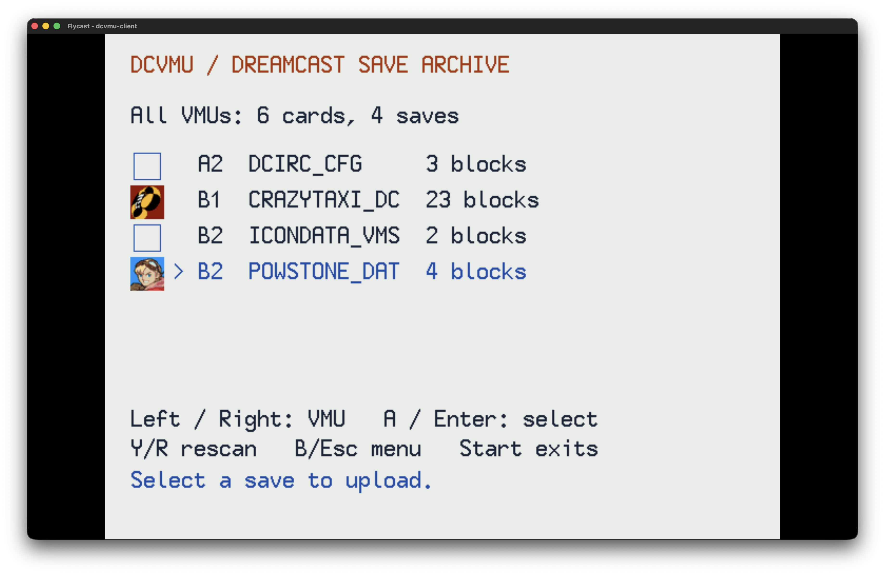

# DCVMU Dreamcast client

A KallistiOS app that backs up VMU saves to [dcvmu.com](https://dcvmu.com) and
installs them again, from the console itself. It needs a Broadband Adapter, a
WIZnet W5500 serial-port adapter or a Dreamcast modem with a working DreamPi,
plus a controller or Dreamcast keyboard. Log in with your dcvmu.com account;
the [getting started guide](https://dcvmu.com/getting-started) covers setup
and everyday use.



## Download

Download the latest **[self-booting CDI](https://github.com/richstokes/dreamcast-homebrew/releases/latest/download/dcvmu-client.cdi)**
for Flycast or GDEMU. A direct-load [ELF](https://github.com/richstokes/dreamcast-homebrew/releases/latest/download/dcvmu-client.elf) is also available.
If you are burning a physical CD-R, you may want to try the padded
[CD-R image](https://github.com/richstokes/dreamcast-homebrew/releases/latest/download/dcvmu-client-cdr.zip) instead (unzip before burning). Real hardware has not been verified yet.

## What it does

- Upload a save from any attached VMU with a title, notes and public/private visibility; an existing backup of the same VMU file can be replaced or kept alongside
- Download from My saves (private ones included) and install on a chosen VMU, with nothing written before you confirm
- Archive a whole VMU as one private snapshot, and restore one block for block with read-back verification
- Browse another user's public saves by exact username
- Install custom icon sets (`ICONDATA_VMS`) drawn in the website studio
- Remember the login in a revocable `DCVMU_AUTH` save on a VMU (never the password); sign out before lending that card

## Controls

| Input | Action |
| --- | --- |
| D-pad / arrows, Tab | Choose a field or save; Tab advances fields |
| Left / Right | Save list: cycle all cards and each VMU. Cloud lists: change page |
| A / Start / Enter | Edit, select or confirm |
| B / Escape / Backspace | Back, or cancel a network transfer. From the login screen or main menu, return to the title |
| Y / R | Rescan VMUs, or refresh a cloud list |
| X / N on My saves | Rename the selected cloud save (public saves cannot be renamed) |
| X / L at the main menu | Sign out |
| On-screen keyboard | D-pad and A (or Start) type, X erases, Y finishes, B cancels |

On-screen hints show controller buttons only. The app has no exit: power off
or reset when done. A canceled or failed request may already have reached
the server, so check your account before retrying.

## Build

Needs KOS 2.3 with the kos-ports `curl`, `mbedtls` and `zlib`; the install
commands and the ports compatibility patch are in the
[Dreamcast Browser README](../../apps/dreamcast-browser/README.md#dependencies).
Apply the repository's [KOS patches](../../../tools/kos/README.md) once and
rebuild KOS (CI does the same), then build the ELF:

```sh
source "$HOME/.local/share/dreamcast/kos/environ.sh"
../../../tools/kos/apply-patches.sh
make -C "$KOS_BASE" -j4
make
```

## Run in Flycast

```sh
./run-flycast.sh               # build, then launch with BBA, controllers, VMUs and keyboard
./run-flycast.sh --skip-build
./run-flycast.sh --list-vmus   # show Flycast's cards and their saves
./run-flycast.sh --dry-run     # everything except starting Flycast
```

`FLYCAST_BIN` and `KOS_ENV` override the Flycast binary and KOS environment.
The client runs on Flycast's own shared cards (`vmu_save_A1.bin`, ...), so
installed saves show up in games and the BIOS file manager. Every card is
backed up to `~/Library/Application Support/DCVMU/backups` before launch.
Click the window to focus it, then press Enter at the title.

## Tests

The Flycast runners build in a temporary directory, serve a local HTTPS
fixture with synthetic accounts, and hand Flycast a folder of blank cards, so
real VMUs are never touched. `--host` is this Mac's LAN IPv4 address; add
`--modem` to use Flycast's modem emulation instead of the BBA.

| Command | Checks |
| --- | --- |
| `python3 -m unittest discover -s projects/dcvmu.com/client/tests` | Host checks (CI runs these): the launcher uses Flycast's cards and backs them up; every script with a custom VMU folder fills it with blank cards first |
| `python3 projects/common/tests/run_dialup_checks.py --log-dir /tmp/dialup-checks` | The shared dialer's profile selection, failure, cancel and drop paths on SH-4, without dialing |
| `python3 projects/dcvmu.com/client/tests/run_upload_stress.py --host <Mac-LAN-IP> --log-dir /tmp/dcvmu-upload-check` | 30 HTTPS uploads (`--transfers` to change) and a large download through Flycast's TCP proxy, every payload verified byte for byte |
| `projects/dcvmu.com/service/.venv/bin/python projects/dcvmu.com/client/tests/run_public_browse.py --host <Mac-LAN-IP> --log-dir /tmp/dcvmu-public-test` | Public browsing: pagination and failed-page recovery, installing another user's save, replace/keep-both and cloud rename |
| Same runner with `--tools --log-dir /tmp/dcvmu-tools-test` | Studio icons and card-imported saves: install, cancel, header offsets, icon replacement keeps game saves, upload list excludes icons and login files, whole-VMU archive and restore with the login save rewritten, no login data in stored archives |
| Manual, normal build | Title idles with the bob and blink; holding Start or Enter plays one chime and the greeting waits for release without selecting anything |

Real-hardware icon display and the BIOS animation still need checking on a
physical Dreamcast and VMU.

## Gotchas

- Flycast 2.7 and earlier stall on the first upload through the TCP proxy, and longer timeouts do not help. Use the [patched native build](../../../tools/flycast/README.md)
- Never point Flycast at an empty `Dreamcast.VMUPath` folder: it moves the real cards in and deletes the originals. `tests/isolated_cards.py` creates a blank card for every slot first
- Self-test builds (`CPPFLAGS=-DDCVMU_SELF_TEST` and friends) read credentials from git-ignored `romdisk/test-*` files. Remove them and run `make clean && make` before a release (the Makefile's `release-check` refuses otherwise), and never run the fixtures against personal VMUs
- Uploads use a fresh connection and never retry automatically (`net.c`): the server may already have stored the save
- On the BBA the client gates the PCI IRQ and polls for received frames instead (`net.c`); re-enabling the IRQ at shutdown brought back Flycast IRQ re-entry
- Modem shutdown needs `tools/kos/patches/kos/kos-ppp-lifecycle.patch`; stock KOS 2.3 `ppp_shutdown` does not stop its worker
- Every request is HTTPS with certificate and hostname checks and no fallback, so a wrong Dreamcast clock breaks login

## Known limitations

- Real Dreamcast hardware, a real modem and DreamPi are not verified yet
- Modem: tone dialing of a plain number only. The number and PPP login come from the saved PlanetWeb profile, then DreamPassport, then the DreamPi defaults (`555`, `dream` / `cast`); a dropped call is not redialed
- VMU mini-games are not listed for upload; archive the whole card instead
- Imported saves keep their bytes and header offsets, not the original directory timestamps or copy-protection flags

## Credits

Powered by [KallistiOS](https://kos-docs.dreamcast.wiki/), the independent
Dreamcast SDK. KallistiOS is distributed under its BSD-like KOS license and
requires attribution.
