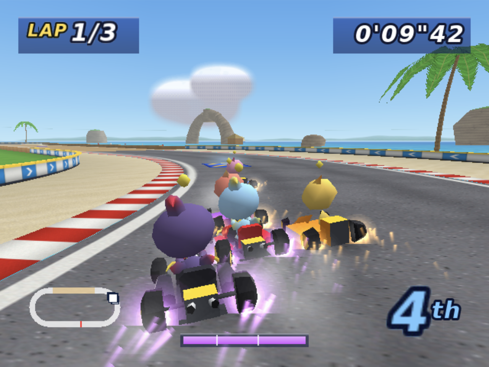

# DreamKarts

<p align="center">
  
</p>

A kart racer for the Sega Dreamcast with early-2000s Dreamcast looks and modern
Mario Kart-style handling. Hop into a drift, hold the powerslide round the
corner by counter-steering, watch the sparks at the rear tyres turn blue, orange
and then purple, and let go for a mini-turbo.

There are four courses. **Emerald Beach** is an oval with a wooden boardwalk
straight over a turquoise sea, a natural rock arch, a lighthouse, palm trees,
beach huts, a grandstand and Sonic-style dash panels. **Coral Crossing** is a
classic figure 8 on a palm-lined headland: one leg launches you off a ramp,
high over the other leg where it crosses, after a full-width jump pad that
makes sure every kart has the speed to clear it. **Palm Harbour** is a
twisty circuit by the harbour: a fast right-hand sweeper out of turn 1, a long
left onto the seafront, a tight right-left chicane toward the water, a beach
straight, then a left hairpin into the infield and a right hairpin back out
before two lefts onto the main straight. **Temple Hill** is the technical one,
with 18 m of climb: from the beach straight, two hairpin switchbacks climb a
jungle hillside to a summit ridge lined with ancient columns below a stepped
temple, where a hump throws you into the air (higher still off its dash
panel). Descending esses then drop onto an arched stone viaduct over a sea
inlet, between lit braziers, and a last left runs down to the line. Carved
stone heads watch the hairpins. You drive a Chao in a standard kart,
in the colours you pick, against five CPU Chao, or race a friend in
**two-player split screen** (Grand Prix with CPUs, or head-to-head Versus).

## Download

Download the latest **[self-booting CDI](https://github.com/richstokes/dreamcast-homebrew/releases/latest/download/dreamkarts.cdi)**
for Flycast or CD-R. A direct-load [ELF](https://github.com/richstokes/dreamcast-homebrew/releases/latest/download/dreamkarts.elf)
is also available.

## Features

- **Drift handling inspired by Mario Kart World:**
  - Press the drift button to hop. If you land steering, you start a powerslide; a short grace window lets you pick the direction just after landing.
  - While sliding, steering into the turn tightens the slide and counter-steering widens it, down to a gentle arc. A new slide starts at the neutral arc and tightens to full lock over about a third of a second, so the stick still held hard over from picking a direction doesn't snap you into the inside wall. You can hold a slide through a whole corner.
  - The mini-turbo charges faster when you steer in tight and stops charging on sand. Stage 1 (blue) gives a 0.45 s boost, stage 2 (orange) 0.95 s and stage 3 (purple) 1.55 s.
  - Sparks spray from both rear tyres, with a glow, and a gauge at the bottom of the screen shows the charge.
  - Hold the drift button without steering to charge a jump (Mario Kart World's charge jump), then release to spring into the air.
  - A rocket start: press accelerate as the "2" fades and hold it through GO. Press too early and you burn out.
- **Grand Prix:** a 3-lap race against five CPU Chao (four in two-player). They drive a racing line, drift and use mini-turbos, and have mild rubber-banding against the leading human. Each has its own style: smoother or twitchier steering, a line that weaves a little on the straights, an early or late turn-in, and a habit of now and then taking a bend on grip, so the pack doesn't hop into every corner in single file.
- **Time Trial:** a solo 3-lap run with lap splits and your best lap.
- **Two-player split screen:** top/bottom views, one controller each. Play a Grand Prix with four CPUs, or Versus (just the two of you). Each player has their own chase camera, HUD, countdown, rocket start and engine sound; a centre bar shows the race clock and a shared minimap. Either player's Start pauses the game and that player drives the pause menu, which can also switch the music off.
- **Main menu:** after the title, choose SINGLE PLAYER, TWO PLAYER or ONLINE MULTIPLAYER.
- **Online multiplayer:** race up to five other Dreamcasts over the internet with a Broadband Adapter or a dial-up modem (for example through a [DreamPi](https://github.com/Kazade/dreampi)). See [Online](#online) below.
- **Colours:** pick your Chao and kart colour from eight presets (CLASSIC, BUBBLES, MANGO, CORAL, PEBBLE, MIDNIGHT, HERO, LIME) in the race setup menu. The kart in the menu updates as you choose; in two-player, P2 changes theirs with their own pad's left/right. CPU rivals take the presets nobody picked.
- **50cc, 100cc and 150cc** engine classes.
- **Track select:** after race setup, pick a course on a screen that flies over it, with its map and lap length.
- **Final-lap dolphins:** on the final lap a pair of dolphins surfaces in the sea and races alongside you, making three splashy leaps each. On Emerald Beach they appear as you leave turn 1, beside the boardwalk about 26 m ahead and to the right. On Coral Crossing, whose shore is further off, they leap larger and higher past the shallows as you run up leg B from the crossing toward the west loop. On Palm Harbour they race you along the seafront, through the chicane and down the beach straight, out past the moored boats. On Temple Hill they leap beside the beach straight as you leave the line. In two-player each player gets the show, shared if you arrive together. Measured on the console, it costs no noticeable frame time.
- **Hills (Temple Hill):** the road climbs and falls with smooth slopes, and the ground is shaped around it, so it runs through grassy cuttings on the switchbacks and along embankments down to the viaduct. Over a sharp crest a kart leaves the road whenever the road falls away faster than gravity can pull it down, so the summit hump gives about 2 m of air at speed.
- **Ramp jump (Coral Crossing):** the jump pad's long boost carries you up a 4 m kicker; karts leave the lip at a fixed climb rate under lighter gravity, so every class soars about 7 m over the karts passing underneath and lands on a deck that eases back down to the road. The jump pad's push varies a little each time (about -8% to +10%), so some karts sail further than others, but a minimum take-off speed means every kart always clears the gap. A drift in progress fires its mini-turbo at take-off.
- **Dash panels** give a boost (on Emerald Beach, one on each straight and one on the exit of turn 1), and any boost lets you cut through sand.
- **Presentation:**
  - Title screen with a rotating Sega-style sunburst, a bouncing logo whose letters drop in one by one, sparkles, and the grid in the background.
  - A slide-in race setup menu.
  - A sound test on the main menu: play any song (with its time, tempo and a beat-synced equaliser) or any of the effects, and hear the final lap's 6% speed-up.
  - A fly-in intro, then a 3-2-1-GO countdown.
  - "FINAL LAP!" with the music sped up 6%, a FINISH! banner with confetti, and a results screen.
- **Audio:** three original synthesized songs that play back to back and loop: "Coral Speedway" (the title theme: steel drums, marimba, slap bass, electric piano and brass; 128 BPM, 75 s), "Harbour Lights" (city-pop fusion with a synth lead, slap bass, Rhodes, funk guitar and brass, with a last chorus a step up; 137 BPM, 77 s) and "Temple Run" (toms and taiko, marimba, kalimba, flute and brass in D minor; 133 BPM, 72 s). The title screen plays the theme and each race starts on a random other song, then the playlist carries on in order. The songs are mixed and ADPCM-encoded as one continuous loop, so each change of song flows without a gap or click. There are also 26 effects. The player's engine is two pitch-shifted loops crossfaded by speed, with tyre squeal, spark crackle and sand rumble loops alongside.
- **Vibration:** with a Jump Pack in the controller, rumble strips rattle harder and faster the quicker you cross them, sand grinds, and wall hits, kart bumps, hops, landings, mini-turbo stages, boosts, dash panels and rocket starts each give their own jolt. In two-player, each pack follows its own player.
- **Graphics:** a custom PowerVR renderer using [SH4ZAM](https://sh4zam.com/). Matrix transforms use FTRV, perspective divides use FSRRA, polygons go straight to the store queues, and triangles crossing the near plane are clipped. It also has table fog, chunked frustum culling, distance LODs for palms and karts, an animated sea and shore foam, a sky dome, clouds and a lens flare.

## Online

Pick ONLINE MULTIPLAYER, type a name (up to 10 letters, digits, `-` or `.`)
on the on-screen keyboard and press Start. The game uses a Broadband or LAN
adapter if one is plugged in (DHCP), and otherwise dials out with the modem
using the dial-up settings saved by PlanetWeb or DreamPassport, falling back
to dialling `555` with login `dream` / `cast` (which a DreamPi accepts).
Dialling can take up to a minute. Nothing touches the network until you
choose Online. In Flycast, `./run-flycast.sh` uses the emulated broadband
adapter whatever Flycast's saved network settings are; `DK_NET=modem` uses
the emulated modem through Flycast's local proxy. (Flycast's DCNet dial-up
service, if switched on in its settings, does not complete the game's PPP
login.)

The name is saved to the first VMU found (a 2-block `DREAMKARTS` file with
its own icon) when you press Start, and filled in for you next time. With no
VMU, a full one or an unreadable file the game just starts from `CHAO`.

- **Lobbies:** ten lobbies of up to six players. The browser shows each
  one's players, whether it is open or racing, its track and its leader.
- **Leader:** the first player into a lobby leads it (the next to have joined
  takes over if they leave). The leader picks the track, 3, 5 or 10 laps and
  50/100/150cc, and starts the race whenever at least two are in.
- **Everyone** picks their own colour (no two the same), and sees each
  player's ping next to their name.
- **Races** have no CPU karts. Each Dreamcast drives its own kart; the others
  are drawn from the network about a tenth of a second behind, smoothed
  between updates. The server starts everyone's countdown together and
  decides the places. Start during a race offers to leave it.
- **Points:** 10, 8, 6, 4, 2 and 1 for places one to six, added up for as
  long as you stay in the lobby. The lobby ranks players by points, with
  gold, silver and bronze trophies for the top three.
- After the results everyone is back in the same lobby. B leaves it for the
  lobby browser.
- If the server is running a newer version, the browser says a new version
  is out; if your version is too old to play, the game says so and asks you
  to download the latest.

The server is in [server/](server/README.md) (Go, UDP port 7535 at
`dcvmu.com`); its protocol is in [server/PROTOCOL.md](server/PROTOCOL.md). On
a 56k modem a race uses about 1 KB/s up and 2.5 KB/s down.

## Controls

| Dreamcast controller | Flycast keyboard default | Action |
| --- | --- | --- |
| Analog stick or D-pad | I/J/K/L or arrow keys | Steer (menus: move) |
| A | X | Accelerate (menus: OK) |
| B | C | Brake, even while holding A; reverse with A released (menus: back) |
| R trigger (or L trigger, or X) | V (or F, or S) | Hop and drift; hold without steering to charge a jump |
| Start | Return | Pause (continue / restart / music on-off / quit) |

Player 2 uses the second controller with the same layout. A Jump Pack in
either expansion slot of a player's controller vibrates for that player.

To drift: hold accelerate, press and hold R as you turn in, and keep holding it
through the corner. Push the stick toward the inside to tighten the slide and
away to widen it. Release R when the sparks are orange or purple.

## Build and run

From the repository root:

```sh
source "$HOME/.local/share/dreamcast/kos/environ.sh"
make -C projects/games/dreamkarts
file projects/games/dreamkarts/dreamkarts.elf
sh-elf-readelf -h projects/games/dreamkarts/dreamkarts.elf
```

Every build clones or fast-forwards an ignored `third_party/sh4zam` checkout
of upstream SH4ZAM `master` (see the repository README); it is never pinned.

Run it in Flycast with the serial console on your terminal:

```sh
projects/games/dreamkarts/run-flycast.sh
```

The launcher builds first unless you pass `--skip-build`. It uses only
transient `-config` flags and Flycast's own VMU in A1, where the game saves
the online name.

## Tests and captures

- `make autotest` builds `dreamkarts-autotest.elf`: a CPU drives your kart through a full 150cc Grand Prix. It logs frame rate and per-phase CPU time every 2 seconds, prints a summary (lap times, drifts, mini-turbos by stage, walls hit, results), then exits on `DK AUTOTEST: PASS`. Add `EXTRA_CFLAGS=-DDK_AT_TRACK=1` to race Coral Crossing (it then also fails unless your kart makes every jump and no kart ever needs rescuing from the gap) `-DDK_AT_TRACK=2` for Palm Harbour or `-DDK_AT_TRACK=3` for Temple Hill (`-DDK_AIR_TRACE` logs your kart's height above the road whenever it is airborne off a crest), `-DDK_AT_TT` for Time Trial, `-DDK_AT_2P` for a two-player split-screen race (both humans driven by the CPU; combine with `-DDK_AT_TT` for Versus), `-DDK_AI_TRACE` to log the CPU's drift decisions, or `-DDK_RUMBLE_TRACE` to log every vibration level the game asks for (it logs with or without a Jump Pack attached, so you can check effects without one).
- **Online:** `EXTRA_CFLAGS="-DDK_AT_ONLINE -DDK_NET_TEST_HOST=<server>"` makes the autotest go online instead: it connects, joins lobby 10, starts a race as leader once two are in, lets the CPU drive, and passes once the server's results bring it back to the lobby. `./run-flycast.sh` uses Flycast's emulated broadband adapter (put `DK_NET=modem` in front for its emulated modem), against a local server and a `dk-bot`, or two Flycast windows against each other (see [server/README.md](server/README.md)). The same flags on the capture build screenshot the name entry, lobby browser, lobby room, race and results.
- **Saved name:** `EXTRA_CFLAGS="-DDK_AT_NAME=QA1 -DDK_AT_NAME_WANT=QA0"` opens the name entry, checks the VMU gave back `QA0` (saved by the previous boot's `-DDK_AT_NAME=QA0`), then saves `QA1` the way Start does. Add `-DDK_AT_NAME_CORRUPT` to overwrite the file with junk first and check the game falls back to `CHAO`. These write to Flycast's real A1 card, so delete the `DREAMKARTS` file afterwards if you don't want the test name kept.
- `make VARIANT=capture dreamkarts-capture.elf` then `uv run tools/capture.py --out captures` plays scripted button presses through the title, menu, intro, countdown, GO!, a drift, a boost, the boardwalk, the pause menu (switching the music off and back on) and the results. It screenshots the Flycast window at each step without taking over the screen.

### Real hardware

`make hwbench` runs the same scripted title, menu and 150cc race on a real
Dreamcast through `tools/dc-hw.sh`. That script power-cycles the console with
the Shelly plug and waits for dcload-ip; it finds the plug and the console on
the network if their DHCP addresses change. The run logs timing every 10
seconds, because each printf under dcload-ip stalls the console. It saves
screenshots of the displayed framebuffer to `captures/hw/` through
dc-tool-ip's `/pc/` share. At three heavy scenes it freezes the race and
re-renders the same frame with each feature group switched off, printing the
PVR render time for each (`DK GPU` lines). `make hw` plays the release build on
the console.

Measured on hardware on 2026-10-17, 150cc, six karts, over a full race:

| | Dropped vblanks | CPU per frame (avg) | PVR render, start grid |
| --- | --- | --- | --- |
| 1P, first build | 208 of 6,652 frames | 13.0 ms | 21.0 ms |
| 1P now | 3 of 6,802 frames | 12.1 ms | 10.4 ms |
| 2P split, first build | 1,142 of 5,390 frames | 20.1 ms | 13.0 ms |
| 2P split now | 10 of 6,767 frames | 12.4 ms | 11.5 ms |

Coral Crossing on the same day, with its jump and dolphins: 1P dropped 7 of
7,599 frames (13.0 ms average CPU), and 2P split dropped 15 of 7,604 (12.6 ms).
Palm Harbour: 1P dropped 5 of 7,842 frames (11.4 ms), and 2P split dropped 1
of 7,815 (11.3 ms). Temple Hill: 1P dropped 5 of 8,558 frames (12.1 ms), and
2P split dropped 30 of 8,506 (12.2 ms), a few a lap on the switchbacks, where
the whole hillside is in view twice. Add `-DDK_AT_TRACK=1` (Coral Crossing),
`-DDK_AT_TRACK=2` (Palm Harbour) or `-DDK_AT_TRACK=3` (Temple Hill) to
`EXTRA_CFLAGS` to benchmark them.

Run the two-player benchmark with
`make hwbench EXTRA_CFLAGS=-DDK_AT_2P HW_LOG=captures/hw/hwbench2p.log`.

What made the difference:

- **Presorted translucency.** Translucent polygons are submitted back to front instead of using the hardware autosort, which cost about 7 ms a frame.
- **Particle fill.** Smoke puffs close to the camera are skipped and puff size is capped; the large "GO!" glow is gone.
- **Hardware split clipping.** Each split view is seven whole 32-pixel tile rows, with the clock and map in the band between, and the PVR's user tile clip trims each view in hardware. Software clipping at a 240-pixel split had broken most ground strips into clipped triangles.
- **Music speed-up in place.** The final lap's 6% faster music used to restart the stream, which refilled its whole 32 KiB AICA buffer in one frame: 16.5 ms, enough to drop a vblank as the final lap began. The stream's two channels now get a new pitch in place, as the engine loops do, in about 0.06 ms. The benchmark summary prints this cost and the stream's byte rate before and after (`DK AUTOTEST: music speed-up`).
- **Fast math.** `-ffast-math` lets GCC use the SH-4's FSCA for `sinf`/`cosf`. KOS passes `-mfsca`, but without fast-math every call still went to libm.
- **Kart work shared between views.** Each kart's part matrices and lighting are computed once per frame and reused by both views, and matrices are composed with the FTRV unit.
- **Kart detail.** Karts use one of three models by distance, with a margin so they don't flicker between models. In single player: full detail within ~16 m, a 330-triangle model built to match it from the chase camera out to ~42 m, and a ~150-triangle far model beyond. In split screen each view's own kart drops the hidden steering wheel and uses simpler wheels, and every other kart uses the far model.
- **Split-screen scenery.** Fog and draw distance come in, the outermost terrain is dropped, and fewer palms and clouds are drawn.

In Flycast the 1P race averages about 6 ms of CPU, so the console is about
1.5x slower than the emulator for this code.

## Assets

Everything is generated from code, and the generated files are committed so a
plain build needs no Python:

| Command | Script | Output |
| --- | --- | --- |
| `make textures` | `tools/build_textures.py` | Procedural textures, the HUD font, the logo and the countdown lettering, packed as twiddled, mipmapped PVR textures (`tools/pvr_texture.py`) |
| `make models` | `tools/build_models.py` | The kart and Chao as rigid parts with LODs, rival paint slots and outward winding checks. Preview them with `tools/preview_models_blender.py` (Blender) |
| `make audio` | `tools/build_audio.py` | Effects and music synthesized with numpy and encoded to AICA ADPCM with KOS `wav2adpcm` |

The HUD and logo lettering uses the DejaVu Sans Bold Oblique font bundled with
matplotlib (Bitstream Vera licence). Previews go to `assets/generated/previews/`,
which Git ignores.

## Layout

| File | Contents |
| --- | --- |
| `src/kart.c` | Handling, drifting, boosts, laps and CPU drivers |
| `src/track.c` | Track centrelines, road heights, the jump, surfaces, walls and dash panels |
| `src/world.c` | Scenery building and the animated sky and sea |
| `src/render.c` | PVR lists, SH4ZAM transforms, clipping and submission |
| `src/models.c` | Lit, animated kart and Chao rendering |
| `src/fx.c` | Sparks, flames, smoke and confetti |
| `src/hud.c`, `src/title.c` | Overlays and menus |
| `src/audio.c` | Music stream and effect voices |
| `src/rumble.c` | Jump Pack vibration effects |
| `src/main.c` | Race flow and cameras |
| `src/online.c` | Online menus, lobby rooms and online races |
| `src/save.c` | The online name saved to a VMU, read and written on a worker thread |
| `src/net.c`, `src/net_version.h` | Online protocol client and the version numbers the server checks |
| `src/netlink.c` | Broadband/LAN adapter or dial-up modem link, brought up on a worker thread |
| `server/` | The Go lobby server, a test bot and the deploy script |
