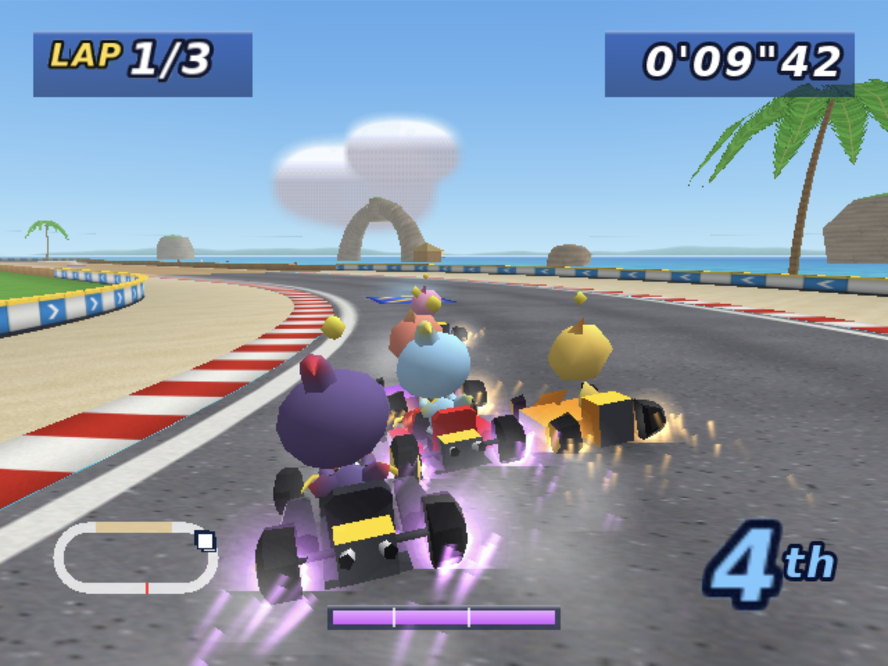

# DreamKarts

<p align="center">
  
</p>

A kart racer for the Sega Dreamcast: early-2000s looks, modern Mario
Kart-style handling. Hop into a drift, hold the powerslide with
counter-steer, watch the sparks turn blue, orange and purple, then let go
for a mini-turbo. You drive a cute little character against five CPU rivals, a friend in
split screen, or up to five other Dreamcasts online.

Nine courses:

- Emerald Beach: a beach oval with a boardwalk straight over the sea and dash panels; the tide washes over the outside of turn 1, and gulls lift off as you pass
- Coral Crossing: a figure 8 whose ramp jumps one leg over the other, with gulls on the beach rail on the first and final laps
- Palm Harbour: a twisty harbour circuit with a chicane and two hairpins, a crane working the quay and a ferry crossing the bay
- Temple Hill: a jungle hill climb (18 m) with switchbacks, a summit hump and a stone viaduct, monkeys on the ruins and parrots bursting from the palms at the first hairpin on lap 1
- Neon Skyway: 1,056 m of neon road above a cyberpunk city at night, with a banked loop, a gap jump and open edges to fall off; freeways of lights far below, a UFO on the final lap and eight emerald bands, twice the other tracks'
- Spiral Canyon: a hill-zone valley of palms, bushes, sunflowers, checkered loops, totem poles and tiki torches at golden hour, a retrowave sun setting behind the hills, where two banked corkscrews climb and descend 20 m as ledges round slate towers, through torchlit tunnels where they pass under themselves, with a hump on the summit ridge and a chicane on the way home
- Tsudoken Drift: a flat club circuit after Tsukuba under Mt Fuji on a spring afternoon, 1,031 m of hairpins and long lefts through cherry blossom, paddies and stone lanterns, a grandstand under a swept tiled roof along the start straight, torii over the road and a ramp jump over a stream halfway down the 200 m back straight
- Apple Valley: a kart club circuit in the Mojave after Apple Valley Speedway, 1,304 m and fifteen turns on a narrower road between tyre walls, on a desert slope that drops 10 m from turn 14 down to turn 1, tumbleweeds and dust devils on the wind, past Joshua trees and creosote, with a brown mountain and the snowy San Bernardinos on the horizon
- Bay City Hills: a San Francisco street circuit, 1,298 m between painted Victorian row houses: out along a pier past the sea lions, up Hyde Street's cable car tracks in three ~30% blocks that the karts hop at each crossing, a cable car running up and down one of them (which one is drawn each race; online and in time trials, always the first), down the crooked street's four brick switchbacks between hydrangeas, over the crest at its foot and round Coit Tower into a two-crest plunge back to the bay, the Golden Gate and Alcatraz across the water and a ferry crossing the bay

And one place that is not a course:

- Night Meet: Free Roam's parking lot, after Daikoku PA in Yokohama. A flat island in the bay at night, a service road round a big lot of painted bays under sodium lamps, the expressway looping round it on pillars with parking underneath, its on-ramps single lanes that leave the ring road's edge, climb an earth embankment and widen into the deck, an overpass humping over the north end, service bays, a tower and a clubhouse with neon over them (one sign buzzing, another now and then), trucks, bleachers with a swaying crowd, a food truck with a queue of little drivers and more standing about, cherry trees, the city behind and a lit suspension bridge across the water. Built from the other courses' props and textures

Highlights:

- Free Roam: no laps or places, power-ups if you want them (emeralds on the south straight, up on the deck, across the middle aisle and by the west trees), just the Night Meet lot to drive round, alone or in split screen, with five CPU karts cruising the ring road for company; the ring road's barrier follows each ramp out, so take the ramp lane off the road's edge and the deck down the west side and along the south (two stretches of its inner parapet are missing, so you can drop off into the parking under the deck and drive back out to the road), or the overpass across the lot, which you can also drive under; a speedo in mph instead of the lap counter and no clock, everyone on the map, and a drift score: a slide counts up at ten points a degree-second (the kart's slide angle, tight worth more than wide, at speed), shown centre screen as it climbs, and is banked when you release it cleanly, with your best drift under the speedo; a wall, a spin or the brake throws the slide away
- Grand Prix: all nine courses back to back against five CPU rivals, 10/8/6/4/2/1 points a race and the standings in between; Single Race on any course, with race again or a new track from the results; Time Trial; all at 3, 5 or 10 laps and 50/100/150cc
- Two-player split screen in every mode (Versus instead of Time Trial), each player picking their own kart
- Online multiplayer over a Broadband Adapter, a WIZnet W5500 serial-port adapter or dial-up modem, with lobbies, points and a spectator TV director
- CPU rivals with their own driving styles that drift, mini-turbo and rubber-band mildly
- Chaos Emerald power-ups: Power Sneakers, a homing Star Spear, a Mine dropped behind you and a Barrier, offline and online
- Rocket starts, charge jumps, barrel rolls off the ramps for a landing boost, burnouts, emotes, final-lap dolphins and a biplane weaving ahead on Spiral Canyon's final lap
- Nine songs by Alex Morgan as CD audio: a theme, five shuffled through the races with NEXT SONG on the pause menu, three chill ones for the online lobby; 42 effects, character voices by colour and Jump Pack rumble
- A Settings menu with the sound test, your online name, a music switch and volume, where the drift score shows (off, Free Roam only or every mode), and a Customize screen: paint your own kart (body, trim and driver from a 16-colour palette), saved to the VMU and raced offline or online as CUSTOM
- VMU screens for the countdown, place, lap and results

## Download

Download the latest **[self-booting CDI](https://github.com/richstokes/dreamcast-homebrew/releases/latest/download/dreamkarts.cdi)**
for Flycast or GDEMU (the music is CD audio tracks on the disc, so there
is no stand-alone ELF). If you are burning a physical CD-R, you may want to try the padded
[CD-R image](https://github.com/richstokes/dreamcast-homebrew/releases/latest/download/dreamkarts-cdr.zip) instead (unzip before burning).

## Controls

| Dreamcast controller | Flycast keyboard default | Action |
| --- | --- | --- |
| Analog stick or D-pad | I/J/K/L or arrow keys | Steer (menus: move) |
| A | X | Accelerate (menus: OK) |
| B | C | Brake, even while holding A; reverse with A released (menus: back) |
| R trigger (or L trigger, or X) | V (or F, or S) | Hop and drift; hold without steering to charge a jump; press again on the way up off a ramp for a barrel roll and a 2 s boost on landing |
| Y | D | Use the held power-up (with down held, throw a Star Spear backwards; a Mine always drops behind); wave when holding nothing, arms taking turns |
| Both triggers together | F and V together | Look behind while held |
| Start | Return | Pause (continue / restart / music on-off / next song / perf: off, overlay or FPS counter / quit); Y on the pause menu hides the menu and HUD for a clean screenshot, Y again brings them back |

Player 2 uses the second controller with the same layout; a Jump Pack in
either slot vibrates for that player. To drift, hold A, press and hold R as
you turn in, push the stick inward to tighten or outward to widen, and
release when the sparks are orange or purple.

A+B+X+Y+Start returns to the title screen from anywhere (leaving an online lobby), and on the title screen exits to the Dreamcast BIOS menu.

## Power-ups

Chaos Emeralds hover over the road at two to four bands a lap, each in one
of four slots across the road, picked per race from a seed every console
shares, so the inside or outside slot costs you a tenth or two. Drive
through one and your kart keeps it: a gem trails your kart and a small one
sits beside the lap counter with a Y. A taken emerald bursts and pops
straight back in a new colour, so a whole pack through the band each gets
one; a kart already holding something drives past.

| Emerald | Item | On Y |
| --- | --- | --- |
| Blue | Power Sneakers | A boost like a purple mini-turbo, 2.1 s in first place to 3.1 s in sixth, and half as long again when you are last; cuts through sand like any boost |
| Red | Star Spear | A homing shot that flies along the track at the next kart ahead within 60 m (behind you with down held), spinning out whoever it hits for a second; it follows bends and jumps, and a late swerve can dodge it |
| Yellow | Mine | Dropped on the road behind you, where it waits 25 s for anyone (you included, after a moment) to drive over it and spin out; a charge jump clears it |
| Green | Barrier | A bubble for six seconds that soaks up one Spear or Mine |

CPU rivals take emeralds on their line and use them after a moment's
thought, steer round three mines in four, and leave the leading human alone
on their final lap. The race setup menu's ITEMS switch turns them off; a
solo time trial never has them, so lap times stay honest. Online the lobby
leader has the same switch, and a Spear's or Mine's hit is judged only by
the console driving the kart it hits (see
[server/PROTOCOL.md](server/PROTOCOL.md)).

## Build and run

Needs the toolchain from the [root README setup](../../../README.md#one-time-setup).

```sh
source "$HOME/.local/share/dreamcast/kos/environ.sh"
make -C projects/games/dreamkarts
projects/games/dreamkarts/run-flycast.sh      # builds first unless --skip-build
```

Every build checks out the pinned SH4ZAM in the ignored `third_party/sh4zam`
(see the repository README); asset generators and QA scripts run through `uv run`.
The game is a disc: the music is nine CD audio tracks ahead of the data
track, which the GD-ROM plays by itself. `make music` downloads the songs
(Alex Morgan's, listed with their checksums in `assets/music/tracks.txt`)
from dcvmu.com and cuts them to `cdda/*.wav` with ffmpeg (`brew install
ffmpeg`); `run-flycast.sh` wraps the ELF and those tracks in a throwaway CDI
(`build/cdi/`, ~260 MB) with [mkdcdisc](https://gitlab.com/simulant/mkdcdisc),
built once by `tools/mkdcdisc/build-macos.sh`; `make disc` builds the CDI the
releases ship; under dcload the project directory is mapped at `/pc` and
the music is silent (`make hw MUSIC=1` plays a DreamKarts disc in the tray).
Debug info is split into `dreamkarts.elf.debug` for `sh-elf-addr2line`.
The title screen shows the commit the game was built from (bottom right,
`-dirty` when built with uncommitted changes); please include it in bug
reports. `DK_GIT_SHA=...` on the make line overrides it.

Launcher environment: `DK_ELF` picks another ELF (wrapped in its own CDI), `DK_EXIT_ON_LOG` and
`DK_FAIL_ON_LOG` stop Flycast on a serial line, `DK_NET=modem` swaps the
emulated broadband adapter for the emulated modem, `DK_SHOW_VMU=1` shows the
VMU screens over the game, `DK_KEYBOARD=1` puts a Dreamcast keyboard in port
B fed by the Mac's keyboard (for the lobby chat), `DK_VMU_DIR=<folder>` swaps
in that folder's memory cards (every slot's file must already exist).

## Online play

Pick ONLINE MULTIPLAYER, type a name (up to 10 of `A-Z 0-9 - .`) and press
Start. A Broadband, LAN or WIZnet W5500 (serial port) adapter is used if one
is plugged in (DHCP);
otherwise the modem dials with the saved PlanetWeb or DreamPassport settings,
falling back to `555` with login `dream` / `cast`, which a
[DreamPi](https://github.com/Kazade/dreampi) accepts. The name is saved to
the first VMU found, alongside the music switch, its volume and the custom kart (the
Settings menu edits all three).

- Ten lobbies of six at `dcvmu.com`, UDP 7535. The first player in leads: picks the track, laps, class and whether power-ups are on, and starts the race, alone if nobody else has turned up yet (a bell rings when someone joins; they race from the next one)
- Start mid-race opens a small menu over the race (it cannot pause): the music switch, NEXT SONG and LEAVE, which goes back to the lobby room, not the browser, so a practice lap ends the moment company arrives
- The leader can pick Night Meet too: that opens a Free Roam session on the lot instead of a race, no laps, places or points, everyone driving round until the leader backs out (Start, A), which sends the whole lobby back to the room. Anyone joining the lobby meanwhile drops straight onto the lot, anyone else who backs out waits in the room and presses A to go back on, and the demo lobby never plays it
- Each console drives its own kart; the server starts the countdown and decides places. Points (10/8/6/4/2/1) add up while you stay in the lobby
- X in the lobby room opens the chat: type on the on-screen keys (quick phrases included) or a Dreamcast keyboard in any port, Start or Enter sends. Closed, a strip shows the newest line and a badge counts what you have not read. Chat is per lobby, watchers can read it, and the server stars out bad words
- Lobby 10 is a demo lobby of bots, watch only
- An old console is told a newer version is out, or refused if too old to play

The Go server, its test bot, the local test recipe and the checklist for any
change to online play are in [server/README.md](server/README.md); the wire
format is in [server/PROTOCOL.md](server/PROTOCOL.md). A race uses about
1 KB/s up and under 3 KB/s down on a 56k modem.

## Assets

Everything is generated and the outputs are committed, so a plain build
needs no Python.

| Target | Regenerates |
| --- | --- |
| `make textures` | Procedural textures, the HUD font, logo and countdown lettering (`assets/generated/textures.pak`) |
| `make models` | The kart and driver meshes with LODs (`models.h`); preview with `tools/preview_models_blender.py` |
| `make canyon-rock` | Spiral Canyon's rock (`canyon_rock.h`): a `-DDK_DUMP_ROCK` build prints the rock's height field, tunnel bores and road clearance, and Blender (`tools/build_canyon_rock.py`, ~5 s) cuts one mesh from them; open `captures/canyon_rock.blend` to look at it. Rerun after changing the track's layout, heights or the rock's shape |
| `make sf-props` | Bay City Hills' props (`sf_props.h`): Blender (`tools/build_sf_props.py`, ~2 s) models the Golden Gate Bridge and its headlands, Alcatraz, Coit Tower, the pyramid, a cable car, a bay ferry, street lamps, date palms, a cypress, a fishing boat, the sea lions' raft and the wharf's sign; `captures/sf-props/` has a render of each |
| `make apple-valley-props` | Apple Valley's props (`apple_valley_props.h`): Blender (`tools/build_apple_valley_props.py`, ~2 s) models race control, the bleachers, pit canopies, containers, clubhouse, trailer, starter's stand, tyre stacks, light pole, fence, boulders, Joshua trees, creosote and the brown mountain; `captures/apple-valley-props/` has a render of each |
| `make tsudoken-props` | Tsudoken Drift's props (`tsudoken_props.h`): Blender (`tools/build_tsudoken_props.py`, ~2 s) models Mt Fuji, the cherry trees, torii, stone lanterns, pagoda, grandstand, race control, pit garages, teahouse and bridge, and bakes each as strips per material; `captures/tsudoken_props.blend` holds the scene and `captures/tsudoken-props/` a render of each |
| `make biplane` | Spiral Canyon's final-lap biplane (`biplane_mesh.h`): Blender (`tools/build_biplane.py`, ~2 s) models the plane and its propeller; `captures/biplane.blend` holds the scene and `captures/biplane/` renders from five angles |
| `make audio` | Sound effects (`sfx.pak`, `sound_assets.h`) |
| `make music` | The songs, downloaded once to `assets/music/cache/`, levelled to -9.5 LUFS (peaks under -1 dBTP) and cut to CD audio WAVs in `cdda/`, plus `music_tracks.h` (titles, lengths, tempos) |
| `make vmu` | The save file's icon and the VMU screen sprites and fonts |
| `make assets` | All of the above |

## Tests and captures

The `hw` targets run on a real console and need the
[hardware setup](../../../README.md#real-hardware).

| Command | What it checks |
| --- | --- |
| `make autotest` | A CPU drives a full 150cc Grand Prix in Flycast; logs frame rate, CPU time and physics stepping every 2 s, every emerald taken, spear thrown, mine dropped and hit as `DK ITEM` lines (and `misses band` for a kart that crossed a band off the slot), prints a summary and exits on `DK AUTOTEST: PASS` (fails on time, a gap rescue, a missed jump, or tyres drawn 2 cm or more into the road in over 10% of kart-frames; the `tyres vs drawn road` line has the depths) |
| `make VARIANT=capture dreamkarts-capture.elf` then `uv run tools/capture.py --out captures` | Scripted title, menus, race and results, screenshotting the Flycast window at each `DK SHOT` (an emerald ahead, the held gem, a spear, a barrier, a spin-out and a mine ahead included); `--log FILE` keeps the whole serial console |
| `make hwbench` | The same scripted race on the real console through `tools/dc-hw.sh`: 10 s timing lines, `DK GPU` / `DK CPU` feature probes, `DK PC` performance counters, screenshots in `captures/hw/`; powers the console off after. Split screen: `make hwbench EXTRA_CFLAGS=-DDK_AT_2P HW_LOG=captures/hw/hwbench2p.log` |
| `make hw` | Plays the game on the console and leaves it on (`tools/dc-hw.sh power off` afterwards). The music is silent over dcload; `make hw MUSIC=1` plays the CD audio of a DreamKarts disc left in the tray |
| `make -C ../../common/engine/tools/microbench run` | Cycles per vertex or triangle for each `engine/xform.S` routine on the console, about a minute |
| `go test ./...` in `server/` | Server, protocol and version-header agreement; `go test ./demo` loads every demo recording |
| `make online-qa` | Every online scenario against a local lobby server, each in its own Flycast with the bots it needs: race and chat (the bot's skid marks must show), custom karts, practice, spectating (the demo lobby, and two braking bots whose skid marks must show), a server on a newer protocol (the too-old screen must come up) and a server restart mid-race (the console must get into the next race); `DK_QA_LIVE=1` runs the first four against dcvmu.com, `QA="race restart"` picks scenarios, logs in `captures/online-qa/` |

`EXTRA_CFLAGS` for the autotest, capture and hwbench builds:

| Flag | Effect |
| --- | --- |
| `-DDK_AT_TRACK=n` | Track 0-10 (Beach, Coral, Harbour, Temple, Skyway, Cyberstone, Spiral Canyon, Tsudoken Drift, Apple Valley, Night Meet, Bay City Hills); Cyberstone (5) still loads here though no menu offers it, and the lot (9) is Free Roam's alone |
| `-DDK_AT_ROAM` | Free Roam on the Night Meet lot: the CPU drives the player out of its bay and round the ring with the rivals, 18 s in puts it short of the west ramp and steers it up the deck and down the far ramp, and at 90 s passes if it reached the deck and came down through the west gap, every kart is still on the island, every rival still on the ring and the frame rate held; the capture build screenshots the lot every 6 s (`roam-NN`) |
| `-DDK_AT_CC=0/1/2` | 50/100/150cc (the time limit scales) |
| `-DDK_AT_TT`, `-DDK_AT_2P`, `-DDK_AT_LAPS=n` | Time Trial, split screen with both humans CPU-driven (plus TT = Versus), lap count |
| `-DDK_AT_GP` (`-DDK_AT_GP_RACES=n`) | A whole Grand Prix instead of one race: a summary per race, then the final standings with a points audit; `n` races instead of all nine |
| `-DDK_AT_NEXT_TRACK` (capture) | Picks NEW TRACK from the results, the next course along, and races that too |
| `-DDK_AT_NO_ITEMS`, `-DDK_AT_SOLO`, `-DDK_AT_SHIELD_TEST`, `-DDK_AT_MINE_TEST` | Race without power-ups; race the humans alone, for clean captures of the track; hand the player a Barrier every 12 s, to measure its fill; hand the player a Mine every 12 s, or every `=<s>` (the capture looks behind at it; alone with `=30` the player laps round to its own) |
| `-DDK_AT_WRONG_WAY` | Turns the player round 10 s in (player 2 at 12 s) and drives it back up the track for 5 s; `DK WRONG WAY` lines log the banner coming and going (capture shots `wrong-way`, `wrong-way-p2`) |
| `-DDK_AT_FIXED` | One 1/60 s step a frame and held screenshot frames: two runs give pixel-identical captures and `DK STATE` fingerprints, for before/after diffs |
| `-DDK_XF_CHECK` (with `-DDK_AT_FIXED`) | Runs the C beside each `engine/xform.S` routine; `DK XFCHECK ... mismatch=` must stay 0 |
| `-DDK_AT_ONLINE -DDK_NET_TEST_HOST=<ip>` | Goes online: joins lobby 9, chats with the bot (a line from a faked keyboard, one from the on-screen keys, the bot's second line starred by the word filter), races, passes when the results arrive (recipe in server/README.md) |
| `-DDK_AT_ONLINE -DDK_AT_PRACTICE -DDK_AT_LOBBY=<n>` | Online practice: starts a race alone in an empty lobby, drops out, leaves and rejoins the lobby and gets into its next race, hears the bell as a bot joins mid-race, drops out back to the lobby room, races the bot, sees the bot's kart leave when it drops out (`dk-bot -retire`), drops out again (recipe in server/README.md) |
| `-DDK_AT_ONLINE -DDK_AT_SPECTATE` | Watches the demo lobby through every camera |
| `-DDK_AT_ONLINE -DDK_AT_ROAM_ONLINE` | Free Roam online: the leader picks Night Meet and opens it once two are in (a bot or a second console), drives round for 25 s, backs out, and passes if the lobby is back in the room within 5 s with no results, places or points and a remote kart was seen; a guest console passes when the leader brings it back |
| `-DDK_AT_ONLINE -DDK_AT_ROAM_ONLINE -DDK_AT_ROAM_LATE` | The same with the company arriving late: the leader opens the lot alone and backs out 20 s after the first remote kart drops onto it (a bot or a second console started once the session is on); a guest console backs out 8 s in, asks back on from the room and must be driving again before the leader ends it |
| `-DDK_AT_ONLINE -DDK_AT_REJECT` | Against a server started with `-reject-proto 9`: passes on THIS VERSION IS TOO OLD with the download prompt, fails on anything else (builds up to 17 showed LOST CONNECTION after a protocol bump) |
| `-DDK_AT_ONLINE -DDK_AT_RESTART -DDK_AT_LOBBY=<n>` | Starts a race alone, prints `restart the server now`, and once the harness has restarted the server with the same `-race-seed` must come back through the browser, rejoin and get into the next race, whose id repeats (builds up to 18 sat in the room showing RACE IN PROGRESS) |
| `-DDK_AT_LIVE` | With the online autotests against dcvmu.com: the chat check no longer expects the bot's second line starred (the live word list has no BLORP) |
| `-DDK_AT_NAME=QA1 -DDK_AT_NAME_WANT=QA0` (`-DDK_AT_NAME_CORRUPT`) | Saved-name round trip on the VMU: the name screen must open on the saved name (and recover from a junk file); writes Flycast's real A1 card, delete its `DREAMKARTS` file afterwards |
| `-DDK_AT_SETTINGS` (capture), then `-DDK_AT_SETTINGS_WANT` | Walks the Settings menu: music off, volume 6, the drift counter off then always on, a custom kart painted and saved, CUSTOM on the race setup's colour row, the online name saved; the second build checks a reboot loads them all. Run both with `DK_VMU_DIR=<folder of blank cards>` so the real VMU is left alone |
| `-DDK_AT_ONLINE -DDK_AT_CUSTOM` | Goes online with a custom kart; `DK ONLINE: kart` lines show every racer's colour and picks as the lobby sent them (pair with `dk-bot -colour 8 -custom 2,3,4`, the rest as in server/README.md) |
| `-DDK_AT_CAMTOUR` (capture) | Screenshots every spectator camera on every track (with `-DDK_AT_TRACK=n`, one track's) to `captures/tv` |
| `-DDK_AT_VIEWS` (capture) | Spiral Canyon's rock: `=1` the rock from outside (both mountains from above and afar, the tunnel mouths from overhead, the waterfalls), `=2` the chase camera every 8 m round the lap with a look left and right every 16 m (`sweep-NNN-f/l/r`, the check that matches what a player sees), `=3` the leak test: cameras inside the rock, each shot twice, the real world and the rock's height function drawn on its own; `=4` Night Meet instead (the food truck and its queue, the bleachers, the vending machines, the south side from above, the buzzing sign lit and put out, both on-ramps from the road and from the side). Add `-DDK_ROCK_TINT` to colour the rock red and everything else grey with the sky black; the leak test needs it, and `uv run --with pillow --with numpy tools/leakcheck.py captures/<dir> --ref <any normal shot>` then lists every shot where the baked rock falls short of the height function, with a sheet of the worst. `-DDK_LEAK_FROM=a -DDK_LEAK_TO=b` restricts the leak test to a stretch of the lap, `-DDK_SWEEP_FROM=a -DDK_SWEEP_TO=b` the sweep |
| `-DDK_AT_VIEWS=2` (hwbench) | The sweep on the console: no screenshots, one `DK HWVIEW` line per point with its PVR render and render CPU time (average/max) and triangles, forward only; run with `tools/dc-hw.sh run ... dreamkarts-hwbench.elf` as `make hwbench` does |
| `-DDK_CHUNK_STATS` | Spiral Canyon, Tsudoken Drift, Apple Valley, Night Meet and Bay City Hills: strips and vertices the world sends a frame, by kind (ground, deck, rock, props, torches; for Tsudoken and Apple Valley ground, road, buildings, trees and scrub; for Night Meet props, ground, ring, decks, skyline), every 2 s (`DK CHUNKS`); at 0.41 us a vertex and 1.6 us a strip on the console |
| `-DDK_PERF_HUD` | Starts with the performance overlay on (the pause menu's PERF: OVERLAY): frame CPU time and its phases, PVR render time, vertex buffer, triangles and missed vblanks, half-second averages and maxima against the 16.68 ms frame. It costs ~0.3 ms of CPU a frame on the console. In Flycast the PVR row is a constant 7.50 ms and VTX reads `--`, so judge headroom on hardware. hwbench adds a `-perfhud` probe step |
| `-DDK_AT_PVRSPIKE=15.0f` | Logs where any race frame's PVR render runs over that many ms (`DK PVRSPIKE`, the player's lap distance and heading), at most one line in 2.5 s |
| `-DDK_AT_WALLRIDE`, `-DDK_AT_ZIGZAG` | The player rides the right rail all of lap 1 and the left all of lap 2, or slams the rails at an angle every 1.5 s; any kart ending up past a rail logs `DK ESCAPE` |
| `-DDK_AT_FALL` | Steers off Neon Skyway's open edge on lap 1 to count falls (fails on time by design) |
| `-DDK_AI_TRACE`, `-DDK_HOP_TRACE`, `-DDK_AIR_TRACE`, `-DDK_VOICE_TRACE`, `-DDK_RUMBLE_TRACE`, `-DDK_NET_TRACE`, `-DDK_PATH_LOG` | Per-event logs: CPU drift decisions, short hops (a stream of them on hills means karts stuttering over the road), airtime, voice lines, rumble levels, network start-up timing (never on hardware builds), the kart path `dk-bot -path` replays |

Other builds: `VARIANT=record` with `-DDK_RECORD` records the server's demo
races (see [server/README.md](server/README.md#demo-lobby)); `VARIANT=film`
with `-DDK_FILM_SPECTATE` or `-DDK_FILM_SHOW` plays trailer footage with
`DK FILM` highlight lines, recorded through OBS and cut by `tools/film/`
(`-DDK_FILM_NO_MUSIC` for effects only, `-DDK_FILM_CLEAN` for no HUD). To film
chosen tracks, point it at a local lobby server (`-DDK_NET_TEST_HOST=<Mac IP>`)
whose demo races are limited to those tracks.

## Performance

Real console, 2026-10-19, 150cc, six karts, a full race, before and after
the SH-4 assembly vertex loops and the other savings below. CPU is the
game's time a frame (the display's frame is 16.68 ms); the worst window is
the highest 10 s average in the race; dropped vblanks count the whole run
and now fall almost entirely in the menus while screenshots are written.

| | CPU avg | Worst frame | Worst 10 s window | Dropped vblanks |
| --- | --- | --- | --- | --- |
| Emerald Beach 1P | 11.8 → 8.7 ms | 17.7 → 14.2 ms | 13.9 → 10.1 ms | 5 → 4 of ~5,800 |
| Coral Crossing 1P | 12.2 → 8.5 ms | 22.6 → 14.1 ms | 13.6 → 10.1 ms | 6 → 3 of ~6,300 |
| Palm Harbour 1P | 9.7 → 7.6 ms | 16.0 → 12.5 ms | 11.5 → 8.4 ms | 2 → 4 of ~6,400 |
| Temple Hill 1P | 11.7 → 8.3 ms | 19.7 → 13.7 ms | 13.5 → 9.9 ms | 5 → 4 of ~7,050 |
| Neon Skyway 1P | 11.3 → 8.1 ms | 21.0 → 18.0 ms | 13.6 → 10.2 ms | 3 → 4 of ~8,000 |
| Cyberstone 1P | 8.7 → 6.9 ms | 13.5 → 11.4 ms | 10.6 → 7.9 ms | 3 → 4 of ~8,250 |
| Emerald Beach 2P split | 13.5 → 9.8 ms | 20.8 → 15.5 ms | 15.2 → 10.9 ms | 58 → 5 of ~5,750 |
| Temple Hill 2P split | 12.9 → 9.5 ms | 22.6 → 16.8 ms | 15.4 → 11.6 ms | 60 → 3 of ~7,000 |

Spiral Canyon on the console (2026-10-21, `make hwbench`, 150cc, six
karts), before and after cutting its world draw (better strips for the
baked rock, a coarser rock and road copy beyond 25 m in a split screen):

| | CPU avg | Worst frame | Dropped race frames |
| --- | --- | --- | --- |
| Spiral Canyon 1P | 10.5 → 9.2 ms | 23.5 → 24.5 ms | 6 → 1 of ~7,500 |
| Spiral Canyon 2P split | 13.3 → 11.2 ms | 47.6 → 20.0 ms | 197 → 4 of ~7,500 |

With the totem poles, bushes and golden-hour sunset (2026-10-22): 1P 9.9 ms
and 3 dropped race frames, 2P 11.5 ms and 7, most on lap 1 with the pack
bunched. The sun and its glow cost ~1 ms of PVR render. Props need to be
joined strips: drawn as separate pieces the totems and bushes cost ~0.4 ms a
frame in split screen and took the 2P drops from 4 to 19. The scenery alone
peaks at 10.8 ms of PVR render (the run down to the start line, both
mountains in view; `-DDK_AT_VIEWS=2` on the console), so the rare render
spikes over 16.7 ms in a race come from karts and their effects.

Tsudoken Drift on the console (2026-10-23, `make hwbench`, 150cc, six
karts). The first split-screen build stalled at 4 fps: the flat circuit
keeps nearly the whole lap in view, and two views of it passed the Tile
Accelerator's 1 MB vertex buffer. The buffer is 1.5 MB now, a split screen
draws a coarse copy of the road beyond 25 m (five strips instead of
thirteen), leaves out the pagoda, teahouses, bridge, the grandstand's
paper lanterns and every third cherry tree, and sees a coarser Fuji.

| | CPU avg | Worst frame | Dropped race frames |
| --- | --- | --- | --- |
| Tsudoken Drift 1P | 9.5 ms | 17.3 ms | 0 of ~7,300 (5 in the menus) |
| Tsudoken Drift 2P split | 12.6 ms | 19.9 ms | 14 of ~7,300 |

Apple Valley on the console (2026-10-26, `make hwbench`, 150cc, six karts):
the PowerVR is the limit, 15-19 ms in the widest views (turn 14 down the
main straight, turns 9-10 across the infield); a split screen draws a
coarse copy of the ground as well as the road, and leaves out the creosote
and two Joshua trees in three. A whole Grand Prix (`-DDK_HW -DDK_AT_GP`,
all eight courses) missed 61 of 54,733 frames, the track loads included.

| | CPU avg | Worst frame | Dropped race frames | Vertex buffer peak |
| --- | --- | --- | --- | --- |
| Apple Valley 1P | 9.3 ms | 18.0 ms | 4 of ~8,700 | 1,241 KiB |
| Apple Valley 2P split | 11.6 ms | 18.1 ms | 1 of ~8,700 | 1,172 KiB |

Bay City Hills on the console (2026-11-06, `make hwbench`, six karts):
lighter on the PowerVR than Apple Valley (13-14 ms at worst against 15.5),
heavier in the world draw (6.8 ms a frame against 4.6), its houses and
blocks of flats. The start grid is the tightest view (16.5 ms of CPU
frozen, 10.9 of it the world), so small props stop drawing where they turn
to specks (sea lions 110 m, boats 170 m, the parked cable car 200 m): the
same views cost ~2 ms more before. A split screen leaves out the city
blocks, the ferry, the boats, the sea lions, the palms, downtown and the
parked cable car, and draws the moving one within 160 m (320 m alone);
before that it dropped 110 race frames. Race-to-race drops swing with how
closely the pack runs round the player; frozen-view sweeps
(`-DDK_AT_VIEWS=2` under `hwbench`) compare builds.

| | CPU avg | Worst frame | Dropped race frames | Vertex buffer peak |
| --- | --- | --- | --- | --- |
| Bay City Hills 1P | 9.5 ms | 19.6 ms | 6 of ~9,000 | 1,017 KiB |
| Bay City Hills 2P split | 13.3 ms | 19.8 ms | 9 of ~9,400 | 1,062 KiB |

Night Meet on the console (2026-10-29, `make hwbench EXTRA_CFLAGS=-DDK_AT_ROAM`,
Free Roam, six karts cruising, 90 s): the lightest course for one player
and middling in a split screen, where the world draw is the cost. Coarse
split-screen copies of the floor, ring, decks and poles beyond 25 m (the
other tracks' lod 1/2 pairs) took the split-screen world draw from 6.1 to
4.4 ms a frame on average and from 10.1 to 6.6 ms from the bays with the
whole lot in view; the props left (bleachers, trailers, service bays) are
now the biggest sender. The lot's life (the bystanders, the swaying
crowd, the buzzing signs, the food truck) costs about 0.4 ms a frame in
a split screen, half of it the bystanders, and the Best Drift panel 0.1 ms; the
lane ramps, the barrier's profile and the parking under the deck about
0.4 ms of world draw. The rest of the rise from the first profile (6.2 and
8.9 ms) is the sea glints, asphalt sheen and shadow volumes every track
gained meanwhile: in a split screen they are 0.9 ms of the translucent
and sea passes here.
The PowerVR sits at 6 to 9 ms in the feature probes (grid, deck, lot
floor) and peaks at 13 to 15 ms.

| | CPU avg | Worst frame | Dropped race frames | Vertex buffer peak |
| --- | --- | --- | --- | --- |
| Night Meet 1P | 7.6 ms | 9.9 ms | 5 of ~6,160 | 878 KiB |
| Night Meet 2P split, no coarse copies | 10.7 ms | 19.0 ms | 4 of ~6,300 | 948 KiB |
| Night Meet 2P split | 10.9 ms | 18.2 ms | 7 of ~6,300 | 720 KiB |

The PowerVR's render time peaks at 14 to 16 ms in the heaviest scenes, so
the GPU is now as close to the limit as the CPU. Baseline, 2026-10-17: the
first hardware build dropped 208 vblanks in a 1P race and 1,142 in 2P,
mostly to the translucency autosort. Flycast averages about 6 ms of CPU in
the 1P race, so the console is about 1.4x slower for this code; `make
hwbench` is the measurement that counts.

Power-ups (2026-10-19, after the assembly loops): the same 150cc Emerald
Beach race with emeralds, spears and barriers in play dropped 7 of 5,717
frames (one in the race, at a 16 ms render) at 7.7 ms average CPU and a
16.0 ms worst frame, within the table above. With `-DDK_AT_SHIELD_TEST`
handing the player a Barrier every 12 s (36 of the race's 69 s under one),
the PVR stayed at 11 to 13.5 ms and no race frame dropped. The GPU probe
puts the items together with the particles at 0.1 to 0.7 ms. The sun's
sheen on the asphalt (a per-vertex offset colour, probe step `-sheen`)
costs the CPU 0.23 ms a frame on the start straight, 0.04 ms in a bend
and nothing on the GPU.

What each change saved on the console (ms a frame unless stated):

| Change | Saving | Lesson |
| --- | --- | --- |
| Translucency presorted, PVR autosort off (`engine/render.c`) | ~7 | Autosort peels layers per tile; submit back to front instead |
| Vertex loops in SH-4 assembly (`engine/xform.S`) | ~1.5 | 111 → 88 cycles a world vertex, 88 → 57 a kart vertex, 111 → 86 a kart triangle. The CPU, not the Tile Accelerator, was the limit |
| Bounding spheres on world strips (`engine/render.c`) | 0.6-0.9 | Whole strips culled or sent without outcodes; only edge-crossers tested per vertex |
| Kart lighting once per normal/paint group (`src/models.c`) | 0.7-0.8 | 950 groups cover 1,614 vertices |
| Sea and cloud-sea colours cached per camera cell (`src/world.c`) | 0.3-0.55 | |
| Kart triangles skip outcodes when the mesh is wholly on screen | 0.2-0.45 | |
| Kart meshes as strips over each mesh's distinct positions (`engine/mesh.c`, `engine/xform.S`) | 0.1-0.4 CPU, 0.05-0.25 render | 959 of 1,614 kart vertices differ only in normal or paint, so only those positions are transformed; strips alone saved render time, not CPU |
| Music as CD audio tracks (`src/audio.c`) | the stream's thread, 290 KiB and every refill stall gone | The GD-ROM plays them into the AICA by itself; the final-lap speed-up that retuned the old ADPCM stream went with it |
| Physics step = measured vblank period (`engine/frame.c`) | one-frame hitch every 4-16 s gone | A fixed 1/60 s step owed the 16.68 ms display a double step; 18 double and 2 zero-step frames of 5,269 → 0 |
| Split views on whole 32-pixel tile rows with the PVR user tile clip | | Software clipping at a 240-pixel split broke most ground strips into triangles |
| Kart LODs with hysteresis (`src/models.c`); far model for split-screen rivals | ~140 → 10 dropped frames a split race | |
| `-ffast-math` (`Makefile`) | | Without it `sinf`/`cosf` stay libm calls despite `-mfsca` |
| Kart matrices and lighting shared by both split views; less split-screen scenery; near smoke puffs skipped and capped; "GO!" glow removed | | Translucent fill is the console's bottleneck |

Measured and not worth the code: TA DMA (the CPU waits on the TA only
~0.1 ms a frame), software-pipelining the assembly loops (under 0.1 ms),
`pref` at any distance (streaming vertices from RAM costs ~20 cycles a
32-byte line regardless), staging-buffer placement (nothing), lighting or
the 4x4 matrix product in assembly (~0.1 ms), letting the PVR cull kart
back faces (0.3-0.4 ms less CPU, 0.1-0.5 ms more render time).

Palm Harbour's life (the crowd's wave, which Beach, Coral and Temple share, a deck of onlookers, crane and ferry) on the
console (2026-11-01, `make hwbench`, 150cc, six karts) is lost in the noise:
world draw 2.77 to 2.88 ms in 1P and 4.53 to 4.58 ms in a split screen,
vertex buffer peak 406 to 432 and 476 to 481 KiB.

Temple Hill's monkeys and parrots (2026-11-02, same bench): world draw 3.20
to 3.39 ms in 1P and 5.09 to 5.22 ms in a split screen. Monkeys drawn whole
out to 140 m cost ~0.5 ms, so they stop at 80 m and drop to six boxes past
35 m. Birds on the sand behind a barrier are hidden by it; perch them on it.

## Gotchas

- RAM is the limit, not the ELF's size: with the music linked in (14.6 MB of the 16 MB) the heap had about a megabyte, a release shipped with sound effects failing to load and no online worker thread (`Out of memory` on the serial console), and KOS copies each effect through a temporary heap block its own size. The music is CD audio now and the world's vertex pool is static; the link still strips debug info into `dreamkarts.elf.debug`
- VRAM filled up with every track's art loaded at boot (19 KiB left after Apple Valley). Each track now lists its own textures in `src/track_tex.c`, and they share one pool sized for the biggest list (Night Meet's, ~1.2 MB), uploaded as the world is built: ~1.4 MB free after the perf overlay. Add a new track's textures to its list; autotest builds log any pooled texture a track draws without listing it
- Stock KOS resends a lost first DHCP DISCOVER after 4 s, so online took 7-12 s to connect on the console; `tools/kos/patches/kos/kos-dhcp-fast-retry.patch` backs off from 1 s (4-5 s now)
- Under dcload the drive is left alone (no music) unless built with `MUSIC=1`: a GD-ROM command blocks its caller for the seek, which is why the game's jukebox thread, not the frame loop, talks to the drive
- Under dcload-ip every printf runs with IRQs off and can stall or freeze the console: hardware builds log every 10 s and keep `-DDK_NET_TRACE` off (`src/autotest.c`, `src/netlink.c`)
- Change a vertex loop in its C reference first, then `engine/xform.S` to match, and keep `-DDK_XF_CHECK` at 0 mismatches
- Looping voices (engine, squeal, crackle) need channels reserved with `snd_sfx_chn_alloc()`, or one-shots steal them and pitch updates retune the wrong sound (`engine/sfx.c`)
- Flycast's DCNet dial-up does not complete the game's PPP login; test the modem path with `DK_NET=modem`
- Flycast does not emulate the W5500, and probing for one there spins on SCI timeouts for ~0.9 s. It runs once, on the link thread while the player types a name, so nobody waits on it
- Online, two level karts each see the other ~150 ms behind, so a power-up hit is only ever judged by the console driving the kart hit; a spear spawned from a packet is moved on by the draw delay, and a mine from a packet catches a kart that crossed its spot in that delay (`src/items.c`)
- One emerald per band starves a tight pack if it takes any time to come back: six CPUs cross a band within a second, so it pops back at once
- The Tile Accelerator's vertex buffer (`pvr_init`, `engine/render.c`) is a hard ceiling: a frame that passes it stalls the console to a few fps with the CPU time all in the world draw. A split screen of a flat, open track is the case that hits it; `-DDK_CHUNK_STATS` shows what each kind of scenery sends
- Flycast with anisotropic filtering on (`rend.AnisotropicFiltering` above 1) keeps the road sharp to the horizon; the console has none, and at its own mip pick the road went soft 10-20 m out. The road surfaces use D-adjust 0.5 for that (everything else stays at 1.0), the asphalt is mapped with square texels and opaque mips are Lanczos filtered (`src/engine_assets.h`); judge texture blur and shimmer on the console, or in Flycast with anisotropic filtering at 1
- Big texture coordinates swim on the console: the PVR interpolates UVs with less than float precision, so a road tiled by lap distance (v up to 80 repeats, the curbs 540) wobbled by whole pixels nearest the camera while it settled on the grid, and Flycast, sampling in full float, never showed it at any setting. World strips take a whole number of repeats off their UVs as they are built (`src/world_mesh.c` strip_wrap_uv); keep any new tiling within a few repeats of zero
- Anything translucent drawn round your own kart fills most of the chase view: the Barrier's first bubble (three 2.5-2.9 m billboards) pushed the PVR to 20 ms and dropped ~70 frames a race; it is a 1.3 m core and ten small orbiting sparks now (`src/items.c`)

## Known limitations

- Online races have no CPU karts
- A server restart, including every deploy, empties the lobbies and sends everyone back to the lobby browser
- Dial-up needs a PPP server that accepts the saved ISP settings or `555` with `dream` / `cast`; dialling can take up to a minute
- Cyberstone is retired for now: its code, art and demo races are still here, but no menu, Grand Prix or lobby offers it (`TRACK_DISABLED` in `src/track.h`, `DisabledTracks` in the server)

## Credits

Built on KallistiOS and SH4ZAM; the font, tools and thanks are in
[CREDITS.md](CREDITS.md), with the licence notices binary releases carry.
