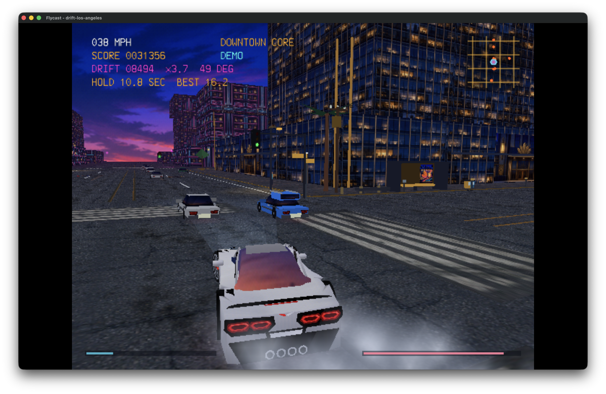
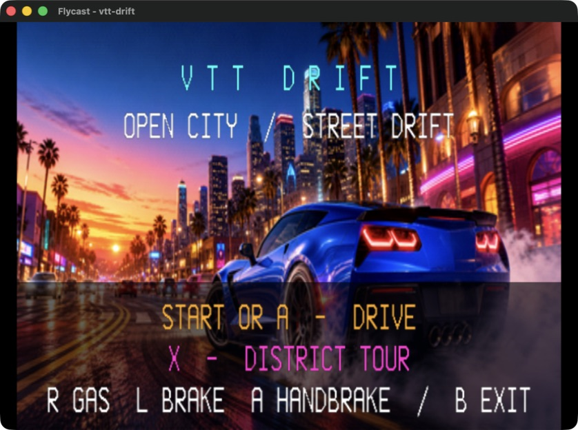
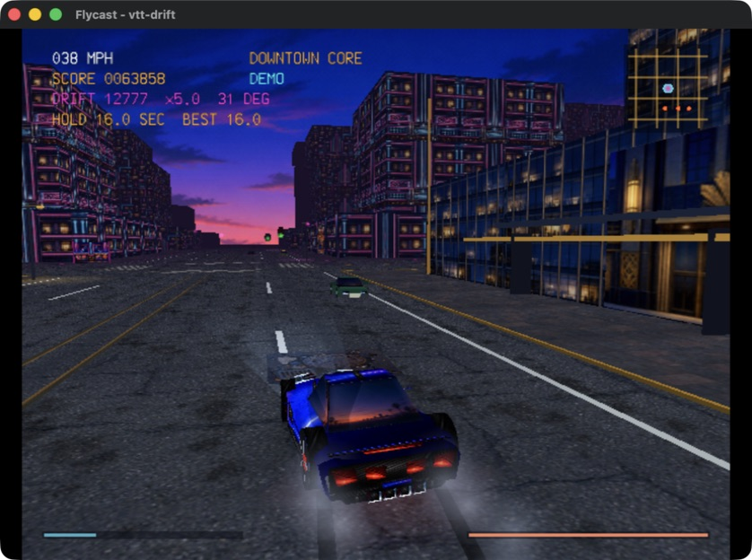
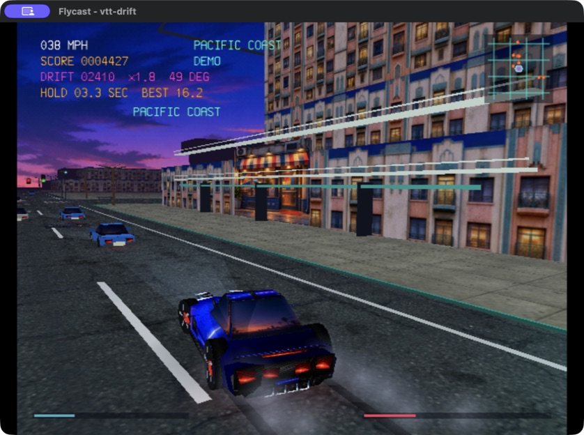
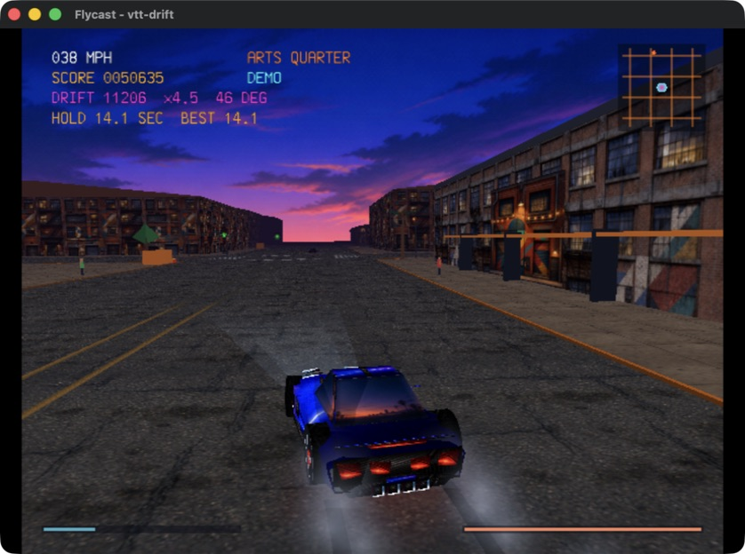
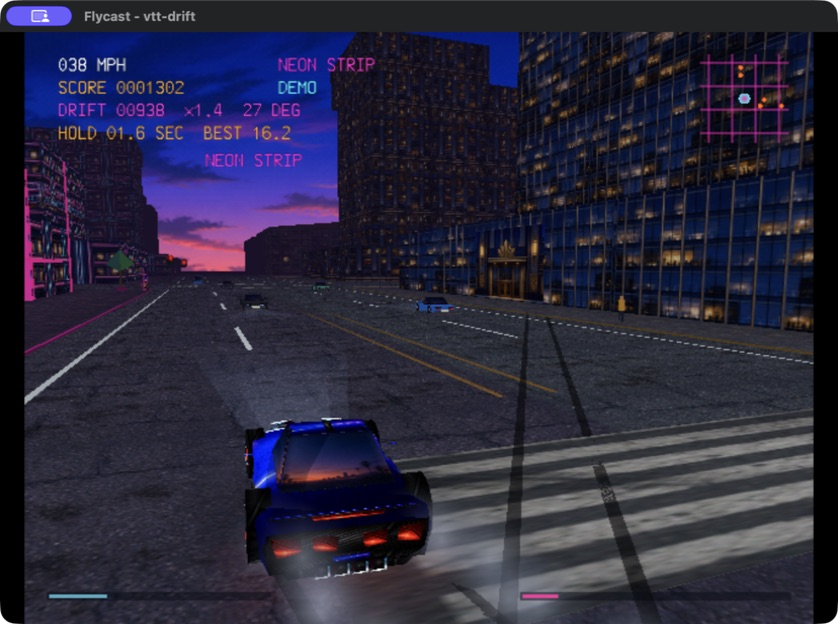
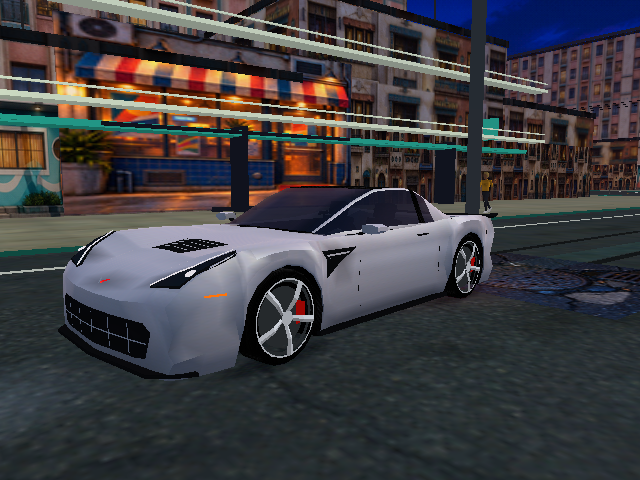
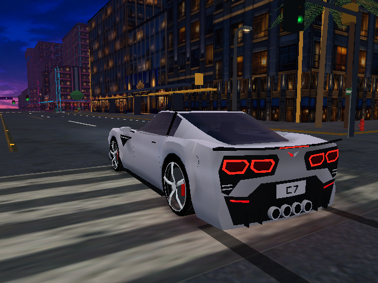
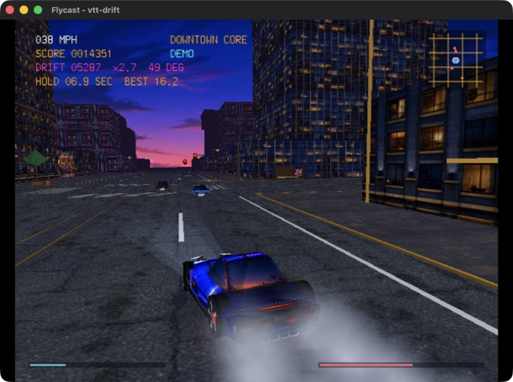
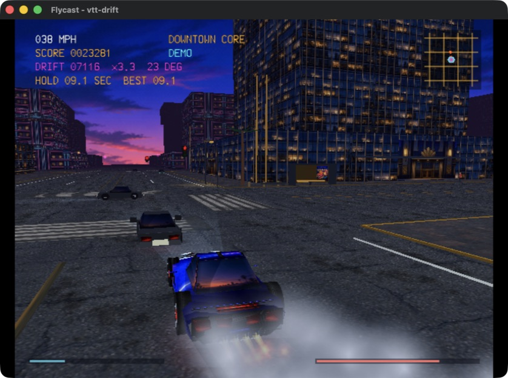

# Drift Los Angeles

<p align="center">
  
</p>

Drift Los Angeles is an original open-city street-drifting game for the Sega
Dreamcast, built with KallistiOS. Drive a C7 Corvette through an endless,
deterministic Los Angeles-inspired street grid at blue hour, link drifts
between the boulevards and bank score chains.

## Download

Download the latest **[self-booting CDI](https://github.com/richstokes/dreamcast-homebrew/releases/latest/download/drift-los-angeles.cdi)**
for Flycast or GDEMU. A direct-load [ELF](https://github.com/richstokes/dreamcast-homebrew/releases/latest/download/drift-los-angeles.elf) is also available.
If you are burning a physical CD-R, you may want to try the padded
[CD-R image](https://github.com/richstokes/dreamcast-homebrew/releases/latest/download/drift-los-angeles-cdr.zip) instead (unzip before burning).

## Highlights

- Endless streamed city with four districts (Downtown Core, Pacific Coast, Arts Quarter, Neon Strip) and no loading screens
- Drift physics with throttle oversteer, clutch kicks, handbrake, burnouts and donuts, scored through a six-times chain multiplier
- Lane-following traffic, parked cars and articulated pedestrians, all with solid collisions
- Lofted C7 Corvette with working lights, steering and wheels, and a modelled cabin behind translucent glass
- Recorded V8 and tire audio plus an original three-track 1980s-style synth soundtrack
- Title screen, automated demo tour, pause and controller hot-plugging

## Screenshots



| Downtown Core | Pacific Coast |
| --- | --- |
|  |  |

| Arts Quarter | Neon Strip |
| --- | --- |
|  |  |

| C7 Corvette, front | C7 Corvette, rear and brake lights |
| --- | --- |
|  |  |

| Layered drift smoke | High-RPM exhaust burst |
| --- | --- |
|  |  |

## Controls

| Control | Action |
| --- | --- |
| Analog stick or D-pad left/right | Steer |
| R trigger or D-pad up | Accelerate |
| L trigger or D-pad down | Brake / reverse |
| Hold R + L together | Brake-standing rear-wheel burnout |
| Full steering lock + R at low speed | Power donut; modulate R to balance its radius |
| Hold A | Handbrake; rapidly locks the rear tires and pivots the car |
| Tap X with throttle | Clutch kick; dumps a short torque/rev pulse into the rear tires |
| B | Toggle close/wide chase camera |
| Y | Reset to the starting boulevard |
| Start | Pause / resume |

On the title screen, Start or A begins, X launches the automated four-district
demo tour, and B exits. In the demo, Start or A takes control and B returns to
the title. From the pause screen, B returns to the title.

## Build and run

```sh
source "$HOME/.local/share/dreamcast/kos/environ.sh"
make                # fetches the latest SH4ZAM master, then builds drift-los-angeles.elf
./run-flycast.sh    # builds and launches; --skip-build launches the existing ELF
make showcase       # hands-off tour that changes district every 15 s (X on the title screen does the same)
```

The launcher uses a connected gamepad, or the keyboard when none is present,
without changing saved Flycast preferences. Force one with `--input gamepad`
or `--input keyboard` (or `DRIFT_LA_INPUT`). `KOS_ENV` and `FLYCAST_BIN`
override the installed KOS environment and Flycast binary.
`DRIFT_LA_EXIT_ON_LOG` and `DRIFT_LA_FAIL_ON_LOG` stop the launcher when a
serial line appears; the QA targets use them.

Beyond KOS and Flycast: every `make` clones or fast-forwards
[SH4ZAM](https://sh4zam.com/) into the ignored `third_party/sh4zam` checkout
(see [third_party/SH4ZAM.md](third_party/SH4ZAM.md); `DEBUG=1` keeps its
asserts). The asset generators need `uv`, and the mesh targets need `blender`
(`BLENDER=` overrides the binary). All generated assets are checked in, so a
normal build needs neither.

## Regenerating assets

Rerun the matching target after changing a source. Keep geometry and art edits
in the generators, not the generated files, so the target reproduces them.

| Target | Regenerates |
| --- | --- |
| `make textures` | `assets/generated/texture_assets.{c,h}` from `assets/source/`; runs `architecture` and `effects` first. ImageGen prompts are in `assets/PROMPTS.md` |
| `make architecture` | Upper-wall, storefront and cornice crops in `assets/source/` from the source paintings |
| `make effects` | Smoke, contact-shadow, headlight and palm alpha sprites in `assets/source/` |
| `make audio` | Engine and tire loops in `assets/generated/audio_assets.{c,h}`, plus `music`; a preview sweep lands in `assets/generated/previews/` |
| `make music` | Renders the three songs and packs `assets/generated/music_asset.*`; WAV previews in `assets/generated/previews/soundtrack/` |
| `make model` | `model_data.h` (player car) through Blender; pass `--blend` and `--preview-dir` to `tools/build_car_blender.py` to keep a scene and previews |
| `make vehicles` | `assets/source/vehicle-atlas.png` and `vehicle_data.h`; then `make textures` |
| `make props` | `assets/source/prop-atlas.png` and `prop_data.h`; then `make textures` |
| `make pedestrians` | `assets/source/pedestrian-atlas.png`, `pedestrian_data.h` and a Blender contact sheet; then `make textures` |

Texture pipeline notes are in [assets/README.md](assets/README.md); audio
source links and licenses are in
[assets/source/audio/README.md](assets/source/audio/README.md).

## QA

The Flycast targets clean and rebuild with QA defines first. Run
`make clean && make` afterwards to get the playable build back.

| Target | Checks |
| --- | --- |
| `make qa` | Asset audit: car mesh limits and texture inventory (`tools/visual_qa.py --strict`) |
| `make qa-tools` | Host tests for the log parser, mesh audit, PVR texture packing and geometry-log compare |
| `make qa-run` | 60-second four-district tour with telemetry |
| `make qa-benchmark` | Same tour; exits when the aggregate arrives and checks the 30 FPS average. Log and JSON land in `assets/generated/previews/visual-qa/` (`QA_LOG=` overrides) |
| `make geometry-qa-run` | Fixed 30 Hz tour printing whole-tour triangle/vertex totals; compare runs with `uv run tools/compare_geometry_logs.py before.log after.log` |
| `make physics-qa-run` | Burnout and donut regression; also fails if anything took the engine or tire loops' reserved AICA channels |
| `make collision-qa-run` | Lamppost, parked car and pedestrian impacts register, nothing is passed through, the pedestrian is launched and comes to rest |
| `make math-qa-build` | Builds `render-math-qa.elf`; boot it and look for `Render math QA: PASS` |
| `make visibility-qa-build` | Builds `render-visibility-qa.elf`; boot it and look for `Render visibility QA: PASS` |
| `make qa-capture-run`, `make qa-visual` | Per-district captures (`QA_SEGMENT=`) and a contact sheet with report |

Check an existing benchmark log with `uv run tools/analyze_render_log.py run.log`.
It needs the aggregate line and at least 30 measured seconds; periodic FPS
samples alone do not count.

## Performance

Every figure is the 60-second four-district Flycast tour (`make qa-benchmark`,
game audio on, Flycast null audio backend). Real Dreamcast hardware has not
been measured. [PERFORMANCE.md](PERFORMANCE.md) has the per-step SH4ZAM,
submission, visibility and hero-car tables.

| Date | Change | FPS avg | Peak tris | Textures + HUD / free VRAM |
| --- | --- | ---: | ---: | --- |
| 2026-09-23 | Before the graphics upgrade | 27.20 | | |
| 2026-09-23 | Graphics upgrade | 32.00 | | 3,965,248 / 1,144,648 bytes |
| 2026-09-23 | SH4ZAM, store-queue submission, referenced-vertex shading, visibility fix | 47.97 | 6,841 | unchanged |
| 2026-09-24 | Articulated pedestrians (256x256 mipmapped atlas, up to ~480 tris per close figure) | 46.54 | 7,014 | |
| 2026-09-24 | Lofted traffic (second 256x256 atlas), per-lot street walls, car cabin | 37.13 | 7,312 | |
| 2026-09-25 | Static block cache, textured street furniture, baked vertex lighting | 35.63 | 7,984 | 4,489,600 / 620,200 bytes |
| 2026-09-26 | Hero car rebuilt (3,811 to 2,296 vertices) | 37.91 | 7,497 | unchanged |

- 30 FPS is an average target, not a floor; sampled intervals dip below it
- Free VRAM is after the 768 KiB PVR vertex buffer. At the block-cache build the ELF was 14.4 MB, 3.6 MB of it the cache
- Of the SH4ZAM-era gain, most came from shading only car vertices referenced by front-facing faces (37.6 to 47.9 FPS); the FTRV/FSRRA math itself was worth ~2.5 FPS
- The hero car gain is entirely the player phase (6.11 to 4.89 ms); city, pedestrian, vehicle and translucent phases did not move

## Lessons learned

- KOS `snd_sfx_play()` hands out channels round-robin and skips only reserved ones, so a loop on an unreserved channel gets replaced by a later one-shot, which the loop's UPDATE commands then retune. The engine and tire loops reserve adjacent pairs with `snd_sfx_chn_alloc()`; every build reads the channels back every 60 frames and prints a `BUG` line if one was taken
- The texture arrays are pre-twiddled. Upload them with `pvr_txr_load`; `pvr_txr_load_ex` would twiddle them a second time
- `-fno-math-errno -ffinite-math-only` on the game object only lets GCC inline `fminf`/`fmaxf` (33 to 44 FPS in Flycast). The QA tools build without it so their `isfinite()` checks are real
- Flycast's JIT does not reward FTRV or FSRRA over scalar math, so emulator numbers say nothing about SH-4 math wins or losses. Measure on hardware before claiming either
- The tire recording is a 1.3 s one-shot with a swell and a fade. Looping it directly re-plays the swell every cycle, so `make audio` re-sequences its sustained core into a stationary loop and rejects any loop whose slow loudness envelope swings more than 1.15:1
- The render pass owns XMTRX. Anything that loads another matrix during it must reload the camera rotation before drawing
- Make does not rebuild when CFLAGS change. `make clean` after switching QA defines or `DEBUG=1`
- Texture bytes are an inventory, not a budget: the 8 MiB of VRAM also holds framebuffers, the vertex buffer and tile bins. `make qa-benchmark` reports what is left after allocation

## Known limitations

- Performance has only been measured in Flycast; real Dreamcast timing is unverified
- The 30 FPS target is a whole-run average and individual intervals fall below it
- `make geometry-qa-run` deliberately omits the benchmark aggregate, so its logs fail `analyze_render_log.py`

## Credits

Powered by [KallistiOS](https://kos-docs.dreamcast.wiki/), the independent Sega
Dreamcast SDK. KallistiOS is distributed under its BSD-like KOS license and
requires attribution. Renderer maths uses [SH4ZAM](https://sh4zam.com/) by
Falco Girgis and contributors (MIT License).

Recorded engine audio uses [“Eight-cylinder engine idling.wav” by
Lumamorph](https://freesound.org/people/Lumamorph/sounds/636066/) under CC BY
4.0 and [“Hot-Rod-V-8-BigSpchg-RoughIdle-RevUps-IdleDR025-30sec.wav” by
Ears68](https://freesound.org/people/Ears68/sounds/144454/) under CC BY 3.0.
The tire recording is [“Distant car tire screetch” by
Sadiquecat](https://freesound.org/people/Sadiquecat/sounds/737192/) under CC0.
The soundtrack (“Blue Hour Boulevard”, “Pacific Coast Highway” and “Neon
Strip”) is original to this project, composed and synthesized in
`tools/compose_soundtrack.py`. Source links, hashes and licenses are in
`assets/source/audio/README.md`.
