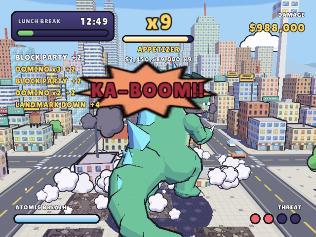

# Kaiju Lunch Break

<p align="center">
  
</p>

> **Very early prototype.** This is a work in progress: expect the controls,
> balance, look and save format to change, and expect rough edges. It has
> only been played in Flycast so far, not on a console.

A city-flattening score attack for the Sega Dreamcast. You are a kaiju with
one hour for lunch (three minutes on the clock) and a whole island city to
get through. Everything comes down: houses crumple underfoot, office blocks
sink into their own dust, and the towers come apart a chunk at a time until
what is left topples like a tree and takes whatever it lands on with it.

- A new city every lunch: 441 blocks and about 3,100 buildings. Downtown
  has a 228 m tower, a TV mast and a donut shop; round it, districts that
  turn a different way each time: an uptown of spires, an old town of
  terraces with a pagoda, suburbs with a stadium, and industry with
  factories, chimneys, tank farms and a container port with cranes
- Comic-book look: hard two-tone shading, ink outlines on everything,
  halftone shadows and a KRAKOOM! over the big hits
- Traffic, crowds that run for it, a news helicopter, then the army, which
  goes by the damage done: a tank at $250 million, gunships from $1.5
  billion, jets at $8 billion
- Overtime: a $100 million bill (the running combo counts) when the bell
  goes buys two more minutes, once a lunch
- The bill is in dollars and your best one is kept on the VMU; with two
  saves, or a full first card, it asks which card on the title

## Download

Download the latest **[self-booting CDI](https://github.com/richstokes/dreamcast-homebrew/releases/latest/download/kaiju-lunch-break.cdi)**
for Flycast or GDEMU. For a CD-R, use the
[CD-R image](https://github.com/richstokes/dreamcast-homebrew/releases/latest/download/kaiju-lunch-break-cdr.zip)
instead (unzip before burning). There is no ELF download: the music is CD
audio on the disc.

## Controls

| Button | Does |
| --- | --- |
| Stick | Walk (into a building to shoulder it down, into the sea to wade) |
| A | Claws (tap again for the other arm) |
| X | Tail spin: everything round you |
| B | Jump and stomp; land on a building to flatten it |
| Y (hold) | Atomic breath, while the meter lasts |
| R | Chomp: eats the nearest vehicle or helicopter, refills the breath |
| R (hold) | Grab instead: a vehicle, a helicopter, a person, a tree, or a chunk out of a building; let go to throw it. While you carry it, the arc shows where it will land, and it locks on to a helicopter or building ahead |
| L (hold) | Charge: through anything under 26 m, head first into anything over |
| D-pad up | Roar: refills the combo timer once a combo, backs the helicopters off |
| D-pad left/right | Turn the camera |
| Start | Pause (the menu has MUSIC and SHOW FPS switches) |

## Chunks

Buildings over 32 m are stacks of chunks. A hit knocks out the ones nearest
where it lands: claws at shoulder height, the tail and a stomp at street
level, the breath wherever the beam goes in. The pieces fly off, break
what they land on, and anything left hanging drops. The building stands
until a whole band of it has gone or less than half is left. Chunks pay
into the combo's pot and add time to its clock without lengthening the
chain.

## Combos

Anything you destroy joins a chain. While the chain's timer runs its damage
goes in a pot, and when the timer runs out the pot is banked times the
multiplier. The multiplier climbs one for every eight things in the chain,
and a trick counts as two or more:

| Trick | For |
| --- | --- |
| DOMINO, TIMBER! | A tower landing on another building; felling one over 100 m |
| BELLY FLOP, SHOCKWAVE | Jumping on to a building; three or more down in one stomp |
| SKYLINE SLICER | Three or more with one breath |
| CHAIN REACTION | Tanks at the tank farm setting each other off |
| BLOCK PARTY, LANDMARK DOWN | The last building of a block; the tower, the mast or the donut shop |
| PANCAKE, HOME RUN, SPECIAL DELIVERY | Stepping on a vehicle; three launched with one tail spin; a vehicle or a thrown chunk landing in a building |
| FAST FOOD, PACKED LUNCH, TANK YOU, IN-FLIGHT MEAL, BREAKING NEWS, DESSERT! | Eating a car, a bus, a tank, a helicopter, the news helicopter, the giant donut |
| SWATTED, TOP GUN DOWN, AIR MAIL | Clawing a helicopter; hitting a jet with the breath; throwing a vehicle into a helicopter |
| BULLDOZER, TSUNAMI | Four or more flattened in one charge; four or more by the wave from a stomp in the sea |
| MIX-UP, FULL COURSE MEAL | Four, then seven, different kinds of destruction in one chain |

A trick pays in full three times a chain, then every third time, and the same
attack more than six times running stops building the chain, so mix it up.
Getting shot takes 0.9 s off the timer.

## Build and run

One-time setup (KOS, Flycast) is in the [root README](../../../README.md#one-time-setup).

```sh
source ~/.local/share/dreamcast/kos/environ.sh
make                 # kaiju-lunch-break.elf
./run-flycast.sh     # build, press a disc image with the music and boot it in Flycast
make disc            # kaiju-lunch-break.cdi
make hw              # on the console; see the root README's "Real hardware"
```

| Target | Does |
| --- | --- |
| `make textures` | Paints the textures and font (`tools/build_textures.py`) |
| `make models` | Builds the kaiju's parts, vehicles and props (`tools/build_models.py`) |
| `make audio` | Synthesizes the sound effects and packs the voice lines (`tools/build_audio.py`; needs ffmpeg) |
| `make music` | Fetches the songs and cuts them to CD audio tracks in `cdda/` (`tools/build_music.py`; needs ffmpeg) |
| `make autotest` | A bot plays 45 s of lunch in Flycast and logs frame times; `EXTRA_CFLAGS=-DKL_AT_SECONDS=180` for a whole one |
| `make capture` | The same with screenshots in `captures/` |
| `make vmutest` | The save written and read back on blank Flycast cards |
| `make film` | Trailer footage: the scripted scenes in `src/film.c` recorded through OBS; `FILM_PICK=3,7` for some of them |

The music is three CD audio tracks, played as a shuffle, so the game is a
disc: a bare ELF runs without it, and under dcload (`make hw`) there is none
unless `MUSIC=1` and a Kaiju Lunch Break disc is in the drive. The mp3s are not in git;
`make music` downloads them, or set `KL_MUSIC_SOURCE` to a folder that
holds them.

## Performance

Flycast only so far; not yet run on a console.

| Scene | CPU a frame (Flycast) |
| --- | --- |
| Mid-rampage, 21 blocks a side | 7 to 10.5 ms |
| The same at 11 blocks a side (`CITY_N` in `src/city.h`) | 7 to 9 ms |

## Lessons learned

- Sending a strip costs about as much as a dozen of its vertices. Culling
  hidden walls took 40% of the triangles out and 13% of the time; joining
  each far building into one strip is what paid
- A box shows two walls at most, and its ink shell only matters on the
  walls facing away, so both halve by comparing the camera with the
  footprint. No back-face test per triangle
- The street ground was 2,000 strips at 21 blocks a side, 3.8 ms on its
  own. Squares of 3x3 crossings with one joined strip a texture halved it
- The building vertex pool is most of the RAM: about 340,000 vertices,
  8 MB. Low buildings keep one far strip of every wall instead of one
  for each quarter, and houses, sheds, containers and the like draw that
  strip close up too, with nothing else kept. That took ~100 vertices a
  building and sends fewer strips
- Smoke, impact stars and trees are punch-through, not translucent: they
  keep an inked edge, need no sorting and leave by shrinking

## Known limitations

- Buildings are boxes, and what is left of a tower falls in one piece
- The camera comes in close among the tallest towers, and inside 32 m a
  tower can still stand in the way
- Buildings under 36 m are not drawn past 480 m, which shows as a bare
  belt from high up (not from the game's camera)
- Not benchmarked on real hardware

## Credits

Lilita One (SIL Open Font License) for the lettering. The voice lines
are generated clips (`assets/voice/`). Everything else,
sound effects included, is generated by the scripts in `tools/`.

Music by nickpanek, from Pixabay (Pixabay Content License): "Intense Anime
Metal Brostep with Chiptune Elements", "Sore Knuckles" and "Slaphammer
Mayhem".
