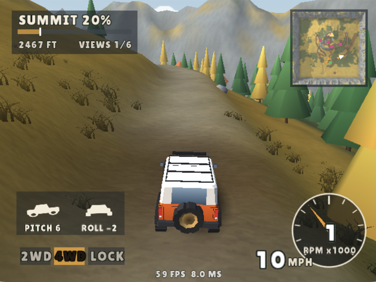

# Ridgeline

<p align="center">
  
</p>

An off-road exploration game for the Sega Dreamcast. Pick a truck and an
area and climb it: Cascade Ridge, a Pacific Northwest mountain in autumn,
from the meadow at its foot to the fire lookout on the summit; Mesa
Grande, red rock canyon country, from the sand flats by the river to a
slab of rock hung out over the drop at the top; Moses Lake, the sand
dunes of the Columbia Basin, from a camp on the lake shore to the crest of
the biggest dune there is; or Loch Lowland, a Highland pass, from the bothy
on the loch's shore up a corrie to the mast above the cloud. No race and
no clock: how high you've been, and the viewpoints you've found.

- Seven vehicles, four liveries each: CASCADE 84, an early-80s pickup (2.4 L
  four, no traction control); KESTREL, a modern two-door 4x4 (twin-turbo V6,
  35 inch tyres, traction control, off when the lockers are in); BOBCAT, a
  short two-door with the top off and a roll cage (4.0 L straight six, no
  traction control, a 4:1 transfer case); FFR, a mid-90s
  extended-cab pickup with a long bed (3.0 L V6, steady at speed but
  beaches on sharp crests and turns wide); TACO, a 2026 double-cab
  pickup (2.4 L turbo four, eight-speed automatic, traction control, a
  long 3.35 m wheelbase); GOOSE, a four-seat sport side-by-side at
  half the trucks' weight (900 cc turbo triple that revs to 8000, half a
  metre of wheel travel, the grippiest tyres and the longest wheelbase
  here); and ONE TEN, a mid-80s British long-wheelbase station wagon
  (3.5 L carburettor V8 and not much of it for two tonnes, coil-sprung
  live axles with long travel, tall on a narrow track, a wide turning
  circle, right-hand drive)
- Cascade Ridge: three ways up from the fork, meeting at a lake before the
  summit trail: the logging road (long, gentle, gravel then muddy ruts and
  fallen logs), the creek bed (water crossings, mud, wet rock) and the
  ridge line (steep, rock ledges, boulders). Each gets harder the higher
  it climbs. A meadow at the bottom to play in first: a creek ford, a
  pond, a mud wallow, logs and a rock pile
- Mesa Grande: three tiers of sandstone over a river, and three ways up
  the first two that meet under an arch: the rim road (graded dirt,
  switchbacks up the talus where each cliff has fallen in), the fins
  (straight up the spines of two sandstone fins, steep and bare, on rock
  with the grip for it) and Bighorn Canyon (up the wash into a canyon:
  sand, boulders, ledges at every pour-off). From the arch a shelf road
  crosses the mesa's cliff and ledges lead over its top to the overlook,
  with a river in a gooseneck far below. The flats at the bottom are the
  playground: a baby fin to drive over, potholes in the slickrock (one
  full of water), a sand hill, the wash, a beach on the river (which is
  deeper than it looks). Where a trail crosses bare rock it is marked as
  the real ones are: two black lines of tyre rubber and dashes of white
  paint, and each way up has its rating on a post (green circle, blue
  square, black diamond)
- Moses Lake: a field of grey basalt sand between a reservoir full of
  drowned dunes and a rim of black basalt, the wind out of the south-west
  as it is there: every dune a long back up to a crest and a slip face
  down the far side. Three ways across it to the rimrock: the shore road
  (packed sand along the inlet and its marsh, then a graded climb through
  sagebrush), the powerline (the service track under the wires: down the
  troughs, over a row of whoops and the saddles, loose on every climb)
  and the razorback (along a dune's crest, down its slip face into a
  bowl and out again, deep sand most of the way). From there one line
  climbs the king dune. Sand comes three ways: packed and damp, as good
  as a road; loose; and deep, on the slip faces, the crests and in the
  bowls, where the tyres sink to the rims. A tyre crossing a slip face
  sets the sand below it sliding, and a line of prints stays on a dune
  for minutes, wearing away gust by gust, first off the side the wind
  is on. The flats by the camp are the
  playground: barchans, a punch bowl, a drag strip, the mud flats and
  their wallow, a bar to wade out to an island
- Loch Lowland: a corrie cut back into a Highland plateau over a long loch
  (after the Bealach na Bà), and three ways up it that meet on the pass:
  the drove road (the old single-track road: a stone bridge, a shelf
  under the crag with passing places, hairpins up the corrie's head), the
  peat road (through the pines, up into a hanging corrie, round its
  lochan through the peat, a rake up its back wall and over the moss
  along the crag's edge) and the Devil's Staircase (up the corrie's floor
  by the burn's fords, the boulders and a rock bar, then ramps of bare
  rock up the head wall). From the pass the mast track climbs the ridge
  to the top. The ground by the loch is the playground: the beach and
  its shallows, a jetty to drive out on, a causeway just under the water
  to the crannog, a peat bog, hummocks the ice left, the burn's ford
- Physics: suspension per wheel with ledge-climbing tyre contact, tyres
  that slide by surface (rock, dirt, gravel, grass, mud, scree, snow, wet
  rock, sand, slickrock, packed sand, deep sand), water with drag and a stall if it reaches the intake, an automatic
  box, and the driveline solved per drive mode: 2WD with an open rear diff,
  4WD with the centre locked, LOCK with low range and both axles locked.
  Low range holds the automatic to the gears that redline under ~30 mph
  (2nd in the pickups, ~22 mph; 4th in the Kestrel, ~28 mph; 3rd in the
  Bobcat, ~22 mph; 2nd in the Taco, ~22 mph; 3rd in the Goose, ~27 mph; 3rd in the One
  Ten, ~28 mph)
- 2WD is the loose one: nose-heavy trucks (the pickup ~60% front) with a
  limited-slip rear, so the tail comes round under power and a spinning
  tyre gives up its cornering grip. Feed it on the progressive throttle and
  catch it with opposite lock. Traction control on the Kestrel and the Taco reins it in
  (in 2WD and 4WD) until you hold D-pad left to switch it off
- A spinning tyre flings a roostertail of whatever it's in (mud clods,
  dirt, stones, snow, spray), and the rear tyres leave tread tracks in soft
  ground
- Things to find off the trail: on Cascade Ridge ten viewpoints, among them a boulder
  field, a stone arch across a deep ford the old pickup can't wade, an
  abandoned truck in the woods and a camp past the lake, where a fire
  burns and lights the tent, the trees and your truck after dark. Lanterns
  hang on the summit lookout and at the start: on the cabin, the picnic
  table and a post by the grid. The logging road
  has a washout, a log bridge and a steep shortcut that skips ~480 m of it.
  On Mesa Grande sixteen: goblins, a balanced rock, the hot tubs, a camp
  under the cottonwoods, an old truck where a mine road gave out and the
  mine it hauled from in the cliff above (an ore cart still on its
  rails), a panel of petroglyphs in the canyon, a dinosaur's tracks
  across the slickrock, a line cabin under the wall with its lantern lit
  at night. At Moses
  Lake fifteen, a whip flag by each: a grove of Russian olives a dune is
  burying, a pond in the cattails, the truck that never got out of the
  bowl. On Loch Lowland fifteen: standing stones on the headland, the
  crannog, a shieling's ruin, the falls under the head wall, the crag's
  edge, a camp by the lochan north of the pass
- In the desert: junipers and pinyons on the benches, cottonwoods gone
  gold along the water, sagebrush, blackbrush and rabbitbrush on the
  flats, tumbleweeds bowling across them in the gusts and a dust devil in
  the heat of the day, mesas along the skyline and one snowy range. The
  country carries on past the map's edge for 770 m, to look at from the
  top: mesas and buttes on the low desert, the river out of the gooseneck
  winding straight into another, a canyon into the upland
- In the dunes: sagebrush and rabbitbrush in flower on the old dunes,
  ricegrass out on the sand, cattails in every pond (potholes, where a
  trough between two dunes reaches the water table), Russian olives and
  willows wherever roots reach water. A powerline's H-frames march from an
  island in the lake over the dunes, ravens on the crossarms, and white
  pelicans raft on the water until a truck comes too near. Every truck
  carries a flag on a whip that lays back as it pulls away and quivers
  after a landing, and after dark the whips are lit, a colour to a rig.
  The camp has quads and a sand rail parked by the trailers; at night
  there are lights in the windows of the ones someone is in, a lantern
  under each awning and a second fire with chairs round it. In a gust
  the crests smoke with blown sand, and tumbleweeds cross the flats. Past the map the reservoir runs on to the
  south, the dunes west, and on the bench the irrigated circles; the
  Saddle Mountains and their gap on the skyline, the Cascades and one
  white volcano far to the west
- In the Highlands: Scots pines, birches gone gold and rowans, heather
  still in flower, bracken and bog cotton, Highland cattle by the fank,
  blackface sheep at the corrie's mouth and red deer among the hummocks.
  Mist that never quite leaves the loch, cloud banked on the summit ridge
  with the mast's red light above it, and the loch a sheet of the sky's
  light from the pass. The loch carries on past the map to its far
  shore, hills behind it, and north of the pass a glen runs down to a
  sound with islands in it
- Showers on Loch Lowland, three a day by the clock (so a lobby is rained
  on together): about 08:00, after 13:00 and after 21:00, clear of the
  sunrise and the sunset. The light goes grey and flat, the far side of
  the corrie and the hills past the loch go into the murk, the ground
  darkens and takes an hour or so to dry; rain slants down the wind,
  rings spread on the lochs, and at night it falls through the
  headlights. It is heavier up at the pass, and inside the cloud on the
  tops there is always a drizzle
- Best times to the summit per area, truck and way up (or your own way),
  saved on the VMU and shown on the truck select. A viewpoint jump from
  the pause menu means no time for that run
- Deer in the meadows that graze, look up as you come near and bolt when
  you get close or sound the horn
- Up to three CPU trucks for company, each taking its own route up, then
  back down another way and up again for as long as you stay out
- Online: twelve lobbies of four, three on each area, by broadband adapter,
  W5500 or modem (a DreamPi or any dial-up server). Drop in and out
  whenever you like; there is no race. Everyone's name floats over their
  truck, horns carry, the lobby shares one time of day, and reaching the
  summit puts a trophy by your name for the session. Ten minutes idle
  (no driving, horn or lights) takes you out of the lobby
- Birds: jays, juncos and ravens perched on logs, rocks, the cabin roof
  and the cairns burst away as a truck comes near (or at the horn), hawks
  circle over the meadow and the bluffs, and now and then a V of geese
  crosses the sky. Leaves come down from the larches and maples, dust
  motes hang in the forest light, fireflies come out over the meadow
  after dusk and snow blows about the summit. Near trees carry painted
  brush strokes
- A day that goes by as you drive, an hour a minute: first light, sunrise
  mist, noon, the long afternoon shadows, sunset, dusk and a starry
  moonlit night, the hills' shadows swinging round with the sun, and the
  haze warming toward a low sun. Mist lies in the valleys at dawn and
  dusk, and the water ripples downstream, foams at the falls and fords
  and catches the sun. A cap of cloud sits on the upper
  mountain, thick in the morning and the evening and thin by early
  afternoon: the summit trail climbs through it and out above it. Pick
  when to set off on the truck select (dawn, morning, afternoon, dusk or
  night); photo mode moves the clock with the D-pad. Headlights are yours
  to switch: off, dipped or full beam (which lights the Kestrel's roof bar),
  and the beams carry through the air at night and in the cloud and light
  up the trees, rocks, cabins, grass and other trucks they reach. The low
  sun glints off paint and glass
- Synthesized engine sound from four rpm points on and off load, tyres,
  wind, the forest and the creek. No music
- Sound test from the main menu: every effect by name, loops toggle on A,
  left/right changes the pitch
- The VMU screen: the mountain in the menus; while driving an
  inclinometer (side and rear views of the truck in degrees) over the
  altitude and drive mode, and a screen for each viewpoint and the summit
- Leave the title alone for ten seconds and a demo runs: four CPU trucks
  set off up the mountain and the camera cuts between them every few
  seconds, chase, helicopter and trackside shots, until a button is pressed

## Download

Download the latest **[self-booting CDI](https://github.com/richstokes/dreamcast-homebrew/releases/latest/download/ridgeline.cdi)**
for Flycast or GDEMU. A direct-load [ELF](https://github.com/richstokes/dreamcast-homebrew/releases/latest/download/ridgeline.elf) is also available.
If you are burning a physical CD-R, you may want to try the padded
[CD-R image](https://github.com/richstokes/dreamcast-homebrew/releases/latest/download/ridgeline-cdr.zip) instead (unzip before burning).

## Controls

The same list is under CONTROLS on the main menu.

| Input | Does |
| --- | --- |
| Analog stick | Steer |
| R / L trigger | Throttle / brake; hold L at a stop to reverse |
| D-pad left / right | Drive mode: 2WD, 4WD, LOCK (low range goes in or out only below ~8 mph); hold left 2 s to switch traction control off or on (Kestrel, Taco) |
| D-pad up | Horn |
| D-pad down | Lights: off, dipped, full beam |
| A | Handbrake |
| B | Camera: chase, far chase, bumper |
| X | Map: corner, large, off |
| Y (hold) | Recover the truck to the nearest trail |
| Start | Pause: recover, back to a viewpoint you've found (left/right picks which), FPS counter, HUD on/off, quit |
| Y (paused) | Photo mode: no HUD, the stick turns the camera round the truck, R/L zoom, D-pad left/right moves the clock, B back |
| Start (online) | The menu, over a mountain that keeps going: recover, viewpoints, leave the lobby. The lobby keeps the clock |

## Build and run

Set up KOS and Flycast as in the [root README](../../../README.md#one-time-setup).

```sh
make -C projects/games/ridgeline run
```

| Target | Does |
| --- | --- |
| `make` | Builds `ridgeline.elf` |
| `make run` | Builds and boots it in Flycast |
| `make autotest` | The CPU drives the player up the logging road with three companions, logging frame times every 10 s; passes at the summit, fails after 120 s without progress or 900 s in all. `EXTRA_CFLAGS=-DRL_AT_AREA=1` for Mesa Grande, `=2` for Moses Lake, `=3` for Loch Lowland, and `-DRL_AT_RAIN=0.9f` for a shower the whole way (any test build takes them) |
| `make vmutest` | The best-times save on eight blank Flycast cards (never the real ones): a time and the online name save and read back, a slower time doesn't replace it, and each area keeps its own |
| `make online-test` | Online in Flycast against a server and bot on this Mac: joins lobby 3, sees the bot's truck, both claim the summit, the bot leaves and comes back. `RL_NET=modem` dials in instead, `RL_QA_LIVE=1` uses dcvmu.com, `RL_QA_LOBBY=5` joins a Mesa Grande lobby, `=8` a Moses Lake one, `=11` a Loch Lowland one, `RL_BOT_TRUCK=3` puts the bot in an FFR ([server/README.md](server/README.md)) |
| `make hwbench` | 180 s of the same on the console, as a bench ([real hardware](../../../README.md#real-hardware)) |
| `make hwbench HW_OFF=` then `make hwreport` | When a console bench goes quiet: reads where it stopped out of the console's memory (then `tools/dc-hw.sh power off`) |
| `make fxbench` | Tyre effects on the console: 15 s of driving, then 25 s of wheelspin in the meadow mud |
| `make hw` | Plays on the console |
| `make disc` | A self-booting CDI |
| `uv run tools/capture.py --out captures` | Capture build: title, select, a scenery tour, two views through the day and the drive as screenshots (`EXTRA_CFLAGS=-DRL_AT_TOD=TOD_NIGHT` starts the drive at another hour, `-DRL_AT_TOUR_ONLY` stops after the tour, `-DRL_AT_TOUR_ROUTE=2` makes the tour a drive up that route) |
| `make film` | Trailer footage: the scripted scenes in `src/film.c` (times of day, trucks, cameras, no HUD) recorded through OBS; `FILM_PICK=3,7` for some of them |
| `make -C tools/hostsim && tools/hostsim/sim route <truck 0-6> <route 1-3>` | The truck physics and CPU driver natively on the Mac: a full route in about a second. `SIM_AREA=1` for Mesa Grande, `2` for Moses Lake, `3` for Loch Lowland |
| `tools/hostsim/sim loop <minutes> <trucks 1-4>` | CPU trucks going up and down the mountain for hours of game time in about a minute: logs every arrival, stall, winch and recover, and counts how trucks meeting head on got past |

Assets (generated output is committed):

| Target | Builds |
| --- | --- |
| `make level` | Every area's terrain, routes, obstacles, trees and colours (`tools/build_level.py`; `AREA=cascade`, `moab`, `dunes` or `lowland` for one), previews in `captures/`. Mesa Grande is `tools/level_moab.py` (the land past its map's edge with `tools/outland.py`), which also writes `captures/level-moab-views.png`: the ground from twenty-six cameras, without the game. Moses Lake is `tools/level_dunes.py`, Loch Lowland `tools/level_lowland.py` (it writes `captures/level-lowland-views.png` the same way) |
| `make textures` | Textures and the font (`tools/build_textures.py`) |
| `make trucks` | Truck models (`tools/build_trucks.py`), previews with `tools/preview_trucks_blender.py` |
| `make audio` | Every sound (`tools/build_audio.py`) |

## Performance

`make hwbench` on the console (2026-11-06): the CPU drives the logging road
with three CPU trucks for 180 s, 59-60 fps throughout. 61 of 10,800 frames
late, 35 of them in the first 10 s (title, menus and scenery tour).

| | Console, ms a frame | Flycast |
| --- | --- | --- |
| CPU, average / worst 10 s window / worst frame | 13.0 / 14.5 / 22.6 | 8.5 / 10.0 / 12.9 |
| Terrain | 3.1-4.4 | 2.2-2.4 |
| Trees, rocks, props | 0.7-4.0 | 1.5-2.4 |
| Trucks | 1.4-1.9 | 1.2 |
| Physics, four trucks | 1.3-2.1 | 1.0-1.7 |

| Terrain change (console, same route, 18 windows) | Terrain ms | CPU ms | Late frames |
| --- | --- | --- | --- |
| Before: separate height and colour, wider LOD rings, every skirt drawn | 4.88 | 13.56 | 78 |
| After: interleaved, tighter rings, far skirts only where grids differ | 3.85 | 13.04 | 61 |

The terrain went from ~8,900 to ~5,900 vertices a frame and from ~10,900 to
~7,100 operand-cache misses. Trees came out 0.1-0.15 ms slower in every
window without being touched: code layout drift, as DreamKarts sees between
unrelated builds. The bench logs now carry the PVR's render time too.

`make hwbench` A/B on the console (2026-11-07), before and after the set
pieces, birds, deer, best times and tower fix: no change in the drive.

| 180 s on the logging road | Before (7ffab7d) | After (b0e9190) |
| --- | --- | --- |
| fps, average | 58.9 | 58.9 |
| CPU, ms a frame | 13.18 | 13.02 |
| PVR render, ms | 10.77 | 10.86 |
| Late frames | 144 | 144 |

The bench also times each scenery-tour view; the new set pieces render
in 7.5-13.8 ms. Its occasional single-frame render spikes (35-85 ms, a
different view each run) come with the RL SHOT prints, which stall the
console under dcload.

`make fxbench` (2026-11-07), wheelspin in mud with roostertails and tracks.
The soft haze puffs flung at the camera were the cost (switching each
effect off in turn: puffs off took the render from 19.7 to 11.2 ms; tracks
off, 16.3; clods off, nothing), so puffs got a hard cap of 36, a fade near
the camera and a third of the mud haze.

| Wheelspin in mud, console | PVR render, average / worst | fps |
| --- | --- | --- |
| Before | 17-29 / 24-34 ms | 30-40 |
| After | 11-13 / 15-18 ms | 57-59 |

Tried and dropped (console, 2026-11-07): SH4ZAM's FSRRA divide on the
physics step's 24 variable-denominator divisions, and its atan2f, atanf, tanf
and asinf for the steering. Physics went 1.67 to 1.76 ms with the divides and
1.70 ms with the trig added; the FPU-stall share never moved, so FDIV latency
is not where the time goes. Fewer substeps or less work per step is the lever.

Time of day, `make hwbench` A/B on the console (2026-11-07), the bench
now running from 17:00 through sunset into the night (the stars and the
moon are drawn; the bench's lights are on two thirds of the time):

| 180 s on the logging road | Before (b0e9190) | Time of day |
| --- | --- | --- |
| fps, average | 58.9 | 59.3 |
| CPU, ms a frame | 13.02 | 14.16 |
| PVR render, ms | 10.86 | 11.15 |
| Late frames in the drive | ~110 | 56 |

`make hwbench` again on 2026-11-08 with the 3 m trail grid, the single
headlight beam and the drifting clouds: CPU 14.60 ms a frame (terrain
4.07, up 0.5 for ~500 more terrain vertices a frame; trees 2.77, trucks
1.67, relight 0.81), PVR render 11.36 ms, 59.1 fps, 89 late frames in the
drive. The late frames cluster where the logging road climbs through the
forest past the lake turn (~14,000 triangles, CPU 16-16.6 ms), the one
stretch that now sits on the 60 fps line. With `EXTRA_CFLAGS=-DENG_PROF`
the terrain and tree sections spend ~40% of their cycles stalled on
operand-cache misses (~6,700 and ~7,000 misses a frame), the trucks and
physics ~10-17%; that cache traffic, not arithmetic, is where the frame
goes.

Grass tufts out to 44 m instead of 26 (2026-11-08, `make hwbench` A/B):
the PT pass stayed at ~0.7 ms of CPU, as tufts are now worked out once
per 8 m block and kept, but the PVR render went from 11.4 to 12.3 ms on
average (14.8 worst window). The CPU came out 0.7 ms faster overall,
which is layout drift, not the tufts.

Relighting the world as the clock runs is 0.8 ms a frame (0.6-0.9 in
Flycast): a slice of the 236,000 ground and scenery vertices each frame,
so a whole pass takes ~3.5 s while the sun moves under a degree. A pass
all at once (a clock jump in a test) is ~165 ms on the console, ~115 in
Flycast. The night costs another ~0.9 ms of TR submission, nearly all of
it the four trucks' headlights, which used to be on a third of the time.

Headlights on the trees, rocks and props (2026-11-09, `make hwbench` A/B,
`EXTRA_CFLAGS=-DRL_AT_TOD=TOD_NIGHT` and the afternoon into dusk): the
`lamps=` split is 0.01-0.35 ms most of the drive and 0.5-0.6 ms where the
four lit trucks climb through the forest together. CPU 15.47 -> 15.56 ms
at night and 15.30 -> 15.36 into dusk; late frames 740 -> 825 and
588 -> 685, all in the forest windows that were already the slowest.
Worth another look if those windows get tighter: lighting only the
player's truck should cut the peaks to about a third. Flycast showed the
same shape but doesn't price `fsrra` against a divide. The grass and the
other trucks taking the beams came later the same day: CPU 15.75 ->
15.80 ms at night, PT up 0.04-0.10 ms.

Where a night frame went on the console that evening (2026-11-09,
15.8 ms average, 17.1 on the forest climb, a tenth of the frames late):

| Part | ms | |
| --- | --- | --- |
| Terrain | 4.35 | near tiles 0.98 building and 2.04 submitting, far blocks 0.82, skirts 0.25 |
| Update | 3.7 | physics 1.9, relighting 0.84 |
| Trees | 2.2 | |
| Trucks | 1.8 | |
| Translucent | 1.7 | effects and glows 0.7-1.0, water and sky 0.5, beams 0.26, HUD 0.21 |
| Grass | 0.74 | |
| Rocks and props | 0.58 | |

Two things in it were waste, and fixing them (`make hwbench` A/B at
night, each against the build before it) put the drive back at 60:

| | CPU, ms | Forest climb, ms | Late frames |
| --- | --- | --- | --- |
| Before | 15.72 | 17.13 | 1042 of 10882 |
| Far terrain, rocks, props and water drawn by index | 14.90 | 16.40 | 575 |
| Strips across the screen's edge sent whole | 13.43 | 14.72 | 263 (32 after the first 20 s) |

- The scenery's walk reads every chunk's record on each call. Three
  calls a frame over ~1,300 chunks cost 0.8 ms for the far terrain's
  ~800 vertices alone; the terrain, rocks, props and water now keep
  their own lists, as the trees did already
- A strip whose sphere touches the screen's edge used to be transformed
  into a buffer, tested, then copied out: 5,500 of the ~9,000 strip
  vertices a frame, nearly all then sent whole anyway. With
  `ENG_CROSS_EMIT` (engine `render.h`) those clear of the near plane go
  straight out. The strips that were wholly off screen go to the Tile
  Accelerator too (5-40% more triangles sent), which drops them: its
  vertex buffer and the PVR's render time did not move
- Still there if it gets tight again: tiles round the camera go out
  triangle by triangle (~580 vertices a frame), the near tiles' spheres
  are padded 13 m down for skirts they don't hold, and relighting is a
  steady 0.84 ms

Lighting the trucks' faces was 0.7-0.8 ms a frame for four trucks' ~960
faces, unmeasured until 2026-11-10. Two changes, both in the engine
(`make hwbench` A/B at night: trucks 1.74 -> 1.49 ms, CPU 12.93 ->
12.76 ms, the worst frame of each window 17.6 -> 17.4 ms):

- `eng_mesh_light` keeps each face's colour as floats and takes the
  three channels' light from one `FTRV`, as the GTA III port's lighting
  does: a frame's 963 faces 688 -> 506 us, 805 -> 585 us with a livery.
  Float colours without the `FTRV` were slower than the 8-bit ones
  (tried on the scenery relight: 141 ms a pass became 151, and 126 with
  it, which is 0.07 ms a frame and was left out)
- Each truck keeps its lit colours and is lit again every other frame,
  half the trucks on each, and at once when its lamps, brake lights,
  paint or detail change (`eng_lit_due`)

Textured near trees (2026-11-09, `make hwbench` A/B against that
morning's main): CPU 15.29 -> 14.61 ms, late frames 571 -> 315, PVR
render level. Once textured, trees visibly changed shape as they swapped
detail, so a 48 m cell now picks its trees' version in their own draw:
each 24 m quarter goes near or three-tier middle, so none swaps nearer
than ~53 m. The trees' chunks are kept out of the scenery's other walks,
and terrain came out ~0.5 ms faster in every window for not stepping
over them. The three-tier middle tree all the way to 170 m cost up to
1.3 ms, so past 110 m it is two cones. Four versions of every tree are
~207,000 vertices: the heap tops out at ~14 MB of 16 after boot.

Mesa Grande (2026-11-10, Flycast only): the CPU up the rim road with
three CPU trucks, 7.8-10.0 ms a frame, 9.08 on average (Cascade Ridge
7.5-12.4, 9.57): terrain 3.0, trees 0.7 (it has ~270 of them, not 1,450),
trucks 1.3. The land past the map's edge is ~0.5 ms of the terrain's on
that drive and up to 1.3 ms looking out from the top (700-1,500 vertices
a frame). Before it was checked against the map's skyline it cost 0.9 ms
everywhere, most of it under the cliffs where none of it shows. The tyre
marks and paint are ~4,300 vertices in 46 chunks drawn within 90 m:
0.1-0.35 ms where a slickrock trail is in view, and with the new props
0.16 ms on that drive's average. With both
areas linked in and six vehicles 1.1 MB of the 16 is free after boot (one
area, before: ~0.3): each area's grid packs to ~0.5 MB (it was 1.7), and
the loaded one unpacks into the room the sounds were linked into, which
is spare once the sound chip has them.

Moses Lake (2026-11-10, Flycast only): the CPU up the shore road with
three CPU trucks, 8.0-9.8 ms a frame, 8.44 on average, 25 of 14,403
frames late: terrain 2.5, trees 0.3 (it has ~150 of them), trucks 1.2.
The lake is ~7,900 water vertices, six times Cascade Ridge's: it is drawn
on a 6 m grid past 70 m and a 12 m one past 190 m. In `tools/hostsim` all
eighteen climbs (six vehicles, three routes) reach the top without a
winch, and two hours of four CPU trucks going round (`SIM_AREA=2 sim loop
120 4`) is ~49 summits and no winches (Cascade Ridge: 29 and 99). With
three areas linked ~1.2 MB of the heap is free with it loaded, and ~0.9
MB of the room the textures were linked into.

The camp's lights, the lit whips, the sliding sand and prints that last
(2026-11-11): in Flycast the dune drive is 8.39 ms a frame against 8.60
on the build before. The dunes' tyre prints are rings of up to 1,536
points a wheel, every truck's: walked point by point they cost 1.7 ms on
the king dune, most of it building strips that were then behind the
camera (what was done about that is below).

On the console, each run on the build before all of this and on the one
after (three CPU trucks; `-DRL_AT_SECONDS=300` takes the shore road to the
top and back off it, `-DRL_AT_TOD=TOD_NIGHT` starts in the dark at the
camp):

| ms a frame, before / after | Shore road to the top, 300 s | Razorback, 180 s | Night at the camp, 60 s |
| --- | --- | --- | --- |
| CPU, average | 12.96 / 12.52 | 11.75 / 11.65 | 12.65 / 12.59 |
| The way down from the top | 18.1 / 15.3 | | |
| Late frames | 429 / 60 of ~18,200 | 39 / 36 of ~11,050 | 23 / 15 of ~3,850 |
| Translucent pass (prints, slides, lights) | 1.87 / 1.53 | 1.57 / 1.28 | 1.94 / 1.79 |
| Trucks | 2.05 / 1.94 | 1.47 / 1.47 | 1.43 / 1.43 |
| Update | 3.78 / 3.75 | 3.60 / 3.65 | 3.38 / 3.39 |
| Terrain | 3.54 / 3.65 | 3.83 / 4.00 | 3.74 / 3.89 |
| PVR render | 10.85 / 11.11 | 10.24 / 10.45 | 9.26 / 9.67 |

- Lit whips cost the PVR ~0.4 ms with four trucks in view. A glow too
  faint to see costs as much as a bright one, so they stay off until the
  sun is down (dusk was paying 0.6 ms for nothing)
- A build between these two, with the camp and the sand but before the
  work on the way down, read 13.43, 12.15 and 13.19: its update was 4.09
  ms against 3.78 and 3.75 either side, from the same update code. Where
  the linker puts things moves the update and the terrain by ~0.3 ms
  (the SH-4's caches are direct-mapped), so an A/B on the console is
  only good to about 0.4 ms of CPU

Coming back down from the top the camera looks over the whole area with
the other trucks all round it: ~17,000 vertices a frame against ~7,600
on the climb, and 18 ms a frame on the console at night, which was most
of a run's late frames. What that was made of, and what was done about
it (the Flycast figures are the two 10 s windows on the way down, 12.4 ms
a frame before and 10.9 after):

- A truck at full detail is ~3,400 vertices, over three times the next
  level, and every truck within 9 m had it: 3.9 ms of the console's
  frame with all four together. Now the player's and the nearest one in
  front of the camera (photo mode: all that are close): 2.6-3.0 ms
- The camp's trailers and the powerline's frames were drawn whole from
  500 m (0.8 ms in Flycast of awning poles and insulators). Past 250 m a
  trailer is its box, stripe and awning and a frame its poles and
  crossarm; whip flags, quads and the rest stop there, and a warm
  light's light on the scenery by 260 m (its glow still shows from
  anywhere)
- Tyre prints cost three times what terrain does a vertex, built and
  bounded one at a time: 1.0 ms in Flycast looking back down a whole
  climb, 0.28 on the way up. A block of sixteen that is one run now goes
  out as one strip on the block's sphere (every other print past 30 m,
  every fourth past 70), and a full ring is culled eight blocks at a
  time first: 0.65 and 0.21 ms. Every area's prints go this way. Only
  the player's show from 105 m, the others' from 35
- The clock's relighting takes ~1.1 ms a frame on the console. After a
  frame over 15 ms it does 40% of its share: the light takes a few
  seconds longer to get round, and the way down gets 0.4-0.6 ms back
- Not touched: the land past the map (0.9 ms in Flycast from the top
  against 0.3 on the climb) and the far terrain (0.55 against 0.25),
  which are the view

The crests' fix (Gotchas: cells split the way their heights lie) landed
with all of this and after the console runs above, which are without it.
In Flycast it puts the dune drive at 8.66 ms a frame (8.39 without it,
8.60 before any of this) and the way down at 11.5 (10.9 without, 12.4
before), all of it terrain: on the console the way down is probably back
near 16 ms, and that has not been measured.

Moses Lake on the console (`make hwbench EXTRA_CFLAGS=-DRL_AT_AREA=2`,
2026-11-10, 180 s from 17:00 into the night with three CPU trucks), and
Cascade Ridge on the same build beside it:

| ms a frame | Shore road | Razorback (`-DRL_AT_ROUTE=2`) | Cascade Ridge, logging road |
| --- | --- | --- | --- |
| fps | 59-60 | 59-60 | 59-60 |
| CPU, average / worst 10 s window | 12.66 / 14.42 | 11.93 / 13.34 | 12.92 / 14.59 |
| Late frames, of ~11,040 | 26 | 36 | 143 (107 of them in the menus) |
| PVR render, average / worst window | 9.9 / 12.1 | 10.3 / 12.1 | 12.7 / 14.7 |
| Terrain (with the land past the map) | 3.6 | 3.9 | 2.9 |
| Trees, rocks, props | 0.5 | 0.3 | 2.0 |
| Trucks | 1.7 | 1.5 | 1.5 |
| Brush or grass | 0.75 (1.4 in the sage) | 0.3 | 0.9 |
| Translucent (water, wires, effects, HUD) | 1.6 | 1.5 | 1.45 |
| Relighting | 1.1 | 1.3 (before the fix below) | 0.8 |

Its slowest stretch is the four trucks in convoy at the meet after dark
(14.4 ms). Trees are what it saves over the mountain and terrain what it
spends: 6,200-6,500 ground vertices a frame against 5,900, drawn out to
1,040 m, and the ring past the map. The first run had relighting at 1.28
ms with a 6 ms frame every couple of seconds: a wet cell's corner is in
the scenery pool four times over at each of the water's three grids, and
each copy was coloured afresh. Colouring a water vertex once a pass took
that to 1.09 ms, the worst frames from 20 ms to 17 and the late frames
from 64 to 26.

Loch Lowland (2026-11-10). In Flycast the CPU up the drove road with three
CPU trucks is 8.0-11.5 ms a frame, 9.20 on average, 30 of 17,922 frames
late: terrain 3.0, trees 0.7 (~260 of them), trucks 1.0. In
`tools/hostsim` all eighteen climbs reach the top without a winch, and
two hours of four CPU trucks going round (`SIM_AREA=3 sim loop 120 4`) is
~36 summits and 4 winches. With four areas linked ~0.65 MB of the heap is
free with it loaded and ~0.8 MB of the textures' room; it was 0.45 MB of
heap until the scenery's strip and chunk tables and the water's scratch
map moved into that room.

A seventh vehicle (the One Ten, 2026-11-11) takes ~230 KiB of that: 91 KiB
of mesh data in the program and 135 KiB of built meshes on the heap. With
any of the four areas loaded 0.39 MB of the heap is free, 0.21 MB in an
online lobby, and sixteen area switches in a row leave it where it was.

On the console (`make hwbench EXTRA_CFLAGS=-DRL_AT_AREA=3`, 180 s from
17:00 into the night with three CPU trucks), Cascade Ridge on the same
build beside it:

| ms a frame | Drove road | Devil's Staircase (`-DRL_AT_ROUTE=2`) | Cascade Ridge, logging road |
| --- | --- | --- | --- |
| fps | 59-60 | 59-60 | 59-60 |
| CPU, average / worst 10 s window | 13.69 / 14.96 | 13.64 / 15.42 | 12.92 / 15.25 |
| Late frames, of ~11,040 | 200 (167 of them in the menus) | 201 (166) | 141 (108) |
| PVR render, average / worst window | 11.5 / 12.4 | 11.6 / 12.7 | 12.6 / 14.7 |
| Terrain (with the land past the map) | 4.1 | 3.9 | 2.8 |
| Trees, rocks, props | 1.2 | 1.2 | 2.0 |
| Trucks | 1.4 | 1.5 | 1.5 |
| Translucent (water, mist, effects, HUD) | 1.7 | 1.6 | 1.4 |
| Relighting | 0.8 | 0.8 | 0.8 |

The Highlands spend on ground what they save on trees: 7,000-9,400 ground
vertices a frame against the mountain's 5,900, as the 6 m grid reaches 220
m and the 12 m one 400 m to keep the crags' shapes across the corrie. The
first console run had 77 late frames in the drive and each window's worst
frame at 16.5-21.6 ms: every relight pass met the loch's 7,300 water
vertices among the scenery pool's copies, which the pass counts as cheap,
and coloured them all in a frame or two (5.4 ms). Water has its own step
in the pass now, a vertex counted as six of the ground's: 33 late frames
in the drive, worst frames 14.6-18.8 ms.

Rain (2026-11-11): the same drive with a shower the whole way
(`-DRL_AT_RAIN=0.9f`), dry beside it on the same build:

| ms a frame, the drive | Drove road, dry | Drove road, rain | Staircase, dry | Staircase, rain |
| --- | --- | --- | --- | --- |
| CPU, average / worst 10 s window | 13.70 / 15.22 | 14.11 / 15.63 | 14.17 / 16.27 | 14.45 / 16.33 |
| Late frames in the drive | 39 | 41 | 69 | 73 |
| PVR render | 11.5 | 11.9 | 11.6 | 12.1 |
| Translucent list | 1.64 | 2.16 | 1.59 | 2.14 |

(The Staircase pair is from the build before `rain.c` moved to the end of
the link, below, so compare within a pair.) Rain is ~0.5 ms of the
translucent list: ~130 streaks about the camera, 14 more in each
headlight beam after dark, and the rings; the haze takes a little of the
far ground's drawing back. The grey light, the murk and the wet ground
are the palette changed before the relight, and cost nothing a frame. In
Flycast the same drive is 9.53 ms against 9.20.

Adding `rain.c` in the middle of the link made the dry drive 0.43 ms
slower than the day before (13.70 to 14.13, all in the opaque list:
terrain and trees), with no rain falling and none of its code running:
the engine's hot loops had moved. Linked last it was 13.70 again.

## Gotchas

- A console run under dcload that goes quiet and stays quiet is usually
  stuck inside a print, not in the game: dcload waits for the Mac's reply
  with interrupts off and a lost packet leaves it waiting. `make hwreport`
  says which. The bench's prints a third of a second apart never stalled;
  silencing them so prints came a second apart stalled 5 runs out of 5
- Rebuild the level and then the textures: the minimap comes from the level
- A truck placed level on a steep slope starts with its body in the hill and
  is thrown off it; `truck_place` sits it on the ground under its wheels
- Route carving: two routes over the same ground at different heights
  carve a step into it. Routes from the fork avoid the forest road, meeting
  points are pinned to one height, and hairpins get a level, wider landing
- The CPU drivers are winched past spots they can't climb, which hid
  undrivable bits of route: the creek bed once ran through 6 m of lake.
  Count winches in hostsim (`sim route ... | grep -c winch`) after changing
  the level. Route search now never takes deep water, a last pass puts each
  route's band back to its height where another route's carving moved it,
  and boulders on a hairpin go to its edges. The ridge line ends on the
  logging road and shares its last stretch: it used to run beside it, 2.5-7
  m away and lower, and the two couldn't both be carved
- A* turns are capped at ~95 degrees a step so hairpins have a radius;
  tighter caps made routes loop for kilometres
- The automatic shifts on road speed and holds its gear while the tyres
  spin; on wheel speed it hunted between 1st and 2nd on loose climbs
- When a tyre breaks away, scale its sideways force with its driving
  force: scaling only the drive left a spinning tyre half its cornering
  grip, and 2WD could not slide. `tools/hostsim/sim turn<mode> <truck>`
  measures the slide angle (`SIM_THROTTLE`, `SIM_DRIFT`)
- A parked truck used to crawl off on its own (up to 7 m in 20 s in LOCK):
  the brakes only reached full torque at 0.6 rad/s, so idle creep always
  won. `tools/hostsim/sim spawn <truck>` (`SIM_MODE=0-2`) should not move
- CPU trucks get a gentle pull back toward the trail and are winched past
  anything that holds them up for 25 s; the player drives unaided
- `tools/hostsim` reads the levels' headers at compile time and their
  packed grids at run time, so rebuild it after `make level`
- Cliffs on a heightfield: the ground's colours run smoothly from vertex
  to vertex, so a cliff's rim shaded as the bench it joins turns it into
  a slope. `level_moab.py` marks every vertex a cell from a big drop
  (`faces`), on the 3 m grid and the 6 m one, and gives those the wall's
  colour and a level normal; the far ground's 12 and 24 m grids take
  their colour from the nearest marked vertex (`far_colour_src`).
  Cliffs 6 m wide survive the 6 m grid; narrower ones come and go
- Where grids meet across a cliff the crack is as tall as the cliff:
  skirts hang by how far the ground drops within 24 m (`edge_drop`), the
  desert only
- Rock formations lofted from rings read as slugs once smooth-shaded:
  towers and buttes are better as heightfield (they get the cliffs'
  treatment). The arch and the goblins are lofts
- Land past the map's edge (`src/outland.c`, a 24 m grid): the PVR's fog
  is solid from its far distance, so a mesa out there stood paler than
  the skyline painted behind it. It fogs itself a vertex at a time,
  never past the haze the skyline's nearest ring has
- A cliff on that grid: ramped over a few metres it comes out as a mound.
  All of the wall goes between two vertices (`outland.cliff`), and only
  its foot is coloured and lit as wall, so the top stays level to its edge
- Where it meets the map, and where its own chunks change grid, an edge
  takes the coarser side's line and a skirt hangs from the map's edge by
  how far the map dips under it; without them the sky shows through in
  dashes
- A ledge across a bend turns a truck along it into the wall, and one
  with sand in front of it can't be climbed from a stop (0.58 of grip
  under the back tyres): ledges go on straights, with rock under the run up
- Boulders on a trail leave a gap of their radius plus 2 m either side
  of the line, not a share of the trail's width
- Ledge boxes on open ground look like planks laid on it. Out of a
  canyon the ledges are steps in the ground itself (the mesa's top is
  terraced), and the boxes that remain take the colour of the bed they
  sit in
- A tyre loop under a second long turns into a rhythm if anything in it
  stands out (the dirt loop had a few loud clods and a tread pattern):
  keep the grains even, and play the loop twice at two speeds a fifth
  apart so what pattern is left does not come round (`audio.c`, dirt only)
- The scenery has 64 colours to light (`world.c` `alb_index`, six bits of
  each vertex's light record) and a 65th is quietly drawn as the 64th.
  Mesa Grande uses 53: a new prop takes its colours from the ones there
  already where it can. The build's log says `FULL` when they run out
- A mark on the ground (tyre rubber, paint, a track) is laid over the
  3 m grid, and a trail's ground is only on that grid within 100 m: draw
  marks no further than that, or they float and sink. Rubber is drawn in
  its own colour with the strength in its alpha; anything lit loses its
  vertex alpha when the hour relights it, so paint's edges are in its
  texture
- A cliff is two or three vertices from foot to rim: varnish can be a
  dark column down it, darker at the top, and no finer. A waterline on
  the wall the river runs under cannot be drawn in the ground's colours
  at all (the first dry vertex is 30 m up)
- Loading a second area has about 1 MB of heap to work in, and ~300 KiB
  less online with the network up. A scratch block that fits at boot can
  fail there, and nothing crashes: a 1 MB one for the far ground's relight
  table left Mesa Grande with no water offline (the water's own scratch
  then failed) and with wrongly lit far ground online. Failed allocations
  now print `NO MEMORY` and fail a test run (`rl_no_memory`)
- Crags on the far ground (Loch Lowland): sandstone in tiers with ledges
  between was truer and turned to brown mush on the 12 m and 24 m grids.
  A crag is one wall, 14 m through, stepped in and out along its length
  into buttresses and gullies; the 6 m grid reaches 220 m there
  (`LvlLook.near_m`), which the area can afford for having no forest
- A crag that juts in and out by metres from one 3 m vertex to the next
  is drawn as fins and notches of single triangles, and so is the bank
  of a track cut across a steep wall at a slant to the grid. Loch
  Lowland's buttresses are round-nosed and stand out ~2 m (they were
  creased and 6 m), its gullies are scoops 8 m across (a V 2 m wide),
  and the faces and the routes' banks are smoothed along themselves, 6 m
  either way (`CRAG_SMOOTH`, `smooth_banks`): along only, so a rim and a
  foot stay sharp, and capped (2.5 m, 1.5 m) so an arete is not rounded
  off. The routes' own surfaces are untouched
- CPU trucks coming off the mast track met those setting out from the
  pass on one track's width and both stood until they were winched (most
  of the area's winches in `sim loop`): a passing place at its foot. A
  second try 12 m further up made it worse (17 winches in two hours), so
  check any change to a route's width with the loop
- The far grids colour a vertex from the nearest flagged cliff face
  (`LVL_FACE`). Flag every face and a grass hillside with one band of
  crag across it is drawn as rock from top to bottom: only great crags
  are flagged (20 m of height within 12 m). The land past the map has
  the same test for a wall's foot, which a Highland hillside passes:
  `ol.faces(H, drop=30)` there
- A zigzag's legs go where the ground already stands at their heights
  (`level_lowland.py` lists the control points that miss it by 4 m). Legs
  drawn first and the ground heaped up to them came out as lobes stuck on
  the hill. The ground inside each hairpin's loop is levelled to the
  road, or what is left between the two legs stands there as a fin
- A step across a 30% ramp stops a long truck dead, on rock as on sand:
  the Devil's Staircase climbs in pitches and treads, its ledges on the
  treads only
- Plants in their own colours (the desert's brush, the heather) are lit
  by the ground's brightness, about 0.7 of them by day: painted as dark
  as real heather they came out as black blobs
- Far water takes the sky by the angle it is seen at (`water_sheen`),
  worked out in the relight passes, not per frame: a loch from the pass
  was otherwise the peat's colour, and lost in the hills round it
- Water high on a hill next to dry ground overflowed the packed grid's
  16-bit residuals: they wrap now, in `levelkit.py`, `level.c` and the
  bot's reader alike
- The sun's and the moon's glow is drawn over everything, so with the
  disc behind a hill it was a patch of light on the hillside (plain on a
  crag across a corrie at dusk). It fades out when a march toward it
  meets the map, the land past the map or the painted ranges
  (`sky_occluded`)
- Water past the map's edge was left out beyond the fog's far distance:
  nothing lost for a river, but a loch then showed its bed, as a straight
  line where the map ends, at dawn and dusk when the fog is near. A
  loch's lanes are always drawn, as a plain sheet in the PVR's fog like
  the map's own far water, and start 30 m inside the map (the map's 6 m
  and 12 m water grids stop short of its edge)
- A mist sheet's texture repeats every 30 m, which from a hill above a
  240 m sheet is a grid of tiles: sheets over 100 m use 110 m
- The ground's detail texture repeats every 9 m, and its small mips are
  one blot a tile: across a hill 300 m off that is a checkerboard, plain
  on the land past the map (its fog is in the vertex, under the texture,
  so nothing softens it) and plainest in rain. Loch Lowland's land past
  the map has a texture of its own (`grass_far`) whose mips fade to its
  average (`mip_fade` in the texture packer): full detail close to the
  map's edge, flat from ~300 m
- Rain is mostly not the rain. It is the palette (sun down to a fifth,
  the sky's light up and grey, haze in to 430 m), and then everything
  that ignores the fog has to be brought into it by hand or it stands
  out bright in the murk: the sun's disc, the summit's cloud bank, the
  painted ranges, and the land past the map, whose haze stops at 70% and
  is tinted by the ground texture (made up for by the texture's
  average). At night a box of rain about the camera puts one or two
  drops in a headlight beam: each beam has drops of its own falling
  through its cone
- A wet cell's dry corners were drawn at the water's own level, so where
  the ground beside the water falls away (a lochan drawn on a crag's
  lip, a burn's bank down a fall) the water stood out over the hill:
  10 m at the lip, 30 m on the 12 m far grid. A dry corner now sits
  under its own ground when that is lower (`wet_id`), and
  `level_lowland.py` gives a closed lochan a rim all the way round and
  says when later ground work cuts it (`rim_check`)
- The grass's trick with distance (near tufts shrink away at 24 m, every
  other one grows to fill in out to 44 m) is invisible in a meadow and
  plain wrong on brush, where each bush stands alone on bare ground and
  is seen to swell and shrink ahead of the truck. Brush (Mesa Grande and
  Moses Lake) is drawn at its own size out to 56 m and brought in over the
  last 7 m of that: 0.2-0.3 ms more of Flycast CPU where it grows thick
- The same goes for Loch Lowland's moor: heather and clumps of hill
  grass stand apart on dark ground, and at speed were seen to warp as
  they came up. They are drawn at their own size out to 44 m
  (`LvlLook.tuft_reach`), a fifth fewer of them: 98 a frame on the drove
  road against 76, +0.07 ms of Flycast CPU
- Dunes from noise read as a swell on water. Moses Lake's are ridges
  drawn by hand (`RIDGES` in `tools/level_dunes.py`): a crest line with
  its peaks and saddles, a long back up to it with the wind and a slip
  face at 32 degrees beyond; the noise on top is centimetres
- A track laid through a dune's crest leaves a canyon no sand would
  stand in: the cut is slumped to the angle of rest (`settle`) and the
  track trued up again
- A grid whose cells are all split along the same diagonal draws a ridge
  that runs the other way as a row of teeth. Moses Lake's cells are each
  split the way their heights lie (`LvlLook.fit_split`, a table built at
  load) and its crests are moved on to the 6 m grid's vertices
  (`snap_crest`), so a crest is a line of mesh edges on the 3 m and 6 m
  grids alike. It costs ~4% more ground vertices, 0.2-0.3 ms of Flycast CPU;
  the other two areas draw and cost what they did
- Two tracks closing on each other leave a blade of ground a vertex wide
  between their cuts, and an outcrop built with a level foot stands out of
  a slope as a shelf. The level tool opens the first away and runs the
  second's foot on down as an apron of sand. Scab Rock's shelf lay across
  the summit track: CPU trucks were winched off it 21 times in twelve
  simulated hours, and once since
- A wire a pixel wide breaks into dashes, and three of them far off run
  together into a band: near spans are three solid ribbons ~2 pixels
  wide, far ones the middle wire alone, translucent (`src/dunes.c`)
- A ribbon of light down the middle of a thin pole (a lit whip) shows in
  dashes where the pole's own faces win the depth test: it is drawn a few
  centimetres nearer the camera
- Something laid on the ground takes its colour from the ground as it is
  lit now (`lvl_c`), a shade darker or paler. Sliding sand in a fixed
  sand colour was a dark smear on a shaded face and white paint on a
  sunny one
- `Wheel.cn` is never filled in: the ground's normal under a tyre comes
  from `terrain_height_n`
- GCC 15 for the SH-4 dies ("in gen_reg_rtx") on a loop that picks float
  constants with `k & 1 ? a : -a` beside inlined calls (the camp chair's
  legs in `world.c`): a table of the constants compiles
- The tables an area fills when it loads (the far ground's relight
  sources, the scenery's, the water's) are a fixed size and live in the
  room the textures were linked into, free once the PVR has them
  (`spent_alloc`): a third area's data left the heap too little for them.
  ~1.2 MB of heap and ~0.9 MB of that room are free with Moses Lake loaded

## Known limitations

- Mesa Grande has no console timings yet (Flycast only)
- The cattle and sheep have no collision: a truck drives through one
  that hasn't got out of its way
- Headlights cast no shadows: a tree behind a cabin catches the beam too
- Headlights do not light the grass tufts (the fire and lanterns do), and
  the lantern post has no collision (the picnic table does)
- The campfire has no crackle, and it and the lanterns have no
  console timings yet (Flycast only)
- No rumble yet
- Online has no chat. Trucks bump each other, but each console pushes only
  its own truck against the others as they were ~150 ms ago, so a shove
  lands a little late
- Rock-ledge climbing is approximate: the tyre is sampled at seven points,
  not swept

## Credits

Lilita One by Juan Montoreano (SIL Open Font License). Everything else
(terrain, textures, trucks and sounds) is generated by the tools here.
