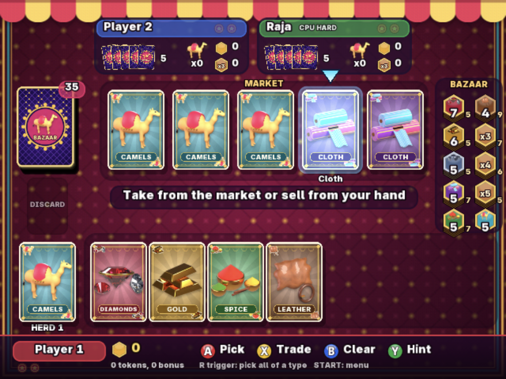

# Totally Bazaar

<p align="center">
  
</p>

Totally Bazaar is a traditional market trading card game for Sega Dreamcast,
for 2 to 4 players on one screen. Trade in the market, herd camels, sell goods
for rupee tokens and earn two Seals of Excellence to become the Maharaja's
merchant. Any seat can be a human or a CPU merchant (Easy or Hard), so it
also plays solo. Hands flip face down between human turns and a pass screen
recaps the last moves before the next player picks up the pad.

## Download

Download the latest **[self-booting CDI](https://github.com/richstokes/dreamcast-homebrew/releases/latest/download/totally-bazaar.cdi)**
for Flycast or GDEMU. A direct-load [ELF](https://github.com/richstokes/dreamcast-homebrew/releases/latest/download/totally-bazaar.elf) is also available.
If you are burning a physical CD-R, you may want to try the padded
[CD-R image](https://github.com/richstokes/dreamcast-homebrew/releases/latest/download/totally-bazaar-cdr.zip) instead (unzip before burning).

## Controls

| Dreamcast controller | Flycast keyboard default | Action |
| --- | --- | --- |
| D-pad or analog stick | Arrow keys | Move the cursor between market and hand |
| A | X | Pick or unpick a card; on your herd, add a camel |
| X | S | Make the trade shown in the hint bar |
| B or L trigger | C or F | Clear your picks |
| Y | D | Hint: the CPU picks a good move for you |
| R trigger | V | Pick every card of the hovered type |
| Start | Return | Pause menu (resume, music on/off, rules, quit) |

Picking a camel in the market picks all of them. The hint bar always says
what X will do ("Sell 3 Leather: 4+3+2 +bonus") or why the picks are not a
legal move. Any connected controller drives the current human merchant.
A+B+X+Y+Start returns to the title screen, and on the title screen exits to the Dreamcast BIOS menu.

## Rules

Each turn you either take or sell:

- Take one goods card from the market; the deck refills its slot
- Take all camels from the market into your herd
- Exchange two or more market goods for the same number of cards from your
  hand and/or herd. You can't take and give back the same goods type
- Sell any number of one goods type for tokens from that stack, highest
  first. Diamonds, gold and silver need at least two. Selling 3, 4 or 5+
  cards also earns a secret bonus token (1-3, 4-6 or 8-10 rupees)

Your hand holds at most 7 goods cards; camels don't count. A round ends at
once when three token stacks are empty or the market can't be refilled. The
largest herd earns the 5-rupee camel token (no award on a tie). The richest
merchant earns a Seal, with ties broken by bonus tokens, then goods tokens;
a tie that survives both gives each tied leader a Seal. The lowest scorer
starts the next round. A player who alone holds two or more Seals wins.
With 3 or 4 players every rule and component is unchanged: five cards each,
turns pass clockwise.

## Build and run

Needs the toolchain from the [root README setup](../../../README.md#one-time-setup).

```sh
source "$HOME/.local/share/dreamcast/kos/environ.sh"
make              # totally-bazaar.elf
./run-flycast.sh  # builds first unless given --skip-build
```

Generated texture, sound and music data in `assets/generated/` is checked
in, so a normal build needs no host tools. Each build first checks out the
pinned [SH4ZAM](https://sh4zam.com/) commit in the ignored
`third_party/sh4zam` (`tools/update-sh4zam.sh`).

The launcher gives each connected macOS gamepad (up to four) its own
Dreamcast port; with none, the keyboard drives port A for pass-and-play.
Force a mode with `--input keyboard` or `--input gamepad`. Settings go in as
transient `-config` flags, so saved Flycast mappings are untouched. The game
uses neither the network nor VMU saves.

### Real Dreamcast

Through `tools/dc-hw.sh` at the repository root: dcload-ip upload, console
log, and power control if it has a Shelly plug (see
[Real hardware](../../../README.md#real-hardware)).

```sh
make hw        # play the release build on the console
make hwbench   # 150 s, four CPU merchants, 10 s performance heartbeat
make hwsoak    # 30 min, two CPU merchants; fails on any stall report
```

`HW_LOG=` (default `hw-console.log`), `HW_SECONDS=` and `SOAK_SECONDS=`
adjust the runs. `hwbench` and `hwsoak` switch the console off when they
finish; after `make hw`, run `../../../tools/dc-hw.sh power off`.

## Regenerate assets

```sh
make art      # Blender renders of the goods and logo, then texture packing
make textures # texture packing only (Pillow, via uv)
make audio    # sound effects and the music loop (numpy/scipy, via uv)
```

`make art` needs `blender` on PATH (5.2 tested); `make audio` needs KOS
`wav2adpcm`. Texture previews land in `assets/generated/previews/`.

## Checks

All run inside Flycast and stop it automatically.

| Target | Verifies |
| --- | --- |
| `make selftest` | Every rule, plus simulated 2-4 player games with card and token conservation checked after each move; Hard CPU beats random play and Easy |
| `make uitest` | Two hot-seat games driven through the real controls: picks, hints, pause menu, pass screens, round results, 3- and 4-player games |
| `make autoplay` | Four CPU merchants play two full games with logging (soak test) |

## Performance

Real console, `make hwbench`, October 2026 build:

| Measure | Value |
| --- | --- |
| Frame rate | 60 fps |
| PowerVR render, busy frame | ~12-14 ms |
| SH-4 time per frame | ~1.5 ms |

## Gotchas

- Under dcload-ip every `printf` is a network round trip made with
  interrupts off, and a lost packet freezes the console. Builds for the
  console never log per move (`src/main.c`, `Makefile`)
- A full-screen translucent layer over the table costs the PowerVR its
  60 Hz budget. Overlays tint the opaque background instead (`src/main.c`)
- Cards are punch-through polygons, so overlapping cards cost about one
  layer, and the static HUD panels are baked into the table texture
  (`src/gfx.c`, `tools/build_textures.py`)
- The music loop is encoded three times over and the middle copy kept, so
  the ADPCM predictor is continuous across the seam (`tools/build_audio.py`)

## Credits

Built on [KallistiOS](https://kos-docs.dreamcast.wiki/), distributed under
its BSD-like KOS license, which requires attribution. Fast trig and `exp`
come from [SH4ZAM](https://sh4zam.com/) by Falco Girgis and contributors
(MIT License). The bitmap fonts are rendered from
Inter as shipped with Blender (SIL Open Font License); goods art and the
logo are Blender renders from `tools/render_art_blender.py`.
